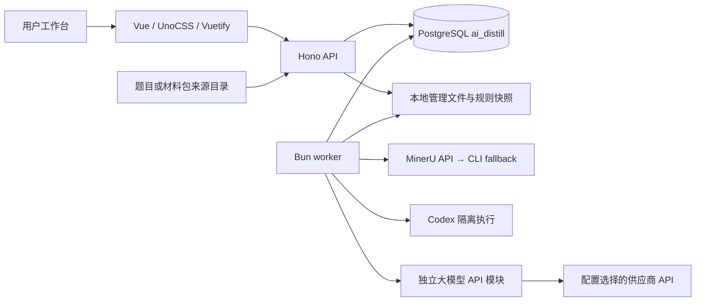

<!-- 文件职责：记录当前实现的系统模块、数据流、稳定契约与运行边界。 -->
# ai-distill 系统结构与架构设计

本文描述 2026-10-13 核对的当前源码结构及维护边界，不代表当前数据库、在线进程或真实业务已验收。历史运行证据见 [文档导航](README.md)，工程规则见 [AGENTS.md](../AGENTS.md)。

## 目标与架构选择

Work 项目规则兼容改造正在实施：新增共享 `workflow-config.ts` 声明阶段扩展配置；作者校验／渲染支持显式 `model_report_v1` Rubric，评分模块新增只收集模型结果的解析入口。旧配置及旧任务默认路径保持不变。出题队列已从评分配置单一来源冻结规则，评分上下文和 Codex/API 调用使用同版规则及可选 calibration 标答，始终排除思路。新评分队列保存模型原始分、0—100 报告指标与独立否决；达标只比较该指标，不从原始分重算。Excel 已支持保留完整规则和这些独立结果，默认旧契约路径不变。页面和可执行钩子代码已完成；033新表与032可空出题方向字段已精确迁移，新API已加载，旧项目与Work各一道独立验收题已完成真实模型、恢复、归档及导出验收；Work已启用新契约且保持空钩子。Work 另有项目专用 `batch-package.ts`，可把已完成的 Harbor 单题目录结构校验后组为批次目录与 ZIP；它不生成题目内容，不代表 Oracle／judge／模型或项目方验收。此结论限定本地文字评测及文件组包能力。进度及验收边界见 [Work 改造计划](../projects/Work法律全场景/系统兼容改造计划.md)。

系统以“主项目 × 期次 × 材料包 × 题目”为组织方式。新建项目统一采用 `material_packages`：每个来源子目录登记为材料包工作流，完成入库和脱敏后，从某次成功脱敏尝试建立多道题目工作流。每题拥有私有的整包材料、脱敏正文及索引快照，并记录材料包 ID、来源尝试 ID 与正文哈希。材料包仅执行 1／2／9，派生题目从 4 继续，步骤 ordinal 保持不变。项目保存本期可选的出题标签，题目和出题任务分别冻结所选标签；旧 `target_level` 保留供历史任务读取，不给其他项目预置 L2–L5。补充材料或重新脱敏只提供新的可选版本，旧题快照不变。历史 `question_folders` 项目仍按原关系读取以保留已有数据；工作台不再提供新项目模式选择或自动转换历史题目的入口。项目页分别平铺材料包和全部题目，题目归档后仍留在全部题目表；材料包详情按页显示关联题目状态，题目详情显示来源包和冻结附件。当前状态来自 `steps`，排队与运行结合活动 `step_attempts`，完整尝试元信息由只读分页接口提供。工作流保存来源、当前附件、每次执行与产物，使用户能逐步骤派发、查看各题状态、核查结果及导出。未达标题目由用户按普通步骤重新派发；新工作流不创建返修链。数据库负责运行状态、附件文本和任务绑定；本地文件保存主项目共享规则资料与 skill、各期原件副本、隔离执行目录和成果文件。

项目列表分别显示未删除材料包与题目数量；API 继续返回工作流总数供旧调用方使用。

当前 `projects` 每行仍表示一个独立期次工作流容器；`parent_name` 和 `phase_name` 显式记录主项目及期数，多个期次的 `local_skill_path` 可以指向同一主项目目录。迁移对已知旧项目“豆包高经济价值 - 第五期”（含无空格别名）显式填写主项目“豆包高经济价值”和期数“第五期”，并把仓库内旧 skill 路径重定向到 `projects/豆包高经济价值/skill`；其他旧行仍按原名作为独立主项目、期数留空，不从未知名称猜期数。第五期的 `materials/`、`skill/` 位于主项目根目录，题目、更新报告、快照与成果位于 `projects/豆包高经济价值/第五期/`。迁移 `031_project_period_root.sql` 只重写第五期 `material_root` 与来源清单中的绝对题目路径，不改变来源哈希和工作流步骤状态。新记录按 `<主项目>/<期数>/questions/` 推导期次题目目录，并共享主项目 `materials/` 与 `skill/`。这保留原有按项目行隔离的模型设置和工作流数据，同时使规则资料与 skill 都可跨期共享。

普通出题的 Codex 能力以桌面端手动出题为对齐目标：每次新会话在项目工作目录加载正常配置、规则和工具，保留完整文件／网络权限；程序主动提供本次数据库脱敏附件、指定 skill 与步骤指令。题包格式和被测模型的作答能力字段不得限制作者使用文件、shell／计算、检索或 MCP。配置加载与工具实际启动是两个验证层次，尚不能宣称桌面专有能力全部等价；具体改进与验收见[能力对齐清单](plans/2026-10-11-codex-manual-capability-alignment.md)。独立评分的匿名输入仍按其评分契约处理。

普通出题按冻结附件 ID 从数据库取得脱敏正文，执行期间将其写为本次任务可分段阅读的文件，并在提示词中给出逐份绝对路径；作者执行结束后清理这份临时正文。数据库产物及其摘要承担后续版本校验，私有任务索引和执行事件保留；清理不改变 Codex 的完整文件／网络权限，也不能据此宣称其他历史目录物理不可访问。

Codex 模型与推理强度以数据库的系统默认、项目默认和步骤覆盖为依据；保存和任务派发只作字段结构校验。本机缓存仅为界面提供建议，不作为执行白名单，也不替换数据库原值。模型实际可用性由 Codex CLI 在调用时报告；评分的输入与权限隔离不变。

当前采用单仓库、模块化后端和独立 worker。HTTP 接收、任务执行与浏览器分别运行；耗时模型请求通过持久化队列消费，客户端等待不决定任务生命周期。保持现有边界即可满足当前本地工作台，不需要为模块说明新增微服务或通用流程引擎。

远程材料与作答沿用同一 API、数据库与持久化队列：本机 CLI 经 SSH 隧道及固定令牌提交单题 `intake`／`redact`／`intake-redact` 操作，或用工作流 ID 与请求标识提交作答；材料操作进度记录在 `remote_material_operations`，作答请求标识绑定在服务器归属的作答 attempt。`WORKER_MODE=server` 且 `MATERIAL_EXECUTION_TARGET=server` 时仅领取服务器入库、PDF/DOCX 提取、API 脱敏和无步骤钩子的作答，不领取 Agent 或评分队列。普通本机 attempt 默认归属 `local`，既有本地流程保持不变。服务器按数据库绝对项目路径只读挂载已同步来源；题面、脱敏正文和答案通过共享数据库进入工作流，本机 CLI 可查询远程作答状态，既有结果接口提供答案正文。`034_remote_material_operations.sql` 是远程归属能力的启用前提；文件存在不代表运行数据库已迁移。

## 模块划分与入口

| 模块 | 职责与关键入口 | 主要关联 |
| --- | --- | --- |
| [web](../web/README.md) | 项目、任务监控、成果库、系统设置及项目／单题详情路由 | `/api`、共享类型、Row／Column、主题 |
| [cli](../cli/README.md) | Codex可调用的本地项目CRUD、项目配置和工作流命令 | 与Web共用Hono API；不直连数据库、不加载凭证 |
| [server](../server/README.md) | `index.ts` 本地监听，`app.ts` 路由装配、校验及同步操作 | 各业务模块、pg、管理文件 |
| 工作流执行 HTTP | `workflow-execution-routes.ts` 注册单步、批量和 attempt 等待；`step-dispatch.ts` 统一 ordinal 到既有队列函数的映射 | `app.ts` 装配、`project-folders.ts` 就绪状态、业务队列 |
| 普通外部调用 | `external-call.ts` 生成调用 ID、关联日志上下文并记录外部调用结果，不访问数据库 | 出题、作答、评分、提取、脱敏 |
| 接收与目录 | `project-folders.ts` 扫描／汇总、统一步骤就绪判断和批次分块；`intake.ts` 附件接收；`intake-jobs.ts` 入库队列 | 来源清单、当前材料、内部 PDF/DOCX 提取 |
| [materials](../server/materials/README.md) | PDF provider、本地解析、缓存、文本落库、独立脱敏及按需原件归档／DOCX 导出 | config、文件、Codex、附件绑定、数据库脱敏文本、`assets/out/附件库/` |
| [agent](../server/agent/README.md) | 独立任务契约、固定指令、任务执行入口、全局／项目／步骤模型设置接口 | 出题、质检、评分、skill、脱敏、设置页面 |
| `concurrency.ts` | Agent／API 全局并发读取与验证、SQLite 本机设置持久化、Agent 跨进程槽位协调 | 系统设置 API、worker 启动参数、Agent 连接测试 |
| [codex](../server/codex/README.md) | 本机 Codex CLI 适配、套餐登录、模型目录、低层设置持久化 | agent 适配器与兼容设置接口 |
| 项目资料 | `rules.ts`、`rule-files.ts` 管理当前目录、引用与任务文件指纹；旧 `rule-loading.ts` 已停用 | 项目资料、本地 skill、每次任务的文件清单 |
| [skill-generation](../server/skill-generation/README.md) | 生成候选、检查、采用为当前项目 skill | Codex、完整模板、当前项目资料 |
| [authoring](../server/authoring/README.md) | 独立出题与审查队列、私有草稿、题面与 rubric 版本 | 步骤提示词、项目本地资料、数据库脱敏附件 |
| [llm-api](../server/llm-api/README.md) | 独立 API 消息/JSON 调用、供应商配置、凭证、完整响应与用量 | 作答、API 脱敏；与 Agent 并列 |
| [answer-models](../server/answer-models/README.md) | 系统模型目录、项目集合、冻结配置、逐模型作答与汇总 | provider 客户端、题目／附件绑定 |
| [scoring](../server/scoring/README.md) | 匿名独立评分、逐答案任务、评分结构与绑定校验 | 步骤提示词、题面、rubric、匿名答案与数据库脱敏附件 |
| [decisions](../server/decisions/README.md) | 评分后的达标判断 | 作答／评分快照 |
| [publishing](../server/publishing/README.md) | 当前合格成果的版本复核、文件指纹校验、主项目交付脚本与去重归档 | 达标结果、当前产物、项目 `delivery.ts` |
| [reporting](../server/reporting/README.md) | 达标题目数据查询与按需 XLSX 导出 | 题目包、达标状态、附件地址、导出记录 |
| [monitoring](../server/monitoring/README.md) | worker 心跳、队列／运行数、本机内存采样、派发控制及 API／Agent 运行步骤明细 | 本地快照、活动工作流尝试、worker dispatch |
| [shared](../shared/README.md) | API 类型、步骤注册表和作答／评分／达标摘要契约 | 前后端共同契约；结果读取守卫不改变历史存储格式 |
| [migrations](../migrations/README.md)、[config](../config/README.md)、[scripts](../scripts/README.md) | 数据结构演进、提取默认配置、人工运行工具 | 各自有操作影响，不能自动运行 |

## 可见步骤与内部身份

当前依据是 `shared/step-registry.ts`。`ordinal` 是持久化身份，`position` 仅表示可见顺序；历史尝试及外键不得随 UI 调整而重编号。

| 显示顺序 | 步骤 | ordinal | 输入与主要结果 |
| --- | --- | --- | --- |
| 1 | 入库（含 PDF/DOCX 文本提取） | 1；内部 2 | 来源附件 → 管理原件、当前材料、私有文本／页索引和 issues |
| 2 | 脱敏与检查 | 9 | 当前已入库文本 → 所选 API 或本地 Agent 脱敏全文与索引 |
| 3 | 出题 | 4 | 步骤提示词＋本题可选出题方向＋项目本地 skill＋数据库脱敏附件 → 私有草稿、题面与 rubric 版本；作者按 skill 自检 |
| 4 | 模型作答 | 5 | 出题成功的当前题面及允许附件＋模型集合快照 → 各模型完整答案及 usage |
| 5 | 独立评分 | 6 | 步骤提示词＋题面／rubric／数据库脱敏附件＋匿名答案 → 逐项报告与程序校验 |
| 6 | 达标判断 | 7 | 当前模型集合、有效分数和阈值 → 达标、未达标、等待或隔离 |
| 7 | 归档达标题目 | 8 | 复核当前达标版本，执行主项目交付脚本或内置空函数，再在数据库写归档标记；项目 Excel 导出另行触发 |

Work 的 Harbor 批次组包由 `projects/Work法律全场景/batch-package.ts` 独立执行，不是 ordinal 8 的副作用。它只接受已完成的单题 Harbor 目录，执行结构／原件校验、批次目录组装和 ZIP；不读取数据库、不创作题包内容，也不等同 Harbor 自测或项目方验收。

ordinal 2 保留提取历史与队列；PDF/DOCX 情况下可见入库状态折叠内部提取状态。ordinal 3 仅为旧规则绑定历史，隐藏且不再派发；ordinal 10 独立审查仅保留历史身份，不出现在新工作流且不作为任何后续步骤门槛。新任务直接读取当前项目 skill，不需要先绑定规则版本。skill 生成是项目级能力，不是一道题的独立可见步骤。

普通工作流由用户单步或批量派发，不等待其他题目全部完成；本轮所有评分任务终结后，达标判断自动运行并记录逐模型结果。项目批量入口也可对仍待判定或失败且评分前置条件满足的题目重算第七步；该操作只运行程序分数判断，不调用模型。所有项目级步骤共享同一就绪判定和逐题结果契约。未达标题目可在核对结果后按普通步骤重新派发。

## 主数据与版本关系

| 实体 | 负责保存 | 不应混同 |
| --- | --- | --- |
| `projects` | 期次工作流容器、主项目名／期数、项目路径、Codex 默认设置及逻辑删除；同主项目期次可共享 `local_skill_path` | 主项目归组使用显式名称字段；本地 `project.json` 不承担队列状态 |
| `workflows` | 题目来源身份、`source_manifest`、可选 `authoring_direction`；旧规则绑定字段仅用于历史兼容 | 来源目录清单不是当前已入库附件 |
| `materials` | 当前附件及已移除附件记录、原件路径、SHA-256、处理标记 | 原始来源文件不随 UI 操作改写 |
| `steps` | 每道题当前步骤状态、摘要、错误与时间 | 当前状态不替代执行历史 |
| `step_attempts` | 每次尝试的冻结输入／配置、结果、心跳、错误 | 终态 completed 不等于 succeeded |
| `artifacts` | 产物索引、指纹、路径；部分文本 content 存数据库 | 文件存在不等于已通过业务发布校验 |
| `rule_versions` | 旧规则快照索引，保留历史兼容 | 新任务不创建或选择编号规则版本 |
| `project_skill_attempts` | 期次记录中的 skill 生成输入、候选及检查 | 文件型共享 skill 采用后更新稳定目录内容并同步活动期次路径；候选仍保留在 `.storage/` |
| 系统／项目模型表 | 模型配置、项目选用顺序和百分制分数上限；系统级步骤提示词另存于系统配置行，项目创建时复制提示词快照 | 密钥不存前端或业务快照 |
| `project_exports` | 导出状态与来源版本 | API 价格统计已移除；Codex 套餐不按 API token 价格计费 |

删除项目时，接口在单个数据库事务中将项目标为隐藏，删除其全部题目工作流、附件记录、步骤、尝试、产物和导出记录；等待／运行中的题目与 skill 任务标记为跳过。项目行、项目级配置、skill 生成历史、规则快照及系统级配置保留。源材料目录、skill、管理副本和导出文件等本地文件不删除。若项目导出正在执行，删除请求返回冲突并要求稍后重试。

附件正文从数据库读取：脱敏读取数据库中的原始提取文本，出题、作答和评分读取数据库中的脱敏文本。系统级维护四类步骤提示词；新建项目时将其复制为项目默认值，后续改系统提示词不回写已有项目，项目内修改也不影响其他项目。出题读取步骤提示词及对应项目本地 skill；普通新出与重出只冻结当前附件、指定 skill 和步骤指令，不读取旧题、答案或评分。作答仅读取题面、允许附件及本次冻结的作答提示词，不读取项目 skill、rubric 或标答。评分只向模型提供同版题面、rubric、数据库脱敏附件、匿名答案和评分步骤提示词；不提供作答思路或标准答案，也不读取项目 skill。作答思路和标准答案仅用于内部校验题目包完整性及版本绑定。每个任务记录附件指纹、项目文件清单和配置，提交前复核绑定；不再维护编号规则版本。ordinal 10 独立审查不参与新工作流，历史记录保留。附件变更使旧附件记录标记移除、活动任务取消、下游当前状态失效，原件与执行历史保留。文件写入和数据库事务并不天然原子；各模块负责预写、校验、提交及失败清理，不概括成跨文件系统事务。

出题和评分的新任务输入显式记录数据库项目名称、题目和步骤；名称参与本次摘要，旧任务未记录名称时保留原摘要兼容。普通出题消息将步骤提示词原文置顶，随后给出身份、skill副本入口、附件路径和交付说明；规范正文不粘贴进消息。附件全文按顺序写入独立文本文件；`input/input.json` 保存身份、提示词、文件索引和指纹。作者逐项读取所需规范章节，案件附件分段完整读取；出题方法仍由 skill 决定。工具说明只描述实际可用能力；CLI网络和文件权限由本次执行选择决定，普通出题为完整访问、评分为受限环境。评分依据由步骤提示词、题面、rubric、数据库脱敏附件和匿名答案提供，不向模型提供作答思路或标准答案，也不读取项目 skill；评分执行器提供文件路径及设置提示词，返回纯文本，项目身份仅保留在队列绑定中。新评分任务原样执行自定义提示词；未设置或精确匹配已知旧内置默认时使用当前默认，不预设分数高低，不追加通用开发者指令。历史冻结任务及评分保留，旧项目文件绑定仅用于历史兼容。私有成稿按项目模板的七章组织，公开题包排除思路、标答与内部附件 ID；模型作答仍只接收题面和允许附件。

附件产物的材料／尝试必须与产物属于同一工作流。当前可见步骤顺序由共享步骤注册表定义，数据库不再维护项目步骤模板表。

达标判定逐模型将原始得分/满分换算为百分制，与0—100的配置上限比较；所有必需模型严格低于上限时题目达标，等于或超过则题目未达标。换算由 `shared/score.ts` 供前后端复用，判定不舍入；缺失满分或分数越界时等待。兼容字段 `minimum_score` / `minimum_score_by_model` 保留名称。判定口径进入来源摘要，旧达标记录发布前需重新判定；历史评分不改写。

## 队列与执行生命周期

阶段钩子通过 `workflow-hooks.ts` 冻结并执行受信任脚本，`workflow-hook-jobs.ts` 将同步前后动作及主操作检查点保存在新 hook_runs 表；不新增或重编号业务 ordinal。三阶段已接入；无动作时直接执行原主操作且不查新表。后置异步记录在主结果成功事务内登记，`workflow-hook-worker.ts` 由 local/all worker 独立领取，API worker 不领取；附加结果不写主步骤。带本地脚本的 API 主任务也由 local/all worker 执行，api worker 的探测、领取和恢复均排除它们。`workflow-hook-routes.ts` 提供结果读取、同尝试检查点续跑和独立异步重试；续跑只接受明确钩子失败标记及有效当前输入，检查点有内容摘要，原失败记录进入 history。模型动作和页面尚未完成，033 迁移未应用，未进行真实队列验收。

典型路径：API 校验前置和附件绑定 → 冻结输入／配置并入队 → worker 事务领取 → 按任务选择项目或受限目录执行／保存心跳 → 检查产物和当前绑定 → 发布结果或保存失败。失联恢复及重复领取保护分别由各队列实现；具体逻辑见模块 `jobs.ts`。

可选附件归档不走常规步骤队列：用户可从题目详情手动请求 DOCX；项目页点击“下载全部达标题目 Excel”时也会逐题触发现有归档接口，先复用有效产物或补齐缺失 DOCX，再生成工作簿。归档 API 锁定工作流，校验当前 ordinal 9 脱敏尝试仍绑定当前附件提取指纹，并逐一校验 `.storage` 原件指纹；新记录的原件副本与 DOCX 写入 `assets/out/附件库/<主项目>/<期数>/<题目>/原件/` 和同目录 `成果/`，其中题目目录取安全化后的题目标题。缺少期数的历史 artifact 继续使用旧 `<项目>/<题目>/` 路径；下载、工作簿和单题重置同时接受旧、新布局。每份原附件对应一份 DOCX，随后新增／更新带 material_id 的 `redacted_docx` artifact；旧合并 artifact 索引被移除。重新导出只在索引更新后清理已知的旧编号目录，不批量搬移或猜测未索引的历史文件。下载时重新验证当前脱敏尝试和 DOCX SHA-256；旧模式题目重置时一并隔离清理该题的外部归档目录；派生题目快照不可重置，可删除后从材料包重建。该能力不新增步骤、任务尝试、worker 调度或工作流状态变化；失败只影响归档文件／索引，不回滚业务流程。

旧模式单题重置要求没有排队或运行中尝试，在事务中删除该题的材料、尝试、产物和步骤结果，并隔离清理其存储管理目录与提取缓存。项目题目目录及 `source_manifest` 保留以便重新入库。只包含该题的导出记录和文件一并删除；包含多题的导出标记为过期，避免重置一题时删除其他题目的发布结果。

`server/worker.ts` 的材料接收／提取并发跟随持久化的 `llmApi` 设置；作答、API 脱敏和 API 评分共享 API worker 通道，实际模型请求还经 `withModelApiSlot` 使用同一设置的全局请求槽位；skill／Codex 脱敏／出题／评分共享 Agent 通道。系统设置可把 Agent 设为 1–4 路、API 设为 1–8 路，配置保存在 `STORAGE_DIR/.concurrency/agent-slots.sqlite3`，API 与 worker 重启后生效；没有保存界面设置时兼容 `AGENT_CONCURRENCY`（默认 2）及 `LLM_API_CONCURRENCY`（默认 8），环境变量支持 1–32 整数。Agent 槽位由 `STORAGE_DIR/.concurrency/agent-slots.sqlite3` 在 worker 与 HTTP 连接测试间共享，进程退出后下一次申请回收失效槽位；模型 API 队列在当前支持的单 worker 内共享总上限。脱敏任务配置中的并发仅控制单任务的请求生产速率，最终仍受全局请求槽位限制。队列空闲时保持约 3 秒发现间隔；Agent 的 skill、Codex 脱敏、出题与评分消费成功后轮转，持续就绪队列不会因固定优先级长期饿死。worker monitor 将数据库任务统计与本机资源采样分开刷新；新任务派发只等待本机内存采样，低内存仍暂停领取，数据库统计失败只把统计状态标记为未知。已有任务与子进程停止行为以取消契约为准，不能把暂停派发理解成强制杀进程。

API 的 `wait_ms` 只控制最多 30 秒的请求等待；模型／工具执行超时独立。客户端断开不取消持久化后台任务。活动任务可监听数据库取消状态；SIGINT／SIGTERM 通过停止信号结束 worker 池并清理资源。

未达标题目按普通步骤重新执行；系统不保存或接续返修链。

## 文本提取与模型输入隔离

- TXT／MD 沿用本地解析；PDF 和 DOCX 通过 MinerU provider 异步结构化提取。DOCX 不依赖 PDF 页码，转换为一个逻辑文本页，忽略图片内容；PDF 的 provider 选择与旧缓存版本保持原样。新任务默认冻结 `mineru-api` 并要求 `MINERU_KEY`；先使用 MinerU v4 直连接口上传和轮询，仅网络、服务端5xx或超时失败时回退一次到 CLI；设置 `PDF_EXTRACTION_PROVIDER=mineru-cli` 可强制 CLI。两种路径都上传 PDF 到 MinerU 云服务，不是本机离线识别。旧 GLM 尝试和页级 vision 调查代码仍保留供历史兼容／排查，不参与当前 PDF 工作流，也不会作为回退路径。
- MinerU API 与 CLI 共用按页结构转换，保留标题、段落、列表、表格、公式、图注、脚注及可识别图片文字；同一结构确定性生成原文投影。未知块、空块、无文字图片和未解析表格保留 issues，提取成功不等于 OCR 完整。结构缓存版本参与复用身份，无结构旧缓存不得用于新结构任务；重新提取入队使该题下游失效。CLI 原始返回和 stderr 存在 `STORAGE_DIR/.mineru-diagnostics/<diagnostic_id>/` 私有目录；API 成功解析后删除临时结果；解析失败保留私有 ZIP 和已读取的原始 JSON，普通日志不包含原文、授权头或签名 URL；产物不进入公开目录。
- `.storage/` 保存受管理原件、任务私有执行目录和大部分工作流产物。原文与脱敏文本保存在数据库产物中；本地项目资料按任务记录清单并校验指纹。来源附件目录只读；用户手动生成归档时，当前原件副本与数据库脱敏文本生成的 DOCX 存入 `assets/out/附件库/`，不作为题目输入或同步来源。
- 题目目录同步遇到超过 200 页或超过单文件限制的 PDF 时，用本机 Poppler 按最多 200 页拆分，以 `.storage/pdf-splits/` 作中转缓存，把分片安装到原 PDF 所在目录；若 200 页分片仍超单文件大小限制则继续细分。全部分片落盘并核对后删除该超限原件。清单登记同目录分片的路径、来源、页码段文件名和指纹。含拆分 PDF 的题目目录总量上限 200 MB，其他目录及手动上传仍为 100 MB；入库重扫同一目录并校验分片指纹。拆分不代表压缩、识别或脱敏。
- Codex 普通出题在冻结的项目 cwd、正常配置与完整权限下执行，产物仍按题目／尝试保存在 `.storage/` 独立私有目录；其他任务保持仓库外受限副本。所有调用新建会话并关闭记忆，普通出题不覆盖宿主开发者指令。
- 作答上下文只取题面和数据库中的允许脱敏附件；评分模型使用步骤评分提示词、题面、rubric、匿名答案和数据库脱敏附件；不接收作答思路、标准答案、目标分数或作答模型身份。出题由单次作者调用按项目 skill 自检修订；历史 ordinal 10 独立审查不再创建、执行或展示。
- 作者完整草稿包含作答思路和标准答案；对外题目包不包含这两项。模型作答输入不得包含标答；作答思路和标答留在系统内部完整题目包中，用于完整性及版本绑定校验，不发送给评分模型；下载暴露范围以路由允许的产物 kind 和对应校验为准。
- 识别 issues、质检失败、无效评分、缺价格／usage 都明确保留。处理成功只证明执行与结构检查结果，不证明全文正确、法律任务有效或外部正式资格。

## 独立大模型 API 与 Agent

`server/llm-api/` 和 `server/agent/` 并列。API 模块接收显式消息与供应商配置，返回文字或经调用方验证的 JSON；Agent 提供本地 Codex 的文件/工具/隔离执行，不接入 API 后端。作答的供应商 HTTP 实现统一下沉到 API 模块，作答模块只管理题面/允许附件与业务队列。脱敏业务按冻结配置选择 API 或 Agent；API 不读取本地目录，业务将数据库提取文本直接作为消息输入。

未设置脱敏执行方式时默认 API；统一 API 默认采用 OpenRouter DeepSeek V4.1 Flash（关闭思考），复用已有服务端密钥和标准端点，可用 `LLM_API_*` 覆盖。步骤复用 `/api/answer-models` 选择现有系统目录的模型，不重复填写供应商或 URL；具体连接参数在入队时冻结。已显式保存的 Codex 配置继续有效。脱敏设置保存/恢复默认在工作流锁内取消旧任务、重置脱敏及其下游状态并使导出失效。新配置在入队时冻结，正在执行的请求不动态切换供应商。API 脱敏按附件／页切分批次后按附件合并；结构校验失败只重试对应批次一次，供应商、额度、网络和超时错误不自动重试，所有调用的可用 usage 与 call_id 均保留。所有页校验通过后才发布脱敏产物，不增加数据库迁移。

## 前端交互与状态含义

项目详情显示七步汇总、当前达标题目表及全部题目记录。达标表按当前成功的 ordinal 7 判定筛选，紧凑显示逐模型得分、百分制、门槛、版本和发布／导出状态，支持异常筛选、搜索与分页；查看内容按需读取单题详情，以宽屏标签弹窗展示脱敏附件全文、完整题目包、模型作答和评分原文。点击步骤名称或“查看题目”仍打开统一步骤表格，展示未进入、就绪、排队、处理中、完成、失败及原因。项目汇总、逐题表格和批量入口使用 `project-folders.ts` 中的同一就绪判断；单题详情 API 返回 `ready` 与 `ready_reason`，前端不复制前置条件。模型作答接受当前出题成功且题目、附件绑定有效的结果。ordinal 10 历史审查记录不显示，也不影响任何当前步骤。

`waiting` 结合当前步骤的活动尝试才能判为排队；当前步骤待执行或失败、没有活动尝试、步骤已启用，且最近一个启用的可见前置步骤成功时才是就绪。归档步骤另要求达标步骤成功且 `decision=accepted`；未达标结果不能归档。归档成功后题目从项目“题目记录”隐藏，并继续显示在“达标题目”中。评分允许所有作答模型均终结且至少一个成功的部分结果进入评分。入库步骤将 PDF/DOCX 提取状态一并判断。历史 ordinal 2、3、10 均不参与可见顺序与门槛。项目汇总、单题记录及批量派发共用同一判断；批量 API 对项目内所有题目按 `BATCH_DISPATCH_CHUNK_SIZE` 分块处理并逐题返回排队、完成、未就绪或派发失败，默认 100、可配置范围 1–1000。第七步达标判断在评分完成后自动触发，也可由批量入口对当前就绪题目重算；该判断仅读取评分结果，不调用模型。版本撤除迁移 `027_remove_material_versions.sql` 保留原件和执行历史，标记历史附件移除，取消活动任务，保留已完成入库／提取并清空后续当前步骤状态；旧快照摘要不用于新任务复用。部署须停止旧 API／worker 后应用迁移并切换代码。

归档和项目 Excel 导出使用题目 attempt 内冻结的项目 skill 路径、文件清单与内容指纹，并校验该快照自身一致；项目 skill 后续变更不改写已经完成题目的出题依据。归档仍在事务内复核当前题目、答案、评分、达标来源与产物指纹；导出和下载仍校验当前题目、达标依据及 DOCX 文件指纹。缺少历史冻结依据或快照内部不一致时阻止归档／导出，不用当前 skill 回填历史。通过 API 更换 skill 绑定时，已完成归档和 attempts 保留，项目 Excel 标为过期以便按当前项目元数据重新生成。项目规则文件编辑 API 只修改 `materials/`，不提供 skill 文件编辑入口。

材料处理状态和题目步骤状态是不同粒度：附件脱敏完成数来自材料标记，处理中／失败等部分显示由题目步骤推导，不是独立附件任务队列监控。

普通附件全文弹窗可读取提取／脱敏文本；PDF 原件可在单独标签中预览。达标题目弹窗单独请求 `redacted_only=true`，只返回脱敏附件正文，不返回原始提取页；题目包、作答和评分从单题当前步骤／尝试响应按需读取。Excel 为每个当前达标题目导出一行任务数据，包含题目名称、任务名称、prompt、逐模型评分（模型名、得分／满分及百分比）、可读考点、作答思路及标准答案；不导出内部任务类型，也不把 rubric 数组序列化为 JSON。输入附件列仅在同一单元格换行显示该题的脱敏 DOCX 文件名；另设“附件清单”页签，一文件一行保存题目、工作流 ID、附件序号、文件名、本机完整路径和可点击 `file://` 链接，供本机上传时定位；标准答案附件列因当前数据契约没有该字段而留空。工作簿包含题目数据和附件清单页签，暂存于系统管理的存储目录并通过导出记录交给浏览器下载；归档状态不影响题目进入该工作簿，但附件引用要求已有覆盖全部当前附件的同次脱敏 DOCX，不接受旧合并文件；缺失时阻止导出，不回退未脱敏原件。

前端 route 页装配功能组件；类型由 shared 转出，API client 统一解析错误，`useResource` 管理读取与卸载取消。主导航提供出题项目、任务监控、跨项目成果库和系统设置；项目／题目详情路由仍属于出题项目入口。模型评测和达标判断保留在单题详情中；返修记录和操作入口已移除。`GET /api/results` 只返回当前有效达标题目的摘要及来源材料包 ID、名称，不返回材料全文；旧目录题目的来源包字段为空。

## 全系统后端日志

整个后端的 API、数据库访问、worker、业务步骤、外部调用和文件边界共用 `server/logging.ts` 的安全结构化 JSONL 约定；它是跨模块基础能力，不归属某个业务服务。普通 JSONL 仅持久化 `error` 级失败；成功、进度、性能告警和正常业务状态不写入磁盘。出题、评分、skill 生成及 Codex 脱敏的失败事件带 `failure_phase`，用于区分输入校验、Agent 执行、结果校验和结果保存。记录落在 `<STORAGE_DIR>/logs/`，按日期和进程 instance_id 分段并带 build_id（`APP_BUILD_ID`，本机默认 `local`）。API 生成 request_id 并通过响应头返回，按路由关联 operation、project_id 或 workflow_id；worker 和业务操作补充 attempt_id、skill_attempt_id 或 call_id。数据库日志仅保留连接、查询或事务的真实失败及安全错误码，不记录 SQL 参数；提交或回滚请求自身失败时明确标记结果未知。连续相同的 worker 派发错误在恢复或错误类型变化前只写一次，避免退避轮询重复刷盘。服务入口同步记录未捕获异常，未处理 Promise 拒绝在同步记录后仍以非零码退出。Codex 私有事件和业务材料仍在各自受限存储，不复制进普通日志；脱敏失败结果只保存安全错误摘要。

当前已接 API/worker、数据库、项目文件与步骤设置、Codex/脱敏执行链及主要业务和文件边界；旧规则绑定入口已停用。并验证两个服务进程同时写同一日志根目录时各自保留完整 JSONL 段。逐入口全系统验收仍在进行，真实数据库和本机服务运行态尚未验证。OCR 专项按用户要求跳过。日志设计、验证结果和缺口见[后端日志计划](plans/2026-10-09-backend-logging-design.md)。

## 运行、维护与验收边界

### 本机 API、可选 CLI 与流程 Skill

Codex → `skill/SKILL.md` → 现有本机 Hono API → 持久化队列与 worker。工作流 Skill 默认直接调用本机 API；`.agents/skills/ai-distill-workflow` 通过符号链接指向根目录 `skill/`，仅用于自动发现。CLI 是可选的并列 API 客户端，只有用户明确要求命令行时才使用；它没有数据库连接、新队列或模型执行器。命令、HTTP解析与等待分别位于`cli/commands.ts`、`cli/client.ts`，使用说明见 [CLI](../cli/README.md)。

明确要求导出未达标题目时，CLI 的 `export failed` 只读当前工作流、第七步判定、精确出题／作答／评分尝试及对应产物，经绑定和哈希核对后写入 `assets/未达标题目/<项目UUID>/<题目>-<工作流UUID>/<判定尝试UUID>/`。每题包含出题文本、逐模型作答和评分文本／JSON及清单；同一判定不覆盖，执行失败缺项只报告。该人工复核导出不进入题目来源、数据库、步骤队列或 `assets/out/` 归档流程。

指定已评分题目即使系统达标，也可用 CLI `export review --ids` 导出到同一复核目录；清单保留真实判定及导出用途，不改动系统状态或将作答低分记为 API 失败。

Codex可在本地运行记录中维护本轮固定题目范围、分组、终点和跳过原因；运行记录不派发任务、不取消任务、不保存分数。步骤状态、attempt历史、分数和当前绑定由 API 从数据库读取。恢复时重新查 API，不新增调度器或数据库表。

同组内由操作 skill 指导 Codex 逐题推进：短等待后批量刷新本组全部状态，按各题下一授权且服务端就绪步骤分组派发，避免整批按阶段等待；用户明确要求整批等待时遵从用户要求。本组全部到终点或记录跳过后才进入下一组。未知写结果先核实，活动尝试不重派，失败不自动重试；模型、工具、权限、输入边界及 worker 并发保持原契约。

Codex等待任务时直接调用`GET /api/attempts/:id?view=status&wait_ms=...`，避免读取结果正文。需要检查正文时再读取完整attempt。服务端长轮询每秒查询一次，睡眠不超过剩余请求预算，取消及时唤醒。正文按需读取；短等待只观察有限任务，流程推进仍使用整组批量状态及就绪条件，不用等待快照推断未观察任务已结束。

流程规则由操作 Skill 根据用户本次范围和终点执行；步骤派发API一次处理一个指定步骤，不恢复后台自动推进。项目自身 `skill/` 仍是出题内容规范。批量范围先固定 ID，单次请求不超过服务端上限；返回逐题派发结果和全部模型任务 ID。派发接受、attempt终态、评分有效与业务达标分别保留，判定继续以服务端当前绑定和逐模型结果为准。

API 默认 `127.0.0.1:3700`。任务等待由不超过30秒的单次API长轮询组成，等待截止或中断不会取消后台任务；POST不自动重试。创建项目、同步来源、归档和Excel导出都需显式调用。CLI与模拟HTTP单测不等于真实模型全流程验收。

API 默认 `127.0.0.1:3700`，Vite 本地开发端口 `3800` 并代理 `/api`；worker 与 API 必须使用同一管理存储路径。`.env.example` 将 worker 默认设为 `local`，本地仅消费材料及 Agent/Codex 队列；云端 worker 设为 `api`，仅消费 API 队列，`all` 保留单机兼容模式。单机部署固定一个 API 和一个 API worker 服务，使用同一数据库与存储，并通过 SSH 隧道访问；配置见 `docker-stack.yml`，入口见 `scripts/deploy.sh`。发布仅接受与 GitHub `main` 一致的干净提交，不推送代码；每次通过 SSH 加密传输本机 `.env` 并覆盖服务器版本，镜像构建排除 `.env`，API 健康检查核对必需迁移均已登记，可选的 033 钩子迁移不阻挡旧文字链路就绪；worker 健康检查核对共享存储中的新鲜心跳。容器以非 root UID 运行，交付脚本只随镜像发布，交付产物写入持久 `STORAGE_DIR/deliveries/`。当前没有完整用户登录或多租户授权，云端入口不应公开到互联网。

数据库备份不能代替本地原件、规则快照与产物备份。模型密钥留在服务端环境；Codex 凭证目录由本地受保护配置读取，不把凭证正文放入业务输入。数据库 TLS 校验及 channel binding 由 `db.ts` 解析配置。

迁移使用完整文件名记录，顺序应用未登记 SQL。024 会撤除历史自动控制数据；不要为修复设置盲跑全部迁移。脚本可能创建／删除临时 schema、写真实项目状态、上传卷宗或调用收费模型，执行前检查脚本说明及授权。

本次文档与注释核对没有启动服务、访问远程数据库、执行测试／lint 或模型调用。当前真实服务、已应用迁移、整份材料准确性、多模型真实题目闭环、正式交付与浏览器完整验收须分别取得证据；不得从源码入口存在推断它们通过。

### 本次规范输入与附件边界调整

出题使用 scanProjectPrompt 的 skill 专用扫描，只读取 skill/ 及其内部引用；不扫描项目 materials/ 或 project.json。新评分任务不扫描项目文件，旧任务仅在绑定复核时兼容其原文件清单。资料管理和 skill 候选生成读取主项目共享 `materials/`、当前 skill 及期次 `project.json`。原任务清单含其他项目资料时须重新派发，旧编号快照包含非 skill 文件时停止执行并要求重新出题。普通新出／重出不查询或注入任何旧题、答案与评分，只使用当前附件、指定 skill 和步骤指令。新普通任务冻结 `fresh-desktop-v1`，旧不兼容活动输入在模型调用前失败，完成历史保持可读。

新的脱敏合并正文由程序保留附件序号、起止边界和原附件页序，后续出题、作答及评分读取相同正文。结构化脱敏把每个文字字段及本批唯一编号提交给模型；模型只返回扁平字段编号和敏感值，类别及遮盖子串可选，不复述整字段、不返回附件 ID、页码、页数或结构，也不生成替换文本。程序只检查 JSON 可解析、本批请求字段全部有回应；无关或无法对应的额外返回项忽略、敏感值能在对应原字段定位；附件归属、页序和结构由输入恢复。敏感值定位先精确匹配，随后仅容忍空白、Unicode 兼容形式及中文值的逗号／顿号差异，数字横线和小数点不得被抹除；类别和遮盖子串缺失时按整值脱敏。重复字段映射合并，重复或重叠遮盖范围由程序合并，不因返回顺序、代码围栏、重复内容或可选字段缺失而失败；真实敏感值无法定位时仍拒绝，避免漏脱敏。非敏感文字由原文保留，不经模型重写。姓名由程序保留姓氏（含识别出的复姓）并遮盖姓名部分，秘密值整体替换为 `**`，电话由程序保留前三位和末两位，其他类别按模型标记的遮盖范围生成 `*`，未给出或无法定位范围时遮盖整个敏感值。API 模式按附件原页序，以字段数、字符数和保守输入／输出 token 估算共同打包；初始默认上限为每批 256 字段、10,000 字符、12,000 估算输入 token 和 16,384 输出 token。估算不是精确 tokenizer 计数，预计单字段超出预算时失败且不截断。每题默认并发 8 批，worker 的 API 脱敏队列一次只运行一个题目，避免多题批量时叠加并发；完成一批后立即补下一批，仍受统一 API worker 的本机并发上限约束。队列等待、单次请求、无进度停滞、整题执行均有时限，初始默认分别为 45 秒、180 秒、6 分钟和 20 分钟；这些边界尚未用真实供应商运行校准。字段结果校验通过后单独提交，只补做失败字段；无法解析的返回才对批次拆分。所有拆分和补做共享每个批次及整题请求预算，不自动无限重试。通过校验的字段映射经单一写入链保存到本地权限受限断点；并发写入先原子保存、再推进完成计数，同一断点只有一个执行者可写。断点绑定材料、提示词、模型配置和协议，不绑定调度预算；同输入重派仅提交未完成字段。图像路径、图片占位符、坐标和 MinerU 原始 JSON 不进入脱敏结构和模型输入。文本投影由脱敏结构确定性生成，并保留现有下游正文契约。脱敏任务标识为 `attachment-field-redaction-v18`；无结构输入也转换为段落字段；历史产物不自动重写。DOCX 从同次脱敏结构生成，复用同时校验脱敏尝试、结构摘要、渲染器版本及文件摘要。结构检查不证明 OCR 无漏字或模型没有漏掉敏感内容。

出题完整结构化题目包（含 rubric、作答思路、标准答案）保存至 steps.result 与 step_attempts.result 的 JSONB；模型作答仍通过输入契约仅选择题面及允许的脱敏附件。

出题输出 Schema 将 `attachment_ids` 限定为本次脱敏材料 ID；`answer_requirements=text/text/tools=[]` 描述当前候选作答 API 的能力，不限制作者 Codex。全新出题作者使用用户配置、项目规则及已配置文件、shell/计算、网页搜索和 MCP 能力；作者调用工具不能写入候选模型能力或改变题目难度。候选作答执行器当前只向模型发送文字并接收文字，没有工具调用循环，因此题目仍须基于给定附件和题面作答。业务校验拒绝与候选作答器不兼容的要求及缺失、重复或越界附件引用。已知结构错误以安全错误码和具体提示保存到失败尝试，未知错误保持通用信息。

评分上下文隔离显式禁用 Codex 记忆、宿主资料发现和外部上下文入口，仍以新临时工作区、忽略个人配置和受限目录执行。固定应用指令与隔离参数进入新评分任务的冻结/去重依据；执行时 CLI 将实际参数、stdin、开发者指令和 schema 保存到模型不可读的私有 `request.json`，评分结果保存 `execution_request` 用于受限诊断。步骤设置经只读 `/api/agent/scoring-instructions` 展示当前服务指令；历史无快照时明确缺失，不回填当前源码。该快照不包含凭证、环境变量或 Codex 未返回的内置系统指令。

### 旧版独立评分直接文本调用（历史格式）

独立评分在新隔离会话中发送题面、rubric、脱敏附件、匿名完整答案和原样评分提示词；作答思路及标准答案仅保留在内部同版题目包校验上下文，不发送给评分模型，不写入供模型读取的 input.json，不追加评分开发者指令，不要求 JSON 输出。Codex 文本模式省略输出 schema，保存 result.txt；其他结构化任务保持原协议。禁用记忆、项目规则及外部工具读取。

评分原文与实际发送正文保存在执行记录中，界面可查看。默认评分提示词要求每项说明分数、理由和逐字答案证据；程序不解析或改写逐项理由。纯文本评分要求按实际 rubric ID 逐项列示，程序校验所有 ID 覆盖唯一、无外来 ID、逐项分值和满分符合 rubric、分项合计等于最终总分；满分为1分的条目只接受0或1。校验无效的评分不参与达标判断，具体问题随评分详情展示。旧内置默认正文精确映射到新版默认，自定义提示词原样保留；旧结构化报告继续按旧协议读取，旧记录不会用当前指令补造快照。

达标结果为每个作答模型保存其答案尝试 ID、评分尝试 ID 和题目／rubric 版本引用，作为判定证据，不参与分数计算。

旧独立评分正文按固定顺序分区：评分提示词 → 完整题目包（题面、rubric、作答思路、标准答案）→ 题目附件 → 待评分答案。该旧格式不代表当前模型输入。当前独立评分分文件提供评分提示词、题面与 rubric、题目附件、待评答案；不提供作答思路或标准答案。输入格式标识参与执行指令绑定，避免复用旧格式评分。

### 当前独立评分：分文件阅读（替代直接正文模式）

评分消息仅列出文件用途、完整阅读要求和用户原样提示词。题面与 rubric、各份附件、待评答案分别通过 `input_files` 传入 Codex 客户端；作答思路与标准答案仅留在内部版本绑定上下文，不写入评分文件；客户端仅在系统临时目录 `ai-distill-codex-*/workspace/` 写入文件，执行后清理整个临时目录，成功、失败及取消均尝试清理，清理异常记录日志。持久化记录保留原有冻结上下文、发送消息、文件名/大小/SHA256、读取事件及评分原文，不保留临时输入文件副本。

评分允许文件读取所需的 shell 工具，文件系统仍限制为独立工作区及执行所需最小运行环境，网络、记忆、项目规则、skill 和其他外部入口继续关闭。每次派发创建新评分任务，不复用已完成结果；同一答案已有等待或运行任务时拒绝重复派发。文本评分与返回后总分提取保持不变。

### 普通出题文件交付（2026-10-10）

普通出题的 cwd 采用冻结的项目 `workspace_path`，skill 继续读取本次经指纹校验的副本，附件读取数据库脱敏正文。步骤自定义指令原样保留；默认仅要求查看指定 skill、依据附件出题。完整访问下历史文件排除属于任务边界。配置优先级仍为步骤、项目、系统，不改变评分设置。

同一作者会话保存 `output/result.json` 和确定性渲染的完整 `output/题目.md`，程序严格比较正文，末条聊天回复仅存 `completion.txt`。缺失、错位、越界、链接、超限、取消或未完成轮次不提交成功；项目 cwd 不参与临时目录清理。私有 `request.json` 保存实际参数、任务说明、模型档位、配置目录及输入清单指纹，事件保留真实调用；不包含凭证或完整桌面内置指令。生成成功与后续业务达标、发布、成功案例选入保持不同状态。实现与运行证据见[验收记录](evidence/2026-10-10-fresh-authoring-alignment.md)。

### 工作台按需读取（2026-10-11）

项目和单题页面取消自动轮询，打开页面、提交操作及手动刷新时更新。任务监控保留前台每 10 秒刷新，后台标签暂停刷新；skill 生成仅活动时前台每 10 秒刷新。

题目列表当前页通过 `GET /api/projects/:id/workflow-status?ids=...` 一次批量读取状态、就绪条件和精简尝试摘要。步骤表格按最多 100 题分块读取同一接口，不逐题拉取完整详情。`server/workflow-view.ts` 统一控制步骤状态与尝试字段；工作流详情仅返回当前题面、模型答案、评分、达标原因，以及最近 20 条和当前引用／活动尝试的有限历史元信息，不返回历史输入、配置和其他输出正文。材料包详情另返回其未删除派生题目的 ID、标题和材料版本摘要，供页面展示一对多关系并直达题目详情。存储的原始业务记录不改写。通用“查看返回结果”与输入输出弹窗撤除，保留题目、作答和评分入口。

费用统计、价格管理接口和对应模块已删除，导出不生成费用页签。历史迁移和数据库用量记录保留。任务取消按连接池每 3 秒批量检查执行状态，状态 SQL 使用 2 秒服务端超时；普通步骤与项目 skill 查询分开处理，一组失败不阻止另一组检查，上游 AbortSignal 仍即时传播。取消恢复／失败日志使用无任务关联上下文；各执行器心跳写入不会重叠。评分事务提交并释放数据库连接后才运行自动达标判定。worker 停止信号阻止新领取，Agent 槽位等待和提取执行可取消，入库在开始保存原件前可退回队列，已经进入材料接收事务的工作安全完成。空队列保持约 3 秒发现间隔，不增加新任务领取延迟。单测不替代隔离数据库压力验收或真实 worker 运行指标；当前运行进程是否加载这些改动仍未验证。

作答时长策略：项目ordinal 5配置保存请求上限与认定阈值，答案队列创建时冻结到attempt输入，provider配置独立解析。配置GET不写库，修改仅作用于后续attempt。当前未验证供应商推理流时序，自动免评分不可开启；作者Codex权限、输入与工具不受此策略影响。

## 2026-10-11 审查修复边界

项目 Excel 导出持有项目级数据库会话 advisory lock，导出查询复用持锁连接；重置用同一标识的事务锁拒绝活跃导出，并恢复无执行者的遗留 running 记录。锁协议切换需确保旧版本导出已结束。Excel 对所引用的当前脱敏 DOCX 实际读取并校验指纹；出题入队同步使项目导出失效。附件库路径校验由下载与重置共用，兼容逐附件及旧合并 DOCX。上述处理不改变 Codex 的能力和输入边界。

## 可移植路径与启动入口

服务路径由 `server/paths.ts` 以仓库位置为基准；API、worker、迁移、日志读取和 PDF 诊断采用同一存储解析。默认模板在 `templates/company-legal-task/`，显式外部配置保留。项目目录接受仓库相对输入，验证后仍保存绝对路径；不改历史快照、指纹、评分隔离或 Codex 配置来源。`scripts/start.sh` 从任意目录定位仓库并通过 `start.ts` 管理三个本地进程，根 .env 由 Bun 加载；无安装、迁移或既有进程重启。前端开发代理读取根 PORT。旧数据跨机器搬迁不在此契约内。

常规模型输出使用 `{fields:[{target_id,redactions:[{source_text,kind?,mask_text?}]}]}`；仅单字段修复另接受明确的 `{redactions:[...]}`。允许 JSON 代码围栏、字段乱序和重复字段；附件 ID、页码、页数、顺序及结构由程序恢复。项目规则明确要求普通金额原样保留时，字段脱敏须核对原有金额未被遮盖；编号仍按编号规则处理。v20 不复用 v19 及更早断点，不自动重派历史失败任务。详情页在现有手动刷新／操作后刷新时展示安全字段进度；API 入队冻结执行预算，旧任务没有快照时使用当前有界默认值。

### 项目流程扩展的页面与附加输入

步骤设置以 workflow JSON 编辑可选规则与钩子；计分规则仍以评分步骤单一来源冻结。作答设置通过 workflow 局部更新接口保存，SQL 仅合并该字段，保留模型及生成策略。详情按需展示 hook_runs 并提交原尝试续跑／异步重试，服务端保持绑定和未知副作用约束。

同步前置钩子声明 input_purpose 后可返回同用途的 additions；出题／评分作为单独来源说明提供给主模型，原文记录于持久检查点及实际发送请求。作答不接受附加输入。钩子 artifacts 仅接受有界命名文字，附带 sha256 保存在钩子结果，页面可读；不写来源文件、不替换或发布主成果。新评分页面使用模型报告指标，原始分及否决分开展示。

钩子的额外模型动作以 model_request 声明固定 API 配置与提示，由宿主发送白名单输入，并记录复核原文、usage 与 call_id。首版选用已有 llm-api；不在持有 Agent 槽位的主阶段嵌套领取 Agent 槽位。默认 HTTP API 调用（含普通任务与钩子）共同使用存储目录下独立 SQLite 命名空间的 llmApi 槽位；API 请求等待可取消并计入超时。模型动作无幂等保证，未知调用状态需人工核实后重试。

同步钩子中断恢复衔接现有三个阶段的失联恢复事务：持有主尝试锁后标记未完成同步记录为待核，保留成功检查点，在原尝试记录钩子失败标识。续跑支持主检查点已保存而后置动作尚未登记的窗口；主检查点运行状态不明时继续拒绝重复模型调用。旧无钩子任务无需新表查询。

API健康检查区分结构性迁移与可选钩子表：033缺失不阻止旧文字链路就绪，其他必需迁移缺失仍为503。钩子接口自己的available状态与实际启用前置不由健康检查替代。

### 脱敏 v17 执行契约补充（2026-10-14）

输出估算用于打包，实际请求使用配置允许的有界输出上限。明确输出容量截断立即缩批；单字段补做可直接返回明确的 redactions 数组，由程序绑定唯一字段，缺失不能视作无敏感内容。同页重复来源字段ID在请求前拒绝。编号／案号未给有效遮盖子串时采用首2末2，已遮盖及短编号整体遮盖。断点独占复用本机 SQLite 事务槽位，每个断点使用独立归属目录；v17 不复用旧规则映射。

执行边界同时核对墙钟与单调时钟，失败统计保留排队耗时及真实最后进度时间。队列拒绝同题不同输入的活动重复任务；发布事务重验当前规则和模型，部分文件写入失败也清理。心跳具有5秒查询时限且收尾等待在途写入，连接获取沿用池15秒时限。上述是当前代码契约，真实完整题目与性能验收以审查文档中的本轮执行记录为准。

脱敏v18补充：真实内容核对发现模型可把完整编号作为mask_text，覆盖首2末2规则；编号／案号现统一由程序生成该遮罩，与姓名／电话同样不受模型遮罩范围覆盖。新协议不复用v17映射。队列原文加载也计入整题预算，读取正文查询最多180秒且不得超过剩余整题时间；脱敏调用只获得剩余预算，发布前再次检查截止时间。真实耗时以attempt开始／结束时间为准，执行器progress仅表示执行器内耗时，不能省略加载与提交。

### 脱敏 v19 执行补充（2026-10-14）

- 原文定位在精确匹配后，允许两个汉字间 OCR 混入标点／符号；不得把这一容错扩展到数字、金额或编号中的横线／小数点。普通金额只遮数字并保留币种和单位；组织名称保留代码中明确识别的公司／法院后缀，不代表识别所有机构别名。
- 一个批次用完局部修复预算后，其他批次继续工作并保存已通过字段。整题截止、停滞、显式取消，以及认证、额度、配置、限流和供应商级错误仍广播停止；若普通批次最终失败，整题仍失败，不得发布部分文件。新任务按输入指纹加载有效断点，只重新发送未完成字段。
- 单次请求超时仍是失败原因；并发池继续完成其他可独立批次，最终任务可能带有未完成字段。真实题目验收必须继续检查字段覆盖、原文定位和发布状态，不能只看已完成数量。

脱敏v20执行边界：API请求使用动态字段字典JSON Schema，所有请求编号为必填键；附加页序、块位置与一次共享的表格行上下文，原首行不假设为表头。输入估算同时计入上下文与Schema，非敏感正文仍由程序从原文恢复。请求超时有限缩批，子批共享请求预算；局部失败不退出消费者，不阻止其他子批和后续批次保存。领取事务锁等待5秒后回滚并退回轮询。旧v19断点不复用，历史产物不重写。Schema覆盖不能替代敏感语义和遮罩范围复核。

脱敏 API 使用全字段必填的严格 JSON Schema 字典，原页及表格行列上下文参与预算。最终渲染仅对本题已定位的便利店主体及明确识别的负责人统一重复映射，保留行业后缀和姓名保姓规则；不跨题共享或推断未知身份。DeepSeek V4.1 Flash 的 OpenRouter 脱敏默认冻结 CoreWeave 上游、禁止自动回退，显式路由及其他模型不变；路由与模型配置一并绑定任务。

### DOCX 提取与人工已脱敏声明（2026-10-14）

DOCX 上传和目录入库默认走内部 ordinal 2 的 MinerU v4 API 结构化提取，按标题、段落、列表、表格顺序保存一页逻辑文本和原件 SHA-256；不处理图片。TXT/MD 仍在入库时本地解析；PDF 仍用原 provider、页码与缓存条件。每个 DOCX 默认参加原有模型脱敏。附件详情可对该附件的当前 SHA-256 显式声明“已人工脱敏”；只有 DOCX 可声明。声明只表示操作者承担审阅责任，不代表系统自动核查敏感信息。已声明的附件不发送给模型，其已提取结构原样进入相同的 `redacted_markdown` 与 `redacted_index` 契约；混合包仅对其他附件调用模型，全已声明包不调用模型。

附件行保存声明，脱敏 attempt 的输入摘要只在已声明时追加模式信息，以兼容旧默认模式摘要；来源与发布时再次核对声明及原件／提取产物指纹。切换声明会取消活动的脱敏及后续尝试，清空当前结果和状态；附件替换产生新行并恢复默认模型脱敏。先前已建立的派生题目仍持有原来源版本和独立快照。`038_docx_redaction_declaration.sql` 必须在新服务代码启动前应用；文件存在不代表运行数据库已迁移。
