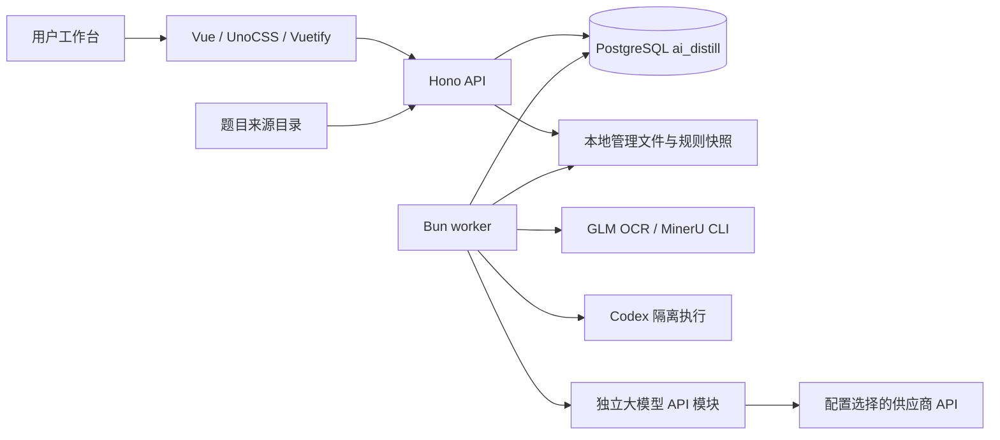

<!-- 文件职责：记录当前实现的系统模块、数据流、稳定契约与运行边界。 -->
# ai-distill 系统结构与架构设计

本文描述 2026-10-09 核对的当前源码结构及维护边界，不代表当前数据库、在线进程或真实业务已验收。历史运行证据见 [文档导航](README.md)，工程规则见 [AGENTS.md](../AGENTS.md)。

## 目标与架构选择

系统以“项目 × 题目目录”为工作单元，保存来源、当前附件、每次执行与产物，使用户能逐步骤派发、查看各题状态、核查结果、返修及导出。数据库负责运行状态、附件文本和任务绑定；本地文件保存项目资料／skill、原件副本、隔离执行目录和成果文件。

当前采用单仓库、模块化后端和独立 worker。HTTP 接收、任务执行与浏览器分别运行；耗时模型请求通过持久化队列消费，客户端等待不决定任务生命周期。保持现有边界即可满足当前本地工作台，不需要为模块说明新增微服务或通用流程引擎。

## 模块划分与入口

| 模块 | 职责与关键入口 | 主要关联 |
| --- | --- | --- |
| [web](../web/README.md) | 项目、任务监控、成果库、系统设置及项目／单题详情路由 | `/api`、共享类型、Row／Column、主题 |
| [server](../server/README.md) | `index.ts` 本地监听，`app.ts` 路由装配、校验及同步操作 | 各业务模块、pg、管理文件 |
| 接收与目录 | `project-folders.ts` 扫描／汇总、统一步骤就绪判断和批次分块；`intake.ts` 附件接收；`intake-jobs.ts` 入库队列 | 来源清单、当前材料、内部 PDF 提取 |
| [materials](../server/materials/README.md) | PDF provider、本地解析、缓存、文本落库、独立脱敏及可选 DOCX 导出 | config、文件、Codex、附件绑定、项目 outputs/ |
| [agent](../server/agent/README.md) | 独立任务契约、固定指令、任务执行入口、全局／项目／步骤模型设置接口 | 出题、质检、评分、skill、脱敏、设置页面 |
| `concurrency.ts` | Agent／API 全局并发读取与验证、SQLite 本机设置持久化、Agent 跨进程槽位协调 | 系统设置 API、worker 启动参数、Agent 连接测试 |
| [codex](../server/codex/README.md) | 本机 Codex CLI 适配、套餐登录、模型目录、低层设置持久化 | agent 适配器与兼容设置接口 |
| 项目资料 | `rules.ts`、`rule-files.ts` 管理当前目录、引用与任务文件指纹；旧 `rule-loading.ts` 已停用 | 项目资料、本地 skill、每次任务的文件清单 |
| [skill-generation](../server/skill-generation/README.md) | 生成候选、检查、采用为当前项目 skill | Codex、完整模板、当前项目资料 |
| [authoring](../server/authoring/README.md) | 独立出题与审查队列、私有草稿、题面与 rubric 版本 | 步骤提示词、项目本地资料、数据库脱敏附件 |
| [llm-api](../server/llm-api/README.md) | 独立 API 消息/JSON 调用、供应商配置、凭证、完整响应与用量 | 作答、API 脱敏；与 Agent 并列 |
| [answer-models](../server/answer-models/README.md) | 系统模型目录、项目集合、冻结配置、逐模型作答与汇总 | provider 客户端、题目／附件绑定 |
| [scoring](../server/scoring/README.md) | 匿名独立评分、逐答案任务、评分结构与绑定校验 | 步骤提示词、题面、rubric、匿名答案与数据库脱敏附件 |
| [decisions](../server/decisions/README.md) | 达标判断、问题分类、返修链、预算及 worker 接续 | 作答／评分、调用账本、材料重做 |
| [publishing](../server/publishing/README.md) | 当前合格成果的版本复核、文件指纹校验与去重发布 | 达标结果、当前产物、下载索引 |
| [reporting](../server/reporting/README.md) | 合格成果查询、XLSX、产量、API usage 与价格快照 | 发布结果、导出记录、价格表 |
| [monitoring](../server/monitoring/README.md) | worker 心跳、队列／运行数、本机内存采样、派发控制及 API／Agent 运行步骤明细 | 本地快照、活动工作流尝试、worker dispatch |
| [shared](../shared/README.md) | API 类型和步骤注册表 | 前后端共同契约 |
| [migrations](../migrations/README.md)、[config](../config/README.md)、[scripts](../scripts/README.md) | 数据结构演进、提取默认配置、人工运行工具 | 各自有操作影响，不能自动运行 |

## 可见步骤与内部身份

当前依据是 `shared/step-registry.ts`。`ordinal` 是持久化身份，`position` 仅表示可见顺序；历史尝试及外键不得随 UI 调整而重编号。

| 显示顺序 | 步骤 | ordinal | 输入与主要结果 |
| --- | --- | --- | --- |
| 1 | 入库（含 PDF 文本提取） | 1；内部 2 | 来源附件 → 管理原件、当前材料、私有文本／页索引和 issues |
| 2 | 脱敏与检查 | 9 | 当前已入库文本 → 所选 API 或本地 Agent 脱敏全文与索引 |
| 3 | 出题 | 4 | 步骤提示词＋项目本地 skill＋数据库脱敏附件 → 私有草稿、题面与 rubric 版本；作者按 skill 自检 |
| 4 | 模型作答 | 5 | 出题成功的当前题面及允许附件＋模型集合快照 → 各模型完整答案及 usage |
| 5 | 独立评分 | 6 | 步骤提示词＋题面／rubric／数据库脱敏附件＋匿名答案 → 逐项报告与程序校验 |
| 6 | 达标或返修 | 7 | 当前模型集合、有效分数和阈值 → 达标、返修、等待或隔离 |
| 7 | 归档达标题目 | 8 | 复核当前达标版本并在数据库写归档标记；项目 Excel 导出另行触发 |

ordinal 2 保留提取历史与队列；PDF 情况下可见入库状态折叠内部提取状态。ordinal 3 仅为旧规则绑定历史，隐藏且不再派发；ordinal 10 独立审查仅保留历史身份，不出现在新工作流且不作为任何后续步骤门槛。新任务直接读取当前项目 skill，不需要先绑定规则版本。skill 生成是项目级能力，不是一道题的独立可见步骤。

普通工作流由用户单步或批量派发，不等待其他题目全部完成；本轮所有评分任务终结后，达标判断自动运行并记录逐模型结果。项目批量入口也可对仍待判定或失败且评分前置条件满足的题目重算第七步；该操作只运行程序分数判断，不调用模型。所有项目级步骤共享同一就绪判定和逐题结果契约。显式启动的返修链由 worker 接续，与已撤除的通用横向／纵向自动运行控制是不同能力。

## 主数据与版本关系

| 实体 | 负责保存 | 不应混同 |
| --- | --- | --- |
| `projects` | 项目路径、描述、Codex 默认设置及逻辑删除 | 本地 `project.json` 不承担队列状态 |
| `workflows` | 题目来源身份、`source_manifest`；旧规则绑定字段仅用于历史兼容 | 来源目录清单不是当前已入库附件 |
| `materials` | 当前附件及已移除附件记录、原件路径、SHA-256、处理标记 | 原始来源文件不随 UI 操作改写 |
| `steps` | 每道题当前步骤状态、摘要、错误与时间 | 当前状态不替代执行历史 |
| `step_attempts` | 每次尝试的冻结输入／配置、结果、心跳、错误 | 终态 completed 不等于 succeeded |
| `artifacts` | 产物索引、指纹、路径；部分文本 content 存数据库 | 文件存在不等于已通过业务发布校验 |
| `rule_versions` | 旧规则快照索引，保留历史兼容 | 新任务不创建或选择编号规则版本 |
| `project_skill_attempts` | 项目 skill 生成的输入、候选及检查 | 采用后更新项目当前 skill 路径 |
| 系统／项目模型表 | 模型配置、项目选用顺序和百分制分数上限 | 密钥不存前端或业务快照 |
| 返修三表 | 链、轮次、外部调用预留及耗时 | 技术重试和内容返修分别计数 |
| `project_exports`、价格表 | 导出状态／来源版本，API 价格及有效期 | Codex 套餐不按 API token 价格计费 |

附件正文从数据库读取：脱敏读取数据库中的原始提取文本，出题、作答和评分读取数据库中的脱敏文本。出题读取步骤配置的提示词及对应项目本地 skill；普通新出与重出只冻结当前附件、指定skill和步骤指令，不读取旧题、答案或评分；显式返修单独沿用绑定的返修证据。评分只向模型提供同版题面、rubric、数据库脱敏附件、匿名答案和评分步骤提示词；不提供作答思路或标准答案，也不读取项目 skill。作答思路和标准答案仅用于内部校验题目包完整性及版本绑定；模型作答不读取项目 skill、评分标准或标答。每个任务记录附件指纹、项目文件清单和配置，提交前复核绑定；不再维护编号规则版本。ordinal 10 独立审查不参与新工作流，历史记录保留。附件变更使旧附件记录标记移除、活动任务取消、下游当前状态失效，原件与执行历史保留。文件写入和数据库事务并不天然原子；各模块负责预写、校验、提交及失败清理，不概括成跨文件系统事务。

出题和评分的新任务输入显式记录数据库项目名称、题目和步骤；名称参与本次摘要，旧任务未记录名称时保留原摘要兼容。普通出题消息将步骤提示词原文置顶，随后给出身份、skill副本入口、附件路径和交付说明；规范正文不粘贴进消息。附件全文按顺序写入独立文本文件，显式返修单独提供返修证据路径，普通出题不提供历史反馈文件；`input/input.json` 保存身份、提示词、文件索引和指纹。作者逐项读取所需规范章节，案件附件分段完整读取；出题方法仍由 skill 决定。工具说明只描述实际可用能力；CLI网络和文件权限由本次执行选择决定，普通出题为完整访问、评分为受限环境。评分依据由步骤提示词、题面、rubric、数据库脱敏附件和匿名答案提供，不向模型提供作答思路或标准答案，也不读取项目 skill；评分执行器提供文件路径及设置提示词，返回纯文本，项目身份仅保留在队列绑定中。新评分任务原样执行自定义提示词；未设置或精确匹配已知旧内置默认时使用当前默认，不预设分数高低，不追加通用开发者指令。历史冻结任务及评分保留，旧项目文件绑定仅用于历史兼容。私有成稿按项目模板的七章组织，公开题包排除思路、标答与内部附件 ID；模型作答仍只接收题面和允许附件。

附件产物的材料／尝试必须与产物属于同一工作流；返修链、轮次与调用记录由复合外键保持工作流、链、轮次和执行尝试的归属一致。`project_workflow_steps.position` 中显示步骤使用 1–8，内部规则步骤与禁用提取项保留在后续位置。

达标判定逐模型将原始得分/满分换算为百分制，与0—100的配置上限比较；所有必需模型严格低于上限时题目达标，等于或超过需要返修。换算由 `shared/score.ts` 供前后端复用，判定不舍入；缺失满分或分数越界时等待。兼容字段 `minimum_score` / `minimum_score_by_model` 保留名称。判定口径进入来源摘要，旧达标记录发布前需重新判定；历史评分不改写。

## 队列与执行生命周期

典型路径：API 校验前置和附件绑定 → 冻结输入／配置并入队 → worker 事务领取 → 按任务选择项目或受限目录执行／保存心跳 → 检查产物和当前绑定 → 发布结果或保存失败。失联恢复及重复领取保护分别由各队列实现；具体逻辑见模块 `jobs.ts`。

可选脱敏 DOCX 不走该队列路径：常规可见步骤全部完成且 ordinal 8 发布成功后，用户可从题目详情手动请求独立 API。API 锁定工作流，校验当前 ordinal 9 脱敏尝试仍绑定当前附件提取指纹，以 `redacted_markdown` 生成 DOCX，并只新增／更新 `redacted_docx` artifact。文件位于项目 `outputs/<source_key>/脱敏材料.docx`；下载时重新验证脱敏尝试、附件摘要和文件 SHA-256。该能力不新增步骤、任务尝试、worker 调度或工作流状态变化；失败只影响导出文件／索引，不回滚业务流程。

单题重置要求没有排队或运行中尝试，在事务中删除该题的材料、尝试、产物和步骤结果，并隔离清理其存储管理目录与提取缓存。项目题目目录及 `source_manifest` 保留以便重新入库。只包含该题的导出记录和文件一并删除；包含多题的导出标记为过期，避免重置一题时删除其他题目的发布结果。

`server/worker.ts` 当前分配材料接收／提取 2 路、作答与 API 脱敏共享 API 通道、skill／Codex 脱敏／出题／评分共享 Agent 通道，另有返修接续 1 路轮询。系统设置可把 Agent 设为 1–4 路、API 设为 1–8 路，配置保存在 `STORAGE_DIR/.concurrency/agent-slots.sqlite3`，API 与 worker 重启后生效；没有保存界面设置时兼容 `AGENT_CONCURRENCY`（默认 2）及 `LLM_API_CONCURRENCY`（默认 8），环境变量支持 1–32 整数。Agent 槽位由 `STORAGE_DIR/.concurrency/agent-slots.sqlite3` 在 worker 与 HTTP 连接测试间共享，进程退出后下一次申请回收失效槽位；模型 API 队列在当前支持的单 worker 内共享总上限。没有任务时通常间隔 3 秒；worker monitor 检查资源，在内存不足时暂停新领取。已有任务与子进程停止行为以取消契约为准，不能把暂停派发理解成强制杀进程。

API 的 `wait_ms` 只控制最多 30 秒的请求等待；模型／工具执行超时独立。客户端断开不取消持久化后台任务。活动任务可监听数据库取消状态；SIGINT／SIGTERM 通过停止信号结束 worker 池并清理资源。

返修启动冻结步骤配置、模型集合及预算；调用先预留，结果不确定仍保留预留，避免重启后“退还”已可能发生的调用。未达标返修另冻结最近最多三条未达标评测轮次及每轮所有模型的答案／评分任务引用；作者入队时按版本和指纹校验后读取完整原文，旧轮次缺少引用时只提供摘要并标明详情不可用。仅 rubric 变化继承答案时校验题面、附件、作答要求和题目版本；改变题面／附件不能复用原答案冒充新作答。预算耗尽、认证／额度问题及未知原因各有明确状态，不保证任意材料最终合格。

## 文本提取与模型输入隔离

- DOCX／TXT／MD 沿用本地解析；PDF 通过 provider 接口。当前任务创建支持 `glm-ocr` 与 `mineru-cli`：显式环境选择优先，否则存在 `MINERU_KEY` 时选择 MinerU CLI，默认 GLM OCR。GLM OCR 使用 layout_parsing；旧 vision 页级识别／缓存代码及调查脚本仍保留，不能混为当前默认执行路径。
- MinerU 按页保留表格 HTML、正文、公式及标题／脚注；空块和未识别占位保留 issues。转换版本参与缓存身份，成功任务复用需匹配冻结配置；重新提取入队使该题下游失效。CLI 原始返回和 stderr 存在 `STORAGE_DIR/.mineru-diagnostics/<diagnostic_id>/` 私有目录，普通日志仅关联诊断编号，不包含原文；诊断文件不进入公开产物。
- `.storage/` 保存受管理原件、任务私有执行目录和大部分工作流产物。原文与脱敏文本保存在数据库产物中；本地项目资料按任务记录清单并校验指纹。来源附件目录只读；仅用户手动生成的当前脱敏 DOCX 保存到项目 `outputs/<source_key>/`，不作为题目输入。
- Codex 普通出题在冻结的项目 cwd、正常配置与完整权限下执行，产物仍按题目／尝试保存在 `.storage/` 独立私有目录；其他任务保持仓库外受限副本。所有调用新建会话并关闭记忆，普通出题不覆盖宿主开发者指令。
- 作答上下文只取题面和数据库中的允许脱敏附件；评分模型使用步骤评分提示词、题面、rubric、匿名答案和数据库脱敏附件；不接收作答思路、标准答案、目标分数或作答模型身份。出题由单次作者调用按项目 skill 自检修订；历史 ordinal 10 独立审查不再创建、执行或展示。
- 作者完整草稿包含作答思路和标准答案；对外题目包不包含这两项。模型作答输入不得包含标答；作答思路和标答留在系统内部完整题目包中，用于完整性及版本绑定校验，不发送给评分模型；下载暴露范围以路由允许的产物 kind 和对应校验为准。
- 识别 issues、质检失败、无效评分、缺价格／usage 都明确保留。处理成功只证明执行与结构检查结果，不证明全文正确、法律任务有效或外部正式资格。

## 独立大模型 API 与 Agent

`server/llm-api/` 和 `server/agent/` 并列。API 模块接收显式消息与供应商配置，返回文字或经调用方验证的 JSON；Agent 提供本地 Codex 的文件/工具/隔离执行，不接入 API 后端。作答的供应商 HTTP 实现统一下沉到 API 模块，作答模块只管理题面/允许附件与业务队列。脱敏业务按冻结配置选择 API 或 Agent；API 不读取本地目录，业务将数据库提取文本直接作为消息输入。

未设置脱敏执行方式时默认 API；统一 API 默认采用 OpenRouter GLM-5.3-Flash，复用已有服务端密钥和标准端点，可用 `LLM_API_*` 覆盖。步骤复用 `/api/answer-models` 选择现有系统目录的模型，不重复填写供应商或 URL；具体连接参数在入队时冻结。已显式保存的 Codex 配置继续有效。脱敏设置保存/恢复默认在工作流锁内取消旧任务、重置脱敏及其下游状态、停止旧返修链并使导出失效。新配置在入队时冻结，正在执行的请求不动态切换供应商。API 脱敏按附件／页切分批次后按附件合并；结构校验失败只重试对应批次一次，供应商、额度、网络和超时错误不自动重试，所有调用的可用 usage 与 call_id 均保留。所有页校验通过后才发布脱敏产物，不增加数据库迁移。

## 前端交互与状态含义

项目详情显示七步汇总、当前达标题目表及全部题目记录。达标表按当前成功的 ordinal 7 判定筛选，紧凑显示逐模型得分、百分制、门槛、版本和发布／导出状态，支持异常筛选、搜索与分页；查看内容按需读取单题详情，以宽屏标签弹窗展示脱敏附件全文、完整题目包、模型作答和评分原文。点击步骤名称或“查看题目”仍打开统一步骤表格，展示未进入、就绪、排队、处理中、完成、失败及原因。项目汇总、逐题表格和批量入口使用 `project-folders.ts` 中的同一就绪判断；单题详情 API 返回 `ready` 与 `ready_reason`，前端不复制前置条件。模型作答接受当前出题成功且题目、附件绑定有效的结果。ordinal 10 历史审查记录不显示，也不影响任何当前步骤。

`waiting` 结合当前步骤的活动尝试才能判为排队；当前步骤待执行或失败、没有活动尝试、步骤已启用，且最近一个启用的可见前置步骤成功时才是就绪。归档步骤另要求达标步骤成功且 `decision=accepted`，返修中的题目不能归档。归档成功后题目从项目“题目记录”隐藏，并继续显示在“达标题目”中。评分允许所有作答模型均终结且至少一个成功的部分结果进入评分。入库步骤将 PDF 提取状态一并判断。历史 ordinal 2、3、10 均不参与可见顺序与门槛。项目汇总、单题记录及批量派发共用同一判断；批量 API 对项目内所有题目按 `BATCH_DISPATCH_CHUNK_SIZE` 分块处理并逐题返回排队、完成、未就绪或派发失败，默认 100、可配置范围 1–1000。第七步达标判断在评分完成后自动触发，也可由批量入口对当前就绪题目重算；该判断仅读取评分结果，不调用模型。版本撤除迁移 `027_remove_material_versions.sql` 保留原件和执行历史，标记历史附件移除，取消活动任务，保留已完成入库／提取并清空后续当前步骤状态；旧快照摘要不用于新任务复用。部署须停止旧 API／worker 后应用迁移并切换代码。

材料处理状态和题目步骤状态是不同粒度：附件脱敏完成数来自材料标记，处理中／失败等部分显示由题目步骤推导，不是独立附件任务队列监控。

普通附件全文弹窗可读取提取／脱敏文本；PDF 原件可在单独标签中预览。达标题目弹窗单独请求 `redacted_only=true`，只返回脱敏附件正文，不返回原始提取页；题目包、作答和评分从单题当前步骤／尝试响应按需读取。Excel 汇总项目内全部当前有效达标题目，暂存于系统管理的存储目录并通过导出记录交给浏览器下载；归档状态不影响题目进入该工作簿。

前端 route 页装配功能组件；类型由 shared 转出，API client 统一解析错误，`useResource` 管理读取与卸载取消。主导航提供出题项目、任务监控、跨项目成果库和系统设置；项目／题目详情路由仍属于出题项目入口。模型评测和返修记录保留在单题详情中。`GET /api/results` 只返回当前有效达标题目的摘要，不返回材料全文。

## 全系统后端日志

整个后端的 API、数据库访问、worker、业务步骤、外部调用和文件边界共用 `server/logging.ts` 的安全结构化 JSONL 约定；它是跨模块基础能力，不归属某个业务服务。记录落在 `<STORAGE_DIR>/logs/`，按日期和进程 instance_id 分段并带 build_id（`APP_BUILD_ID`，本机默认 `local`）。API 生成 request_id 并通过响应头返回，按路由关联 operation、project_id 或 workflow_id；worker 和业务操作补充 attempt_id、skill_attempt_id 或 call_id。出题、评分与脱敏的返修预算事件和 Codex 子进程共用同一调用 ID。数据库层只记录固定查询名、耗时、事务结果及安全错误码，不记录 SQL 参数；提交或回滚请求自身失败时明确标记结果未知。服务入口同步记录未捕获异常，未处理 Promise 拒绝在同步记录后仍以非零码退出。Codex 私有事件和业务材料仍在各自受限存储，不复制进普通日志；脱敏失败结果只保存安全错误摘要。

当前已接 API/worker、数据库、项目文件与步骤设置、Codex/脱敏执行链及主要业务和文件边界；旧规则绑定入口已停用。并验证两个服务进程同时写同一日志根目录时各自保留完整 JSONL 段。逐入口全系统验收仍在进行，真实数据库和本机服务运行态尚未验证。OCR 专项按用户要求跳过。日志设计、验证结果和缺口见[后端日志计划](plans/2026-10-09-backend-logging-design.md)。

## 运行、维护与验收边界

API 默认 `127.0.0.1:3100`，Vite 本地开发端口 `5173` 并代理 `/api`；worker 与 API 必须使用同一管理存储路径。当前是本地工作台，没有完整用户登录、多租户授权和多 worker 部署验收。

数据库备份不能代替本地原件、规则快照与产物备份。模型密钥留在服务端环境；Codex 凭证目录由本地受保护配置读取，不把凭证正文放入业务输入。数据库 TLS 校验及 channel binding 由 `db.ts` 解析配置。

迁移使用完整文件名记录，顺序应用未登记 SQL。024 会撤除历史自动控制数据；不要为修复设置盲跑全部迁移。脚本可能创建／删除临时 schema、写真实项目状态、上传卷宗或调用收费模型，执行前检查脚本说明及授权。

本次文档与注释核对没有启动服务、访问远程数据库、执行测试／lint 或模型调用。当前真实服务、已应用迁移、整份材料准确性、多模型真实题目闭环、返修恢复、正式交付与浏览器完整验收须分别取得证据；不得从源码入口存在推断它们通过。

### 本次规范输入与附件边界调整

出题使用 scanProjectPrompt 的 skill 专用扫描，只读取 skill/ 及其内部引用；不扫描项目 materials/ 或 project.json。新评分任务不扫描项目文件，旧任务仅在绑定复核时兼容其原文件清单。资料管理和 skill 候选生成仍可读取完整工作区。原任务清单含其他项目资料时须重新派发，旧编号快照包含非 skill 文件时停止执行并要求重新出题。普通新出／重出不查询或注入任何旧题、答案与评分，只使用当前附件、指定 skill 和步骤指令；显式返修单独保留 `revision.evidence`。新普通任务冻结 `fresh-desktop-v1`，旧不兼容活动输入在模型调用前失败，完成历史保持可读。

新的脱敏合并正文由程序保留附件序号、起止边界和原附件页序，后续出题、作答及评分读取相同正文。脱敏任务配置记录 text_layout，避免复用旧布局的成功任务；已有产物不自动重写，需重新脱敏后出题。出题提示词要求作者按 skill 自检关键判断是否会被泛泛意见绕过；这是内容要求，不表示结构校验能够证明质量。

出题完整结构化题目包（含 rubric、作答思路、标准答案）保存至 steps.result 与 step_attempts.result 的 JSONB。返修优先读取数据库完整草稿，旧任务兼容本地草稿；模型作答仍通过输入契约仅选择题面及允许的脱敏附件。

出题输出 Schema 将 `attachment_ids` 限定为本次脱敏材料 ID，并将 `answer_requirements` 限定为当前作答模型支持的 text 输入、text 输出、无工具；业务校验继续拒绝缺失、重复或越界引用及不支持的作答形式。已知附件引用错误以安全错误码和具体提示保存到失败尝试，未知错误保持通用信息。

评分上下文隔离显式禁用 Codex 记忆、宿主资料发现和外部上下文入口，仍以新临时工作区、忽略个人配置和受限目录执行。固定应用指令与隔离参数进入新评分任务的冻结/去重依据；执行时 CLI 将实际参数、stdin、开发者指令和 schema 保存到模型不可读的私有 `request.json`，评分结果保存 `execution_request` 供界面查看。步骤设置经只读 `/api/agent/scoring-instructions` 展示当前服务指令；历史无快照时明确缺失，不回填当前源码。该快照不包含凭证、环境变量或 Codex 未返回的内置系统指令。

### 旧版独立评分直接文本调用（历史格式）

独立评分在新隔离会话中发送题面、rubric、脱敏附件、匿名完整答案和原样评分提示词；作答思路及标准答案仅保留在内部同版题目包校验上下文，不发送给评分模型，不写入供模型读取的 input.json，不追加评分开发者指令，不要求 JSON 输出。Codex 文本模式省略输出 schema，保存 result.txt；其他结构化任务保持原协议。禁用记忆、项目规则及外部工具读取。

评分原文与实际发送正文保存在执行记录中，界面可查看。默认评分提示词要求每项说明分数、理由和逐字答案证据；程序不解析或改写逐项理由。对于 rubric 项目均为1分的纯文本评分，程序校验 ID 覆盖唯一、每项仅0或1以及逐项合计等于最终总分，再用于展示及达标判断；其他情况仍按已有总分提取协议。旧内置默认正文精确映射到新版默认，自定义提示词保持原样。无法明确提取或单位分评分不合法时，执行仍记为成功但单独标记校验无效，不参与达标判断。旧结构化报告继续按旧协议读取；旧记录不会用当前指令补造快照。

达标结果为每个作答模型保存其答案尝试 ID、评分尝试 ID 和题目／rubric 版本引用，供返修追溯，不参与分数计算。返修轮次证据显示所选失败评测；出题尝试输入保存经引用校验后的完整答案和评分原文，返修记录页面可查看实际送入作者的评测材料。

旧独立评分正文按固定顺序分区：评分提示词 → 完整题目包（题面、rubric、作答思路、标准答案）→ 题目附件 → 待评分答案。该旧格式不代表当前模型输入。当前独立评分分文件提供评分提示词、题面与 rubric、题目附件、待评答案；不提供作答思路或标准答案。输入格式标识参与执行指令绑定，避免复用旧格式评分。

### 当前独立评分：分文件阅读（替代直接正文模式）

评分消息仅列出文件用途、完整阅读要求和用户原样提示词。题面与 rubric、各份附件、待评答案分别通过 `input_files` 传入 Codex 客户端；作答思路与标准答案仅留在内部版本绑定上下文，不写入评分文件；客户端仅在系统临时目录 `ai-distill-codex-*/workspace/` 写入文件，执行后清理整个临时目录，成功、失败及取消均尝试清理，清理异常记录日志。持久化记录保留原有冻结上下文、发送消息、文件名/大小/SHA256、读取事件及评分原文，不保留临时输入文件副本。

评分允许文件读取所需的 shell 工具，文件系统仍限制为独立工作区及执行所需最小运行环境，网络、记忆、项目规则、skill 和其他外部入口继续关闭。每次派发创建新评分任务，不复用已完成结果；同一答案已有等待或运行任务时拒绝重复派发。文本评分与返回后总分提取保持不变。

### 普通出题文件交付（2026-10-10）

普通出题的 cwd 采用冻结的项目 `workspace_path`，skill 继续读取本次经指纹校验的副本，附件读取数据库脱敏正文。步骤自定义指令原样保留；默认仅要求查看指定 skill、依据附件出题。完整访问下历史文件排除属于任务边界。配置优先级仍为步骤、项目、系统，不改变评分设置。

同一作者会话保存 `output/result.json` 和确定性渲染的完整 `output/题目.md`，程序严格比较正文，末条聊天回复仅存 `completion.txt`。缺失、错位、越界、链接、超限、取消或未完成轮次不提交成功；项目 cwd 不参与临时目录清理。私有 `request.json` 保存实际参数、任务说明、模型档位、配置目录及输入清单指纹，事件保留真实调用；不包含凭证或完整桌面内置指令。生成成功与后续业务达标、发布、成功案例选入保持不同状态。实现与运行证据见[验收记录](evidence/2026-10-10-fresh-authoring-alignment.md)。
