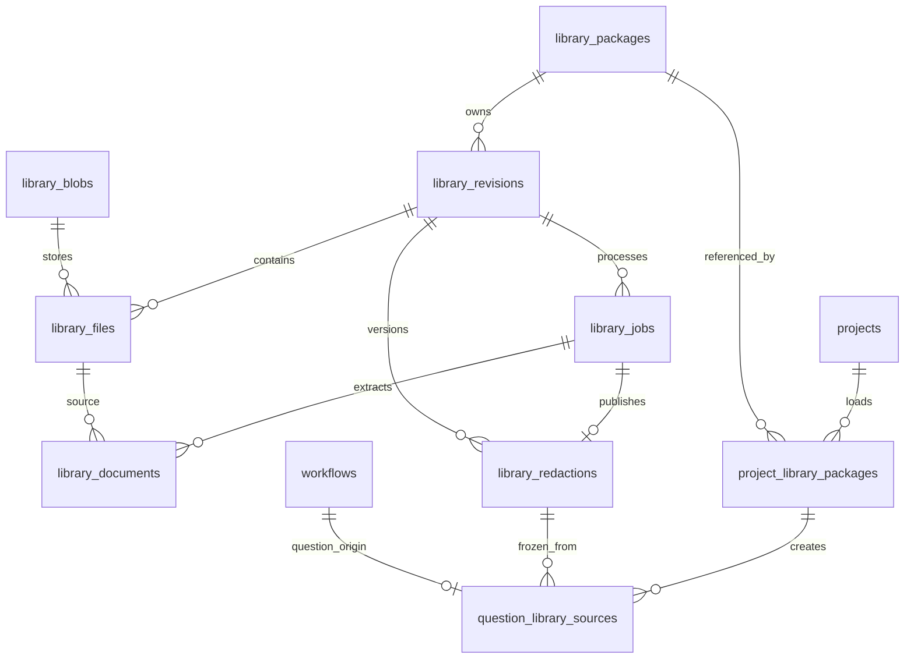

# 独立材料库与项目加载：详细设计

**2026-10-18 最新任务入口：[第16节：主项目多期、防重与Work历史衔接三任务计划](#16-主项目多期防重与work历史衔接三任务计划)。该节记录Work指定数据同步及实施验收结果；不包含其他项目数据迁移。**

日期：2026-10-17；最近核对：2026-10-18。状态：新库及项目加载、私有快照和下游代码已集成；隔离库042/043已登记。合成数据的真实API/worker入库/提取、双项目加载、模拟执行器4–8、DOCX/XLSX、归档撤回、并发归档屏障及删除独立性已验证。材料库设置现已调整为本机全库共用，包内只编辑资料信息；文件阅读、任务记录、项目使用已分开；真实模型、远端传输与原生目录选择尚未验收。最新证据以执行追踪为准，下面保留设计基线与注明时间的历史记录。

本方案给维护者阅读，交付范围为可审查的数据库、接口、任务执行及架构衔接设计。用户已确定：材料包独立于项目；项目加载材料包；入库、提取、脱敏在材料库执行；新旧表和方法并存；本次不迁移旧数据，验收通过后才退役旧实现。

## 本次任务与完成标准

| Item | 设计任务 | 本次完成的判断依据 |
| --- | --- | --- |
| D1 | 核对实际结构和调用链 | 指明当前有效迁移、代码入口和需要替换的读取条件，区分源码与在线事实 |
| D2 | 定义新表及逐字段数据字典 | 每个新增字段均说明类型、空值、默认值、用途、写入者、约束与生命周期 |
| D3 | 明确前后端和运行衔接 | 覆盖材料库、项目加载、建题、worker、配置、监控、作答、评分、归档、DOCX/Excel/五六件套 |
| D4 | 给出实施、回退和验收方法 | 具有依赖顺序、文件修改清单、事务边界、失败行为和可观察验收场景 |

本次只验收设计内容及引用完整性；不验收数据库执行、DDL 实际落库、模型效果、性能、浏览器或业务链路通过。后续实施验收另见本文的实施与验收章节。

## 1. 设计结论与边界

采用“独立材料库 + 项目加载关系 + 题目冻结快照”。新增九张业务表，复用现有项目表和出题后的工作流表。材料库不保存 `project_id`，不借一个隐藏项目承载材料，也不把项目 ID 设为空来改造旧材料工作流。

材料库页面负责原件接收、入库、文本提取、脱敏及各次结果；项目页面负责加载材料包、选择处理结果、创建题目，以及出题到归档。项目 A、B 加载相同材料包时引用同一份库资源，各自建题、配置和成果独立。

三种方案的比较：

| 方案 | 影响 | 选择 |
| --- | --- | --- |
| 新增独立材料表与加载表，统一读取题目材料快照 | 材料脱离项目；后半段只调整材料入口；可按新项目独立验证 | 采用 |
| 继续用旧材料工作流，放进一个“公共项目” | 权限、删除、默认配置、统计仍依赖伪项目；没有真正改变归属 | 不采用 |
| 把项目、出题、作答、评分和归档全部重做 | 扩大当前目标，已有评分与交付能力需要全部重验 | 不采用 |

本轮设计不迁移、不复制、不自动合并旧业务数据。首次启用的新材料库为空，旧数据留在原表、原路由和原项目模式。测试材料由操作者通过新入口重新导入；这属于新业务输入，不是数据迁移。

**退役边界必须准确：**旧入库、提取、脱敏方法，以及旧材料包工作流专用记录可在后续退役；`steps`、`step_attempts`、`materials`、`artifacts` 仍被新题目的后半段和题目私有快照使用，不能整表删除。若要求后半段也换表，是另一项扩大后的目标。本方案不把“保留旧表”误解为永久维护两套材料业务。

## 2. 当前事实与需要解除的耦合

本节依据当前仓库源码核对，不表示已查询在线数据库的实际约束或已加载进程。

| 当前证据 | 已核实事实 | 对新设计的要求 |
| --- | --- | --- |
| [初始建表](../../migrations/001_initial.sql)、[归属约束](../../migrations/026_database_integrity.sql) | 附件、步骤、尝试、产物经 `workflow_id` 关联；工作流经 `project_id` 归属项目 | 新材料库不使用这些表保存库级任务 |
| [材料包建题迁移](../../migrations/035_material_package_questions.sql) | 来源材料包与题目有同项目复合外键 | 新来源单独建表，不把全局材料包 ID 塞进 `source_workflow_id` |
| [材料版本撤除迁移](../../migrations/027_remove_material_versions.sql) | 旧 `input_revision` 已被删除，当前不能再按该列设计 | 新库的不可变文件集合使用新 `library_revisions`，不恢复旧列 |
| [现有建题入口](../../server/material-package-questions.ts) | 复制附件、提取结构、脱敏正文和索引；给题目写继承的 1/9 成功记录 | 新路径保留私有快照能力，不伪造 1/9 成功任务 |
| [出题队列](../../server/authoring/jobs.ts) | 直接 JOIN 步骤 1/9，并要求 `redaction_attempt_id` | 改为统一材料读取，输入来源使用有类型的分支 |
| [作答队列](../../server/answer-models/jobs.ts)、[归档](../../server/publishing/jobs.ts) | 读取附件时 JOIN 脱敏成功尝试和步骤 9 | 两处均改为校验题目快照，不只改出题入口 |
| [DOCX 导出](../../server/materials/redacted-docx-export.ts)、[Excel 汇总](../../server/reporting/export.ts) | 绑定脱敏正文、结构、原件及题目版本 | 新旧来源都提供同一份已校验题目输入 |
| [HTTP 入口](../../server/app.ts)、[步骤就绪判断](../../server/project-folders.ts) | 列表、附件查看、删除、批量派发、汇总多处依赖旧来源与步骤 | 都必须按项目后端模式分流；只改页面会留下业务入口漏洞 |
| [规则工作区](../../server/rule-files.ts) | 部分工作区路径由 `dirname(material_root)` 推导 | 新项目需要显式 `workspace_path`，不能去掉原件目录后误读项目规则 |
| [worker](../../server/worker.ts) | 材料、Agent、API 队列分流，已有并发池和执行位置 | 接入既有池，不为新库另开不受全局配置约束的模型池 |
| [外部调用关联](../../server/external-call.ts) | ExternalCallContext 当前要求旧 attempt_id | 扩展成旧尝试或库 job 的互斥来源类型，不能用库 job ID 冒充 step_attempt ID |

`projects/<项目>/materials/` 当前主要是项目规则资料；本方案中的案件材料库是另一种业务资源。项目规则和 skill 继续按项目目录加载，不能跟着案件材料一起放进全局库。

## 3. 目标数据关系与用户流程



正常顺序：建立材料包 → 上传文件形成待入库文件集合 → 入库核验 → 文本提取 → 脱敏 → 项目加载并选择脱敏结果 → 建题冻结 → 出题 → 作答 → 评分 → 达标 → 归档和项目交付。

允许先把未处理的材料包加载到项目，显示“材料尚未就绪”。入库与脱敏按钮仍在材料库。项目只有选中一份完整成功的脱敏结果后才能创建题目。

“文件集合版本”是内部可追溯记录，不要求用户创建版本号。补文件、删文件、调整文件顺序、变更已人工脱敏声明时，界面保存为新文件集合；旧集合和旧题快照保留。改材料包名称、说明或标签不生成新文件集合。

第一版保持“一道题来自一个材料包”，不增加多材料包拼题。一个包可以包含多份独立文件，也可以在多个项目创建多道题目。

## 4. 类型、默认值和存储约定

- 所有表位于现有 `ai_distill` schema；库表使用 `library_` 前缀，避免混用现有 `materials`。
- UUID 由服务端生成并显式写入，不依赖新增 PostgreSQL 扩展。时间为 `timestamptz`，创建时间默认 `now()`；API 返回 ISO 8601，页面按用户时区显示。
- SHA-256 使用 `text`，约束为 64 位小写十六进制。哈希计算包含字节编码及协议定义；不对正文做空白归一化后冒充原文件哈希。
- JSONB 仅容纳有明确结构的配置、清单、诊断；关联 ID、任务状态和常用筛选条件独立成列。JSON 中的字段同样做服务端校验，不能以 JSONB 为由省略契约。
- 下表的“必填”表示 `NOT NULL`；“空”表示允许 NULL。未注明的必填字段没有隐含默认值，必须由指定写入者提供。`updated_at` 由更新 SQL 显式设置，不假设数据库自动维护。
- 不存业务密码、API key 或凭证正文。任务只存供应商配置引用及非敏感模型参数，实际密钥沿用现有服务端凭证解析。
- 大文本以 UTF-8 字符串存数据库，读取时验证摘要；原始 PDF/DOCX 等二进制存受管目录。共享数据库不等于本机和服务器共享磁盘。

## 5. 九张新表的完整字段字典

### 5.1 `library_blobs`：受管内容对象

用途：在材料库内复用相同原始字节、提取结构和脱敏正文。它保存内容身份与位置，不承载项目归属或处理状态。

| 字段 | 类型 / 空值 / 默认 | 用途与写入者 |
| --- | --- | --- |
| `id` | uuid，必填，主键 | 对象 ID；对象存储方法分配 |
| `sha256` | text，必填 | 实际内容字节摘要；上传/结果写入时计算，读取时复核 |
| `size_bytes` | bigint，必填，≥0 | UTF-8 字节数或原始二进制长度；对象存储方法计算 |
| `content_type` | text，必填 | 已检测的 MIME，如 PDF、DOCX、JSON、Markdown；不只信任上传扩展名 |
| `storage_kind` | text，必填 | `file` 或 `database_text`；决定读取分支 |
| `storage_target` | text，可空 | 二进制必须为 `local` 或 `server`；数据库文本必须为空；标识哪一侧受管根目录有文件 |
| `storage_path` | text，可空 | `file` 必填的受管相对路径，不含用户输入的绝对路径；文本对象为空 |
| `text_content` | text，可空 | `database_text` 必填的完整 UTF-8 内容；二进制对象为空 |
| `created_at` | timestamptz，必填，now() | 对象第一次登记时间 |

约束：两种存储互斥；文件路径必须非空，应用层验证目录归属、禁止路径穿越及符号链接越界。文件对象按 `(sha256, storage_target)` 部分唯一，文本对象按 `(sha256,content_type)` 部分唯一，文件路径按 `(storage_target, storage_path)` 部分唯一。数据库文本与文件即使摘要相同，也不互相替代；相同文本不同解释类型也保持明确身份。

相同字节只复用内容对象，不根据哈希把两个同名案件或两个材料包自动合并。同一文件需要在本机与服务器各存一份时允许两个位置对象，各自有明确摘要。

对象不可原地覆盖；更新写新对象。首版不维护易失真的 `reference_count`，按外键引用判断可回收性，也不自动清除仍有引用的对象。

### 5.2 `library_packages`：独立材料包

| 字段 | 类型 / 空值 / 默认 | 用途与写入者 |
| --- | --- | --- |
| `id` | uuid，必填，主键 | 全局材料包身份；创建接口分配 |
| `name` | text，必填，1–180字符 | 材料包名称；用户编辑，可重名，通过 ID 区分 |
| `description` | text，必填，空字符串 | 材料内容说明，不等于任何项目的出题方向 |
| `tags` | text[]，必填，空数组 | 材料库检索标签；用户编辑，不与项目出题标签混用 |
| `current_revision_id` | uuid，可空 | 当前正在维护的文件集合；可指向待入库集合；尚无文件时为空 |
| `processing_settings` | jsonb，必填 | 保留建包时初始配置以兼容既有结构；2026-10-18修订后新任务改读全库共用设置并冻结，此字段不再作为当前执行配置 |
| `lock_version` | bigint，必填，1 | 元数据、当前集合或处理设置更新时递增，配合 `If-Match` 防覆盖 |
| `created_at` | timestamptz，必填，now() | 创建时间 |
| `updated_at` | timestamptz，必填，now() | 最近编辑时间 |
| `deleted_at` | timestamptz，可空 | 逻辑归档时间；隐藏库列表，不物理清除历史结果 |

这里没有 `project_id`、项目 skill 路径、项目出题方向或项目交付脚本。`current_revision_id` 必须以 `(id,current_revision_id)` 外键指向同包版本；创建表时先建包，再建版本表，最后补这个可空外键，解除建表顺序循环。

### 5.3 `library_revisions`：确定的文件集合

| 字段 | 类型 / 空值 / 默认 | 用途与写入者 |
| --- | --- | --- |
| `id` | uuid，必填，主键 | 文件集合身份，内部版本 ID |
| `package_id` | uuid，必填 | 所属全局材料包，外键到包；无项目归属 |
| `parent_revision_id` | uuid，可空 | 从哪一集合补充/调整而来；首次为空；复合外键保证同包 |
| `state` | text，必填，`pending` | `pending` 为已接收待核验，`ready` 为入库核验通过；失败原因在任务表 |
| `manifest_sha256` | text，必填 | 有序文件清单的规范摘要；包含相对名称、顺序、原件摘要、声明方式 |
| `file_count` | integer，必填，>0 | 固定文件数；创建接口填写，入库/封存时与明细 COUNT 复核 |
| `source_info` | jsonb，必填 | `{kind:'upload'或'folder', ...}` 的来源说明；文件夹路径仅限私有接口读取，不给模型 |
| `request_key` | uuid，必填 | 创建文件集合的包内幂等键；防止上传断线后重复登记集合 |
| `request_digest` | text，必填 | 原始建集合请求的规范摘要，含包/父集合、文件名、顺序、字节摘要、声明与存储目标；不含生成的随机 ID |
| `created_at` | timestamptz，必填，now() | 文件集合创建时间 |
| `sealed_at` | timestamptz，可空 | 入库成功时写入；`ready` 必填、`pending` 为空 |

约束：`UNIQUE(package_id,id)`、`UNIQUE(package_id,request_key)`；同包父版本外键；禁止自身作为父版本。创建后文件清单不可变，即便入库失败也不能悄悄换字节；修改必须创建新集合。`pending → ready` 是唯一状态更新，不引入“失败版本”与“失败任务”两个竞争状态。

`manifest_sha256` 可重复，同一包重复导入相同字节不必制造数据错误；服务可提示复用现有集合，但不能擅自合并用户有意保存的记录。

### 5.4 `library_files`：文件集合里的附件

| 字段 | 类型 / 空值 / 默认 | 用途与写入者 |
| --- | --- | --- |
| `id` | uuid，必填，主键 | 本集合内文件身份；新集合分配新 ID |
| `revision_id` | uuid，必填 | 文件所属集合，外键到版本表 |
| `blob_id` | uuid，必填 | 原件内容对象；相同字节可被多个集合引用 |
| `original_name` | text，必填 | 相对名称；允许 `证据/附件1.pdf`，禁止绝对路径、`..` 和控制字符 |
| `position` | integer，必填，≥1 | 附件顺序；提取、脱敏、建题和导出均沿用 |
| `redaction_mode` | text，必填，`model` | `model` 或 `declared_redacted`；后者仅允许已明确人工脱敏的 DOCX，并按源摘要确认 |
| `created_at` | timestamptz，必填，now() | 文件项创建时间 |

约束：`UNIQUE(revision_id,id)`、`UNIQUE(revision_id,position)`、`UNIQUE(revision_id,original_name)`。扩展名/内容类型与声明方式由服务验证。声明不是系统保证零敏感；新集合才能改变声明，已运行任务引用的声明固定。

### 5.5 `library_jobs`：入库、提取、脱敏任务和尝试

每次实际派发是一行。重试创建新行并关联旧任务，不把失败记录改成新尝试；不再另外建立一套 attempts 表。

| 字段 | 类型 / 空值 / 默认 | 用途与写入者 |
| --- | --- | --- |
| `id` | uuid，必填，主键 | 任务/本次尝试 ID；派发服务分配，返回前端 |
| `package_id` | uuid，必填 | 归属材料包，供列表和日志定位 |
| `revision_id` | uuid，必填 | 本次固定文件集合；复合外键与 `package_id` 一致 |
| `kind` | text，必填 | `intake`、`extract`、`redact` 三种材料任务 |
| `status` | text，必填，`queued` | `queued/running/succeeded/failed/cancelled`；未派发阶段不创建虚假 waiting 任务 |
| `request_key` | uuid，必填 | 客户端幂等标识，包内唯一；同 key 不同输入返回冲突 |
| `previous_job_id` | uuid，可空 | 手动重试的前一次任务；要求同包、同集合、同 kind，旧任务须失败或取消 |
| `input_digest` | text，必填 | 规范输入摘要，包含有序附件/提取结果引用、任务 kind 和协议版本 |
| `input_snapshot` | jsonb，必填 | 私有冻结清单；见第 6 节，存 ID 和摘要，不再复制整份正文 |
| `config_digest` | text，必填 | 完整非敏感配置快照的规范摘要 |
| `config_snapshot` | jsonb，必填 | 实际提示词、模型、推理参数、执行预算、清理协议、提取配置；执行只读它 |
| `executor_kind` | text，必填 | `internal/api/agent`；用于进入正确并发池，不从 kind 猜测执行资源 |
| `execution_target` | text，必填 | `local/server`；入库/提取必须能读取该位置的全部原件；Agent 仅 local |
| `progress` | jsonb，必填，空对象 | 文件/字段/批次计数与阶段；不包含材料正文，不伪造供应商生成进度 |
| `result_summary` | jsonb，必填，空对象 | 输出 ID、文件数、问题数和耗时摘要；不是正式正文存储位置 |
| `error_code` | text，可空 | 稳定错误码，如 `source_missing`、`worker_interrupted`；失败时必填 |
| `error_message` | text，可空 | 面向操作者的安全错误说明；不包含凭证和未脱敏原文 |
| `lease_token` | uuid，可空 | 本次 worker 领取令牌；领取后写入，提交/心跳必须匹配，防晚到提交 |
| `lease_expires_at` | timestamptz，可空 | 当前领取租约到期；running 必填，与业务超时分开 |
| `heartbeat_at` | timestamptz，可空 | 最近 worker 心跳；running 必填，不表示供应商仍在生成 |
| `cancel_requested_at` | timestamptz，可空 | 请求取消时间；running worker 检查并中止，提交前再次核对 |
| `created_at` | timestamptz，必填，now() | 入队时间 |
| `started_at` | timestamptz，可空 | 领取开始时间；queued 为空，统计真实排队耗时 |
| `deadline_at` | timestamptz，可空 | started_at 加冻结的整任务预算；running 必填，排队不消耗执行预算 |
| `finished_at` | timestamptz，可空 | succeeded/failed/cancelled 的实际终态时间；queued/running 为空 |

约束与索引：

- `UNIQUE(package_id,request_key)`；`UNIQUE(revision_id,id)` 供结果归属外键使用。
- `UNIQUE(package_id,revision_id,kind,id)` 供同类型前次任务外键使用。
- 每一文件集合只允许一条 queued/running 材料任务：部分唯一索引 `(revision_id)`。首版不让同集合的重新提取与脱敏互相争写；不同材料包/集合仍可并行。
- 消费索引 `(execution_target,executor_kind,created_at,id) WHERE status='queued'`；历史索引 `(package_id,kind,created_at DESC,id)`；租约恢复索引 `lease_expires_at WHERE status='running'`。
- 任务 kind 与执行器约束：intake=internal；extract=internal 或 api；redact=api、agent，或满足全文件人工声明条件的 internal；Agent 不允许 server。DOCX 全人工声明时走内部投影，配置记 `provider=declared`，仅服务端可根据固定输入生成，仍记录真实的“声明复用”行为，不声称调用模型；混合材料包继续使用真实配置的 API/Agent。
- input/config 摘要、引用、target、kind 在派发后不可变；状态、进度、租约和结果摘要由 worker 有条件更新。成功结果必须在同事务内登记，并以租约令牌取得最终提交权。

### 5.6 `library_documents`：每份附件的结构化提取结果

| 字段 | 类型 / 空值 / 默认 | 用途与写入者 |
| --- | --- | --- |
| `id` | uuid，必填，主键 | 一份提取文档身份 |
| `revision_id` | uuid，必填 | 来自哪个固定文件集合 |
| `file_id` | uuid，必填 | 对应附件；复合外键保证同集合 |
| `extraction_job_id` | uuid，必填 | 来源 extract 任务；复合外键保证同集合 |
| `document_blob_id` | uuid，必填 | 保存结构化 JSON 的数据库文本对象；含页序、段落/表格、原文、页级 issues |
| `source_sha256` | text，必填 | 提取所依据的原件摘要；封存后与附件 blob 比较 |
| `text_sha256` | text，必填 | 按固定协议从结构投影的全文摘要，验证结构与正文一致 |
| `page_count` | integer，必填，≥1 | 逻辑页数；DOCX 依现有路径可为一逻辑页，不冒充物理页数 |
| `issues` | jsonb，必填，空数组 | 从结构中提取的文件/页级问题摘要，供列表与结果门禁；必须与文档结构一致 |
| `created_at` | timestamptz，必填，now() | 提取结果保存时间 |

约束：`UNIQUE(extraction_job_id,file_id)`；结果不可原地修改。数据库约束触发器验证来源 job.kind=extract；应用验证结构、页序、源摘要、全文投影和 issues。

提取任务仅在全部文件都有完整结果时成功。某份失败时可以保留其他文件结果供诊断和下次受控复用，但失败任务的结果集合不能用于脱敏。复用缓存要同时匹配原件 SHA、提取器/协议/配置指纹，不能只看文件名。

### 5.7 `library_redactions`：完整脱敏结果版本

| 字段 | 类型 / 空值 / 默认 | 用途与写入者 |
| --- | --- | --- |
| `id` | uuid，必填，主键 | 可被项目选择的脱敏结果 ID |
| `package_id` | uuid，必填 | 材料包身份；与 revision 复合外键一致 |
| `revision_id` | uuid，必填 | 固定文件集合 |
| `extraction_job_id` | uuid，必填 | 本次使用的完整成功提取任务；明确选择，不取“最新一份” |
| `redaction_job_id` | uuid，必填，唯一 | 产生结果的 redact 任务；每次任务最多发布一套正式结果 |
| `markdown_blob_id` | uuid，必填 | 全包脱敏正文的数据库文本对象 |
| `index_blob_id` | uuid，必填 | 全包脱敏结构索引对象；保留逐附件结构和源页位置 |
| `input_digest` | text，必填 | 必须等于 redact 任务冻结的 input_digest |
| `output_digest` | text，必填 | 协议、文件集合、来源提取任务、正文和索引摘要的整体指纹 |
| `validation_report` | jsonb，必填 | 字段覆盖、结构投影、识别问题、清理计数、内容核对状态及 `usable_for_question`；机器校验不能写成人工认可 |
| `created_at` | timestamptz，必填，now() | 正式结果发布时间 |

约束：`UNIQUE(package_id,id)`、`UNIQUE(revision_id,id)`；extract/redact 来源均必须同集合，且 job.kind、状态与冻结输入一致。结果和 job.status=succeeded 同事务提交；只有验证合格才插入正式结果，失败输出留在私有诊断/断点中。

输出索引必须保存“每份文件 → 原始页 → 脱敏结构”的对应关系。空页、水印清理可影响展示，但不能改写或丢掉源页溯源；有未解决实质识别问题的页必须带出问题并按照现有质量规则阻止不完整交付。

历史成功结果不会因新配置或新集合被覆盖。项目选择哪次结果就是哪次，不把运行中的半成品称为“最新成功版”。

### 5.8 `project_library_packages`：项目加载材料包

| 字段 | 类型 / 空值 / 默认 | 用途与写入者 |
| --- | --- | --- |
| `id` | uuid，必填，主键 | 一次项目加载关系的身份 |
| `project_id` | uuid，必填 | 使用材料包的项目，外键到现有 projects |
| `package_id` | uuid，必填 | 被加载的全局材料包 |
| `selected_revision_id` | uuid，可空 | 项目选择的文件集合；未就绪仅加载时为空 |
| `selected_redaction_id` | uuid，可空 | 项目选择的成功脱敏结果；必须与 selected_revision_id 同时有值或同时为空 |
| `position` | integer，必填，≥1 | 项目内显示顺序；允许排序并列时按 id 稳定排序 |
| `lock_version` | bigint，必填，1 | 切换选用结果、排序、移除时防覆盖 |
| `created_at` | timestamptz，必填，now() | 加载时间 |
| `updated_at` | timestamptz，必填，now() | 选择结果/排序/移除时间 |
| `removed_at` | timestamptz，可空 | 从此项目移除；保留既有题目来源记录 |

约束：未移除的 `(project_id,package_id)` 部分唯一；`UNIQUE(id,project_id,package_id)` 供题目来源外键；`(package_id,selected_revision_id)` 与 `(selected_revision_id,selected_redaction_id)` 复合外键杜绝串包。项目只允许加载未归档材料包，且 material_backend=library_v1。

不存脱敏提示词、供应商、入库状态或“项目自己的材料包副本”。项目 A 改选结果不会改项目 B 的选择，也不会改变项目 A 已有题目的快照。

### 5.9 `question_library_sources`：题目来源与冻结材料

| 字段 | 类型 / 空值 / 默认 | 用途与写入者 |
| --- | --- | --- |
| `workflow_id` | uuid，必填，主键 | 新题目工作流；一题一份材料包来源记录 |
| `project_id` | uuid，必填 | 题目所属项目；和 workflow 复合外键一致 |
| `project_material_id` | uuid，必填 | 从哪个项目加载关系创建，不因移除关系而删除 |
| `package_id` | uuid，必填 | 来源全局材料包；与加载关系复合外键一致 |
| `revision_id` | uuid，必填 | 建题当时选用的文件集合，后续固定 |
| `redaction_id` | uuid，必填 | 建题当时选用的完整脱敏结果，后续固定 |
| `source_digest` | text，必填 | 来源脱敏结果的 output_digest，验证复制来源 |
| `snapshot_manifest` | jsonb，必填 | 库文件 ID → 题目材料 ID/提取 artifact ID 的有序映射及摘要；详见第 6 节 |
| `snapshot_digest` | text，必填 | 题目私有附件、结构、正文、索引及来源身份的规范摘要 |
| `markdown_artifact_id` | uuid，必填 | 题目私有脱敏正文 artifact；不能指向另一题 |
| `index_artifact_id` | uuid，必填 | 题目私有结构索引 artifact；不能指向另一题 |
| `request_key` | uuid，必填 | 项目内建题请求幂等键；与 project_id 唯一 |
| `request_digest` | text，必填 | 建题请求的规范摘要，含项目、加载关系、选中结果、题目标题/标签/角色/场景/方向；同键异输入必须冲突 |
| `created_at` | timestamptz，必填，now() | 题目材料快照创建时间 |

约束：工作流、加载关系、包、版本、脱敏结果和私有 artifact 必须形成完整的复合外键链，详见第 7 节。来源记录与题目私有材料不可原地换绑；重新出题仍使用原快照，换材料应新建题目。

**存储取舍：**库内的同一原件只管理一份资源；为沿用当前全文校验和同源 DOCX 导出，本版建题仍生成题目目录内的私有原件/结构/脱敏快照。这些是固定输入副本，可能增加磁盘占用，不应承诺“整机原件只占一份空间”。这样项目删除、库目录变化或暂时不可用不会导致历史题目无法归档。物理去重题目快照不是首版目标。

### 5.10 现有表只增加的内容

| 表 / 字段或约束 | 类型 / 默认 | 用途 |
| --- | --- | --- |
| `projects.material_backend` | text，必填，`legacy` | `legacy/library_v1`，为新旧流程提供显式分流；既有项目全部保持 legacy，不按 ID/名称猜测 |
| `projects.workspace_path` | text，可空 | 新项目明确的本地规则/作者工作目录；library_v1 必须有非空有效路径；legacy 沿用原推导逻辑 |
| `artifacts(workflow_id,id)` | 新增复合 UNIQUE | 让题目快照的 artifact 外键由数据库保证同题归属 |

现有 projects 其余字段、workflows、materials、artifacts、steps、step_attempts 不重命名，不恢复 input_revision。新项目的 material_root 不作为案件来源；项目规则资料与 skill 继续走现有字段和显式 workspace_path。

新题目写入现有 workflows 时仍为 `workflow_kind='question'`，旧 `source_workflow_id/source_redaction_attempt_id/source_redaction_sha256` 全为空，符合 035 的成组空值约束；新来源由 question_library_sources 承担。

## 6. JSON、摘要和配置的确切内容

### 6.1 配置归属与冻结

处理设置使用以下固定契约，不是任意对象。2026-10-18按用户要求调整为材料库共用：当前本地API保存在STORAGE_DIR私有SQLite，任务入队时读取并冻结到PostgreSQL；包表旧字段保留初始兼容快照，不作为新任务配置。下方早期的“建包复制/包级修改”取舍保留为设计历史，以文末UI修订为当前实现。

```json
{
  "version": 1,
  "extraction": {"provider_config": {}, "protocol": "实现时固定的提取协议"},
  "redaction": {"provider": "api", "api": {}, "prompt": "实际数据库提示词全文"},
  "execution": {"task_timeout_ms": 1200000, "request_timeout_ms": 180000},
  "policy": {"preserve_amounts": true, "preserve_dates": true}
}
```

示例中的空对象是结构示意；提交接口必须校验真实供应商字段，缺少必要模型或端点时不能创建可执行任务。预算示例仅说明毫秒单位，实际默认复用当前执行策略，不擅自延长。

创建材料包时：读取现有 `readSystemStepPrompts()` 中的脱敏正文、当前提取配置和系统 Agent 默认值，组合成完整设置并保存；API 模型由材料库设置选择现有模型目录中的模型，缺配置则明确待配置。不要从“第一个加载它的项目”取提示词或模型。

系统默认改变只影响后来创建的包；点击材料包的“应用系统默认”是显式修改。包设置改变只影响后来派发的任务；已入队和已成功结果都按自己的配置。项目级脱敏覆盖继续只服务 legacy 入口；library_v1 项目页面不展示项目脱敏设置。

金额、日期保留是本次此前已确认的业务规则。实施时须通过现有配置 API 核对实际数据库正文与程序策略，不能直接复制源码里可能过期的旧默认提示词。模型仍负责实质敏感识别，确定性格式/占位符清理继续复用既有加固层；这里不重新定义脱敏规则，也不改变模型能力或推理开关。

任务 config_snapshot 额外包含：配置契约版本、完整实际提示词、模型配置、推理参数、提取协议、脱敏协议、格式清理协议、请求/整任务/无进度预算、并发上限及来源配置摘要。任务 input_snapshot 存有序来源引用。`config_digest` 和 `input_digest` 都用现有规范 JSON 方法计算；不能用普通对象遍历顺序作为跨进程契约。

三类 input_snapshot 的公共头为 `{version,kind,revision_id,execution_target}`；target 也进入 input_digest。同 request_key 重放时先比较原任务的 kind、revision、target 和显式 extraction_job_id，返回原任务的冻结配置；不因为系统/包默认后来改变，就把同一次请求变成新任务或假冲突。

### 6.2 三类任务输入

| kind | input_snapshot 的必需内容 | 前置条件 |
| --- | --- | --- |
| intake | version、revision_id、manifest_sha256、每个 file_id/blob_id/source_sha256/size/position/mode | 文件集合 pending，受管原件已接收 |
| extract | version、revision_id、manifest_sha256、已封存文件清单 | 文件集合 ready，入库核验成功 |
| redact | version、revision_id、extraction_job_id、按文件顺序的 document_id/document_sha/text_sha/mode | 指定 extract job 成功且覆盖完整文件集合 |

提取/脱敏任务冻结输入前就校验来源；执行读取和提交前再次验证。脱敏不允许从多个不相干的 extract job 拼出“看起来齐全”的一包结果。

`snapshot_manifest` 固定为 `{version:1, files:[{library_file_id,question_material_id,original_name,position,source_sha256,redaction_mode,extracted_artifact_id,extracted_sha256}], markdown_sha256,index_sha256}`。每个 JSON 内 ID 都需要服务端逐项验证同题/同集合，数据库 JSON 不自动提供外键。

`output_digest` 使用 `{protocol,package_id,revision_id,extraction_job_id,markdown_sha256,index_sha256}` 规范摘要；`snapshot_digest` 使用 `{protocol,workflow_id,package_id,revision_id,redaction_id,source_digest,snapshot_manifest}` 规范摘要。分开两个摘要，因为建题会重映射附件 ID，题目索引摘要通常不同于库索引摘要。

### 6.3 页面状态如何计算

不在材料包上再保存一个容易不同步的总 status。对当前 revision 查询三类任务与正式结果，分别返回：

- 入库：未派发/排队/运行/成功/失败；ready 是已通过入库的事实。
- 提取：指定或最近一次任务状态，并单独返回已有成功提取结果和问题数。
- 脱敏：最近一次任务状态，同时列出可用的历史成功结果。
- 项目加载：未选用结果、可建题、来源包已归档、存在更新等状态；“可建题”由选中结果的完整性判定，不由最新任务是否失败判定。

重新处理失败不抹掉旧成功结果；新文件集合不能借旧集合的成功结果显示就绪。项目已选结果与材料包当前集合不同，显示“有新材料”，由用户主动切换。

## 7. 关系约束、事务与并发

### 7.1 外键和删除规则

除明确列出的题目/项目从属记录外，库资源外键均使用 `ON DELETE RESTRICT`。首版界面只支持逻辑归档，不触发物理资源级联删除。

| 子表的列 | 父表的唯一键 | 保证的关系 |
| --- | --- | --- |
| library_packages(id,current_revision_id) | library_revisions(package_id,id) | 包当前集合不会串到别的包 |
| library_revisions(package_id,parent_revision_id) | library_revisions(package_id,id) | 父集合属于同包 |
| library_jobs(package_id,revision_id) | library_revisions(package_id,id) | job 的包与集合一致 |
| library_jobs(package_id,revision_id,kind,previous_job_id) | library_jobs(package_id,revision_id,kind,id) | 重试归属和任务类型一致 |
| library_documents(revision_id,file_id) | library_files(revision_id,id) | 文档来自同集合附件 |
| library_documents(revision_id,extraction_job_id) | library_jobs(revision_id,id) | 文档对应同集合提取任务 |
| library_redactions(package_id,revision_id) | library_revisions(package_id,id) | 脱敏结果归属准确 |
| library_redactions(revision_id,extraction_job_id/redaction_job_id) | library_jobs(revision_id,id) | 两个来源任务均同集合；分别建立两个外键 |
| project_library_packages(package_id,selected_revision_id) | library_revisions(package_id,id) | 项目选择不会串包 |
| project_library_packages(selected_revision_id,selected_redaction_id) | library_redactions(revision_id,id) | 选中脱敏版本与集合匹配 |
| question_library_sources(project_id,workflow_id) | workflows(project_id,id) | 来源记录不会串项目 |
| question_library_sources(project_material_id,project_id,package_id) | project_library_packages(id,project_id,package_id) | 题目使用该项目实际加载的材料包 |
| question_library_sources(package_id,revision_id) | library_revisions(package_id,id) | 冻结集合确实属于包 |
| question_library_sources(revision_id,redaction_id) | library_redactions(revision_id,id) | 冻结处理结果与集合一致 |
| question_library_sources(workflow_id,markdown_artifact_id/index_artifact_id) | artifacts(workflow_id,id) | 两个私有产物都属于当前题目；分别建外键 |

普通存在性外键也要建立：包→版本、文件→blob、文档/脱敏结果→blob、项目加载→项目和包。新增复合外键不能取代遗漏的普通根归属。

跨表的 job.kind、成功状态、结果/blob 存储类型用可延期约束触发器校验，允许同一事务先插入结果再设置任务成功。不能用带子查询的 CHECK 假装 PostgreSQL 能检查跨表关系。任务结果与 kind 的校验逻辑在服务层同样保留，以返回清晰的 409。

数据库约束实现按以下清单落地，避免只有文档要求而实际 DDL 允许坏数据：

| 约束实现 | 触发点 | 具体检查 |
| --- | --- | --- |
| 普通 CHECK | 新增或更新行 | 枚举、哈希格式、非空名称、非负大小、两个 selected 字段成对、ready/sealed_at 配对、终态 finished_at 配对、running 租约/期限必填 |
| 不可变行保护触发器 | UPDATE/DELETE 文件集合清单及正式结果 | files 不可改；revision 只允许 pending→ready；文档和脱敏结果不可覆盖；blob 内容身份不可改；题目来源与快照清单不可换绑 |
| job 状态保护触发器 | UPDATE library_jobs | 只允许 queued→running/failed/cancelled，running→succeeded/failed/cancelled；终态不能复活；冻结输入/配置不可改，租约令牌不能被另一个 claimant 偷换 |
| 入库完整性约束触发器 | 提交 intake 成功或 revision ready 的事务 | 同集合文件数、顺序连续性、manifest 与源摘要、对应 intake 成功结果一致；不能只把 ready 字段手动改掉 |
| 提取完整性约束触发器 | 提交 extract 成功事务 | 每个固定文件恰有一份同任务文档，无多余/缺失；document_blob 为 JSON 类型的数据库文本；源SHA一致 |
| 脱敏结果约束触发器 | 提交 redaction 或 redact 成功事务 | 对应提取任务成功、文件覆盖完整、两个任务 kind 正确、input 摘要一致、每次成功 redact 恰有一条正式结果、两个输出 blob 类型正确 |
| 题目来源约束触发器 | 建题事务提交 | workflow 为 question 且项目为 library_v1；两个 artifact kind 正确且正文摘要匹配；加载关系、结果、结构化 manifest 和文件列表完整 |

触发器中的 JSON 结构只核对必要关联、数量和关键枚举；复杂文档结构投影与 SHA 运算留在受控应用代码，不在 PostgreSQL 内重写 OCR/脱敏算法。字节 SHA 可以用数据库文本读取后由应用复算；DDL 不要求安装 pgcrypto。触发器从包/版本/job 到题目采用固定加锁顺序，避免在结果写入时反向锁整个项目列表。

已固化的内容只有删除所属题目/受控维护时才允许整体清理；不可变保护触发器必须允许这种整条关系按外键次序移除，不能让“不能换绑”误变成“题目永远删不掉”。库正式结果首版不提供物理删除接口。

为外键来源列建立必要索引：所有 revision_id、blob_id、extraction_job_id、redaction_job_id、selected_redaction_id、redaction_id、markdown_artifact_id、index_artifact_id；已有复合索引前缀覆盖的列不再重复建索引。项目列表索引 `(project_id,position,id) WHERE removed_at IS NULL`，包列表索引 `(created_at DESC,id) WHERE deleted_at IS NULL`；标签先用数组包含查询，有实际需求再加 GIN，不预先建全文检索系统。

### 7.2 典型唯一约束草案

以下是设计片段，非已执行迁移。九张表完整字段按第 5 节生成 DDL，表和约束均带明确名称；迁移号在实施时根据现有最大号确定，不预占当前并行修改中的编号。

```sql
CREATE UNIQUE INDEX library_jobs_one_active_revision
  ON ai_distill.library_jobs(revision_id)
  WHERE status IN ('queued','running');

CREATE UNIQUE INDEX project_library_packages_one_active
  ON ai_distill.project_library_packages(project_id,package_id)
  WHERE removed_at IS NULL;

ALTER TABLE ai_distill.artifacts
  ADD CONSTRAINT artifacts_workflow_id_unique UNIQUE(workflow_id,id);

ALTER TABLE ai_distill.projects
  ADD COLUMN material_backend text NOT NULL DEFAULT 'legacy'
    CHECK(material_backend IN ('legacy','library_v1')),
  ADD COLUMN workspace_path text,
  ADD CONSTRAINT projects_library_workspace_required CHECK(
    material_backend='legacy' OR
    (workspace_path IS NOT NULL AND length(btrim(workspace_path))>0)
  );
```

`UNIQUE(package_id,id)` 等键列冗余有明确用途：以少量索引空间换取数据库直接拒绝串包/串项目。正文、配置和状态不重复保存成多份可写真相。

### 7.3 上传与入库

1. HTTP 接收分块/流式写入受管临时文件，沿用当前单文件/类型/数量限制，检测文件真实格式并计算 SHA；不得只保存外部文件路径。
2. 原子安装内容对象；同 hash 同 target 冲突时复核既有对象再复用。每次请求仅登记自己有权清理的临时文件。
3. 事务锁包、核对 lock_version，登记 blob 引用、revision、全部 library_files，并把 current_revision_id 指到新集合；一次提交，失败不留半套文件清单。
4. 入库 job 核对大小、摘要、可读性和支持格式，成功时同事务把 revision 设 ready、写 sealed_at、把 job 置 succeeded。
5. 文件清单创建后不可修改。用户上传损坏文件、外部来源变动或需要调整声明时，创建新集合；不能让旧 job 对着新清单执行。

网络断线只代表前端未知，不取消持久化 job；用 request_key 查询原任务。失败临时文件可清理，已被其他引用复用的 blob 不能因本请求失败而删除。

### 7.4 派发、领取和结果提交

派发事务：锁 revision → 核对包/来源 → 先查 request_key → 冻结输入/配置 → 建 queued job。相同 key 且摘要相同返回同 ID，不同摘要 409；不同 key 在同集合已有活动任务时 409 并返回活动 ID。后续失败重试须新 key、新 job，previous_job_id 指向旧任务。

领取事务使用 `FOR UPDATE SKIP LOCKED`，写随机 lease_token、running、started_at、deadline_at、heartbeat_at、lease_expires_at，立即提交；调用 OCR/模型时不持有数据库事务。租约时长及心跳周期沿用当前 worker 运行策略并集中配置，不能把单次调用超时误当租约。

输出先进入该 job 的私有临时目录。最终事务锁 job，核对 running、lease_token、未取消、租约未失效、业务 deadline 未过、固定输入摘要一致，再写结果对象/结果表并标成功。更新影响行数必须为 1；失去提交权就撤回本任务临时输出，不能覆盖新结果。

重启后将过期 running job 标 failed/worker_interrupted；不自动重新发起可能已收费的调用，不把旧 job 改回 queued。保留断点，操作者按原输入显式重试。数据库提交失败与模型失败分别记错误，已成功模型字段在严格同输入条件下可继续复用。

待取消 queued job 可直接变 cancelled；running 写 cancel_requested_at，由任务信号中止。即使供应商不支持中止，也不能再接受其晚到结果。终态不能回到运行态。

材料包的 current_revision_id 改变时，旧集合正在执行的任务仍按已冻结输入完成并留在旧集合历史；任务不更新包的当前集合指针，所以晚到结果不会抢回“当前材料”。逻辑归档需要先结束该包活动任务，不通过删除项目间接取消全局任务。

### 7.5 建题快照的提交顺序

1. 请求携带项目加载关系 ID、selected_redaction_id、预期 lock_version、request_key，以及题目标签/角色/方向。先按项目和 key 查既有来源记录，相同完整请求返回原题 ID，不同请求冲突。
2. 短事务锁项目与加载关系，验证 library_v1、未删除、未移除、选中结果符合关系；读取不可变来源清单和摘要。然后释放事务，避免文件复制期间占锁。
3. 创建唯一的题目私有暂存目录，复核原件、提取结构和脱敏对象；复制完整来源，重映射材料 ID，重建题目索引及 snapshot_digest。副本只包含本次包的固定材料。
4. 所有涉及包、项目和加载关系的写事务统一按 `package → project → project_library_packages` 顺序加行锁。最终事务按同一顺序重锁，并重新检查包 `deleted_at IS NULL`、项目未删除且 `material_backend='library_v1'`、加载关系未移除、仍选择同一结果且 `lock_version` 未变、脱敏结果仍是完整可用结果；任一不满足即冲突退出。这样材料包归档与建题最终提交互斥：归档先提交则建题拒绝，建题先提交则归档看到并保留已创建的题目来源。然后插入 workflows、题目私有 materials/artifacts、question_library_sources 和 steps 4/5/6/7/8。**不插入步骤 1/2/9，也不制造继承成功 attempt。**
5. 题目目录以唯一 ID 安装后提交数据库；失败清理仅属于本次题目的新目录。COMMIT 回执未知时先按 request_key/题目 ID 查询，不立刻删除可能已提交的目录或重复建题。加载、改选、移除、包归档、任务入队与建题都先锁包、再按所需加锁项目与加载关系，避免跨表操作反向持锁形成死锁；更新加载关系时也在持有包锁后校验包未归档。

同 key 并发由 UNIQUE(project_id,request_key) 收束；失败的一方清理自己目录，比较 request_digest 后才返回已提交题目。request_digest 按原始规范请求计算，不从以后可能编辑过的题目字段倒推；请求中的预期 lock_version 用于并发门禁，不计入重放语义。仅材料相同而标题或方向不同不能视为同一请求。

## 8. 与现有项目架构的具体衔接

### 8.1 统一读取接口

新增 `server/question-materials.ts`，由它返回经校验的题目材料，而不是在每个业务模块里复制一套“库还是旧题”的 SQL：

```ts
type MaterialOrigin =
  | { kind: 'legacy'; redaction_attempt_id: string }
  | { kind: 'library_v1'; workflow_id: string; redaction_id: string; snapshot_digest: string };

type QuestionMaterials = {
  origin: MaterialOrigin;
  attachments: { id: string; sha256: string; name: string; text: string }[];
  // 沿用现有已校验结构类型；这里不重新发明文档格式。
  documents: unknown[];
  originalRefs: { material_id: string; sha256: string; storage_path: string }[];
  digest: string;
};
```

实现时 documents 使用仓库现有 IndexedDocument/导出所需结构的准确类型，不能在生产接口保留 unknown。公开给作者/作答/评分的投影不含 originalRefs，原件只供程序校验与 DOCX 渲染。

新模式由项目 material_backend 决定：library_v1 缺少来源记录直接冲突，不能悄悄回退查询旧 ordinal 9。旧模式读取既有绑定，不改变旧指纹算法。新的出题 frozen input 增加明确契约版本与 material_origin；旧任务仍按原 redaction_attempt_id 和原摘要算法执行，不能把 library job ID 冒充旧 step_attempt ID。

### 8.2 各模块调整清单

| 位置 | 应实施的修改 | 为什么需要 |
| --- | --- | --- |
| server/app.ts | 注册独立库路由；项目创建、详情、加载、建题、附件查看/下载/删除按 backend 分流 | 当前大多数 HTTP 入口仍 JOIN 旧工作流 |
| 新 server/material-library/ | repository、service、jobs、routes、storage 各负责持久化、业务、调度、HTTP、对象 IO；建立目录 README | 材料库有自己的生命周期，但不增加服务进程 |
| server/materials/process.ts 及 provider | 复用提取算法、结构和缓存校验；去掉算法入口对业务 workflow ID 的隐含依赖，接收明确缓存/任务 scope | 材料库不再有旧 workflow_id |
| server/materials/redaction.ts | 复用字段映射、加固清理、结构投影和期限逻辑 | 保留现有脱敏能力，不重写成新的模型全文改写流程 |
| 现有 redaction-jobs.ts / materials/jobs.ts / intake-jobs.ts | 继续只消费旧表；新库 jobs 调用可复用执行能力，不伪造旧入队参数 | 保持新旧任务、重试和日志身份明确 |
| 新 server/question-materials.ts | 统一来源读取、artifact/材料归属、正文和结构摘要校验 | 出题、作答、归档共用一份真实绑定 |
| 新 server/material-library/questions.ts | 创建题目私有快照，写来源和步骤 4–8 | 从全局材料进入项目题目的唯一入口 |
| server/authoring/jobs.ts | prerequisites、冻结输入、still-current 校验与完成提交都使用 material_origin | 只替换派发条件仍会在完成校验时失败 |
| server/answer-models/jobs.ts | 校验当前题面 attachment_ids 属于该题快照，移除新分支对步骤 9 的 JOIN | 避免作者能出题但模型无法作答 |
| server/scoring/context.ts / jobs.ts | 延续题面/答案输入冻结；绑定中纳入新的材料来源摘要，继续匿名/隔离 | 不把全局库、其他项目题目或模型身份泄露给评分 |
| server/publishing/jobs.ts | 使用统一读取；归档校验题目私有快照和当前题面，不比较库“最新版本” | 库更新不能让历史题无法归档 |
| server/materials/redacted-docx-export.ts | 从同一题目结构/原件快照取得数据，保留原件摘要和渲染器版本校验 | 保持样式、空页处理和 DOCX 绑定 |
| server/reporting/export.ts | 按题目的有效输入和达标结果导出；来源列增加库包名/选用结果描述 | Excel 不依赖旧材料包 workflow 外键 |
| server/publishing/project-delivery.ts / work-simulation.ts | 保持 DeliveryInput 与项目钩子契约，由材料 adapter 提供同形安全附件 | Work 五件套、六件套继续消费脱敏资料和同版题目 |
| server/project-folders.ts / step-dispatch.ts | library_v1 的就绪判断只含 4–8；拒绝项目内 1/2/9；包数从加载表统计 | 不能仅在前端隐藏按钮 |
| server/rule-files.ts 与规则指纹调用方 | library_v1 明确使用 projects.workspace_path；legacy 保持原路径推导 | 案件材料搬走后仍能加载正确规则、skill 和钩子 |
| server/worker.ts / monitoring / logging | 接入新 job 消费，增加库任务身份和独立状态读数，复用并发与日志工具 | 无项目归属的任务也必须能查错误、取消与恢复 |
| server/external-call.ts | ExternalCallContext 改为互斥 attempt_id/library_job_id 来源；保留现有调用的参数形状 | 当前必填 attempt_id，原样调用不能支持独立库任务 |
| shared/types.ts / step-registry.ts / workflow-results.ts | 定义新 DTO/材料来源联合类型；新增题目适用步骤列表函数，不改 ordinal | 页面位置变化不改历史步骤 ID |
| web/src/router/index.ts / AppShell.vue | 独立材料库导航、列表和详情路由 | 全局资源不挂在项目内 |
| ProjectDetail.vue / ProjectForm.vue | 新项目选择材料库后端与显式规则工作区；显示已加载包、加入/选版/移除 | 项目从出题开始，不再同步案件目录 |
| WorkflowDetail.vue / 材料查看组件 | 显示库来源与冻结版本；私有 artifact 列表支持无旧 9 attempt 的快照 | 当前 INNER JOIN attempts 会漏掉新快照产物 |
| ResultsLibraryView.vue / 来源摘要接口 | 按新来源记录展示全局材料包名称和来源链接 | 避免 source_workflow_id 为空就显示成“旧题目录” |
| CLI / ai-distill-workflow skill / remote-material-routes.ts | 增加库 API 操作与查询、项目加载命令；旧命令限 legacy，远端新 job 明确 target | 防止手动或 Agent 操作绕回旧方法 |

读取私有快照 artifacts 时允许其 attempt_id 为空，但必须经过 question_library_sources 明确引用和摘要验证。不能直接把所有 artifact 查询改为无条件 LEFT JOIN 后就视为合法脱敏材料。

### 8.2.1 新题导出来源绑定

新库题目不一定有 ordinal 9 的脱敏 `step_attempt`，因此不能继续把 DOCX/Excel 的有效性绑定到 `attempt_id`，也不能把 `library_job_id` 写入旧 attempt 字段。新格式使用 `redacted-docx-manifest-v2`，至少绑定：`workflow_id`、带判别字段的 `material_origin`（legacy 的 `redaction_attempt_id`，或 library_v1 的 `package_id/revision_id/redaction_id/snapshot_digest`）、题目快照摘要、每份原件/脱敏正文/结构附件的 ID 与 SHA-256、`renderer_version`、导出文件摘要。旧题仍读写 manifest v1，保持旧校验算法。

artifact 的 `attempt_id` 对库来源快照和由其生成的 DOCX 可为空；v2 manifest 中的材料来源是身份依据。DOCX 读取/复用、题目详情下载、Excel 生成和项目专属交付都调用同一来源解析与 manifest 校验：确认 workflow 的 `question_library_sources`、快照摘要、当前题目附件和文件摘要一致；旧来源继续校验当前成功 ordinal 9 attempt。Excel 来源列读取冻结来源包名/版本，不跟随库的后来改名、更新或归档。不能只因文件存在或 DOCX SHA 匹配就复用。

### 8.3 后半段的流程和配置

项目只显示“出题、作答、评分、达标、归档”五个步骤，对应旧 ordinal 4、5、6、7、8。新建 workflow 只创建这五行；共享注册表提供按 backend/workflow_kind 返回适用步骤的函数，不在数据库里重编号。

出题继续使用项目步骤提示词、项目 Agent 配置、当前 skill 和规则指纹。作答继续只得到题面和允许附件；评分继续得到同版 rubric、匿名答案与允许附件，校准标答仍按现有显式政策。达标算法和项目交付规则不因材料共享改变。

重新出题使这道题的 5–8 失效；重新脱敏只产生库的新结果，不使任何项目旧题自动失效。更换项目选用结果只影响此后新建题目。全局材料库不可看到项目答案/评分作为脱敏输入。

### 8.4 并发与本机/服务器

intake/internal extract 进入既有材料池；OCR 或其他收费 API 的实际提交复用相应供应商/全局 API 限流；redact-api 进入既有模型 API 调度与请求 gate；redact-agent 进入 Agent 槽位。新库与旧队列用公平轮转共享资源，不为每个模块创建一份相同上限。任务级排队与 API 的字段级并发是两层，不能重复获取同一个不可重入 gate 造成自锁。

worker 必须先获得对应材料/API/Agent 资源槽位，再领取有执行权的 job；资源未取得时 job 保持 `queued`，执行预算不开始计时。领取后创建租约并转 `running`。首版不允许 `running → queued`：领取后进程中断或租约过期时，将该尝试标记为失败并明确 `worker_interrupted`，由用户显式重试创建新 job 并引用前次 job。这样避免已产生外部副作用的请求被自动当成“从未执行”再次调用。单任务批次并发仍受冻结执行策略和供应商配置共同约束。

API/Agent 脱敏可以从数据库文本执行；intake/extract 则要求 execution_target 能读取原件 blobs。文件集合跨本机/服务器时，先通过受控传输把字节放到目标受管存储，验证摘要后引用目标 blob，禁止“数据库有路径所以一定可读”的假设。

新库远程原件读取/传输使用现有服务端认证边界新增专用端点，不向前端返回绝对路径或供应商密钥。新题快照创建需要原件在创建侧可读；远端字节未传输时返回明确 source_unavailable，不创建半题。不能通过共享数据库让新库隐式继承旧“挂载项目来源目录”的远程路径契约。

第一轮可先在本机跑通新库和跨项目复用；全量替代前需完成远端提取/脱敏/作答及原件快照传输验收。未完成时保留 legacy 远程入口，不宣称新库服务器路径已可用。

### 8.5 日志和调用用量

复用现有 logging.ts 与 external-call.ts，新增可选上下文 `library_package_id/library_revision_id/library_job_id/library_file_id`，并更新日志字段白名单及只读查询过滤器；库任务不伪造 project_id/workflow_id/step_attempt_id。`ExternalCallContext` 使用 `{attempt_id:string;library_job_id?:never}` 或 `{library_job_id:string;attempt_id?:never}` 的互斥类型，运行时也验证来源。call_id 继续关联供应商请求，安全日志只记录阶段、计数、原因码和耗时。

`GET /api/monitor` 增加材料库队列和活动任务列表；项目监控显示“加载关系引用的材料状态”，不把同一全局 job 为 A/B 两项目各计算一次。供应商返回的 token usage 可以留在 job.result_summary 的受校验字段和现有 call.completed 中，用 job/call_id 关联。当前架构已撤除费用统计和价格管理，本次不恢复估价、费用报表或分摊系统。

## 9. HTTP API 和页面行为

### 9.1 独立材料库 API

新前缀 `/api/material-library` 避开现有 `/api/material-packages/:workflowId/...`，不让相同 URL 的 ID 突然换一种含义。

| 方法 / 路径 | 输入与结果 | 事务与错误 |
| --- | --- | --- |
| GET /packages | q、tags、page、page_size、ready_only；ready_only=true 在分页前只返回有可用成功脱敏结果的包；返回元数据和当前集合各阶段摘要 | 不读取完整正文；分页有稳定排序 |
| POST /packages | name、description、tags、可选明确处理设置；返回 ID/lock_version | 从系统复制默认；缺模型配置可保存但标不可执行 |
| GET /packages/:id | 包、当前文件、各阶段摘要、加载项目数 | 各阶段历史和全文另外按需读取 |
| PATCH /packages/:id | If-Match + 名称/说明/标签 | 版本冲突409；单包处理设置写入被拒绝，转用共用设置 |
| POST /packages/:id/revisions | If-Match、request_key、上传文件或明确本地目录导入清单 | 创建不可变文件集合；格式/路径问题 400/413 |
| GET /packages/:id/revisions | 文件集合和处理结果摘要 | 支持查看历史，不搬旧项目记录进来 |
| POST /revisions/:id/jobs | kind、request_key、execution_target；redact 必传 extraction_job_id | 成功入队 202，响应 job_id/reused；前置不满足 409 |
| GET /jobs/:id | status/progress/result/error及重试/取消来源 | 当前使用手动刷新，不自动等待或推进 |
| POST /jobs/:id/cancel | 明确取消 | queued 同步终止；running 返回正在取消 |
| GET /revisions/:id/documents | 必填 extraction_job_id；不传file_id只返回文件摘要/识别问题，传file_id按需返回单文件正文 | 限制成功同集合提取任务，验证文本摘要，正文上限4MiB |
| GET /redactions/:id/preview | 成功脱敏结果元信息、校验报告和全文 | 不读失败中间文件；验证正文摘要，上限4MiB |
| GET /files/:id/content | 原件下载 | file→revision→package限制身份；校验执行位置、受管路径、大小和hash，不提供任意blob入口 |
| GET /processing-defaults | 当前完整系统处理默认值 | 仅显式应用到共用设置草稿 |
| GET/PUT /processing-settings | 全材料库共用的完整处理配置 | If-Match控制版本，首次版本0；已派发任务不回写 |
| DELETE /packages/:id | If-Match，逻辑归档 | 有活动 job 返回409；不删加载关系、旧题及物理文件 |

revision 创建使用独立的 request_key/request_digest 列和包内唯一约束；先比较既有请求再处理 If-Match，避免一次成功上传导致 lock_version 增加后，网络重放反而得到假冲突。同键异清单 409。不能只把 UUID 埋在 source_info 中，却在数据库里没有幂等约束。

原件下载端点必须先通过 file→revision→package 验证原件身份和访问边界；不允许持有任意 blob UUID 就读取处理诊断、prompt 或目录外文件。服务端原件传输还核对 execution_target 和现有远程调用认证。

### 9.2 项目加载和建题 API

| 方法 / 路径 | 行为 |
| --- | --- |
| GET /projects/:id/loaded-materials | 只查询当前项目未移除加载关系，带选中结果、当前库更新提示和本项目题目数 |
| POST /projects/:id/loaded-materials | package_id、必填 redaction_id；必须是已入库集合中提取/脱敏均成功且校验可用的结果；包内唯一加载，重复返回既有关系，不复制原件或执行脱敏 |
| PATCH /projects/:id/loaded-materials/:linkId | If-Match、明确 redaction_id/排序；反查 version 和 package，一次更新两列 |
| DELETE /projects/:id/loaded-materials/:linkId | If-Match，标 removed_at；已有题目保留；再次加载建新关联记录 |
| POST /projects/:id/loaded-materials/:linkId/questions | request_key、选中结果 ID/预期版本、题目标签/角色/场景/方向；只创建有完整私有快照的题目 |

建立/切换引用时必须验证结果完整。发布后的数据意外丢失或哈希不一致返回 409 并显示修复原因；绝不能降级成未脱敏附件继续建题。

### 9.3 前端交互

侧栏增加“材料库”；列表显示名称、标签、文件数、入库/提取/脱敏状态、被多少项目加载和更新时间。可从列表新建、上传、搜索、进入详情；批量派发仍由操作者明确点击，不恢复项目普通步骤自动推进。

材料包入口选择本机文件夹，以目录名建包并通过现有 multipart 接口导入 PDF/DOCX/TXT/MD；不要求输入材料正文，不监视或改写来源目录。导入失败保留已创建包和上传请求标识供原请求重试。材料详情显示原件清单、识别结果/问题、脱敏预览、三类执行历史和处理设置。首版操作入口分别为“入库核验”“文本提取”“脱敏”；每次派发返回对应真实任务，不引入未设计持久化状态的自动串联按钮，也不能把未提取完成显示为整个处理成功。

项目详情增加“加入材料包”：搜索已完成脱敏且校验可用的全局库包 → 选择成功结果 → 确认加入。未完成脱敏或没有可用结果的包不允许加载；页面候选过滤与服务端事务校验使用相同就绪条件。已加载包表显示“选择脱敏结果”“创建题目”“移除”；没有项目内入库/脱敏按钮。

项目创建表单要求明确规则工作目录和 skill；规则资料入口改名“规则资料与 skill”，避免案件材料混淆。题目详情显示全局材料包链接、建题时结果、冻结附件及题目步骤，冻结附件查看来自该题副本。

列表不自动读取全文。UI 只在打开、操作后或手动刷新更新业务数据，沿用当前按需读取；监控页沿用既有轮询，不新增后台定时器。

## 10. 更新、移除、重置和删除的行为

| 操作 | 材料库结果 | 项目和题目结果 |
| --- | --- | --- |
| 修改包名/标签 | 原 ID 保持，lock_version 增加 | 各项目显示新名称；已冻结输入和成绩不变 |
| 补附件/调序/改声明 | 产生新 revision，当前指针切到它 | 提示新材料；项目仍选原结果 |
| 重新提取/脱敏 | 新 job、新结果，失败仍保留原成功版 | 已选旧结果与已建题目不失效 |
| 项目切换选用结果 | 全局结果不变化 | 仅该项目之后建题使用新选择 |
| 项目移除包 | 无库修改 | 标记 link removed，已有题目仍可运行、查看和归档 |
| 归档材料包 | 逻辑隐藏，保留全部依赖对象 | 禁止新加载/新建题；已有私有题目继续执行 |
| 重置新题执行 | 无库修改 | 清理题目步骤4–8及其输出，保留来源记录与私有输入快照；不能调用旧“删除全部材料”的 reset |
| 删除题目 | 无库修改 | 取消该题活动任务，清理其来源、私有附件/产物及工作流；按外键顺序删除 |
| 删除项目 | 无库修改，不取消其他项目共享库任务 | 只取消/删除此项目题目与加载关系，保留库原件、提取、脱敏及归档/撤回审计事件；事件按冻结标题和 ID 留在材料库使用历史 |

删除题目时先删 question_library_sources，才能删它引用的私有 artifacts；删除项目时先处理题目，再删加载关系，避免复合外键冲突。文件清理仅限生成时登记的题目目录，不能拿任意 storage_path 递归删目录。

库内物理清理留作明确维护操作：事务内确认没有文件/结果/项目引用并锁定对象后才处理，设置合理保留期，不能一见引用数为零就删除正在上传的对象。首版不为这个需求新增定时清理服务。

## 11. 文件布局与复用边界

```text
server/
  material-library/
    README.md              模块边界、任务和维护说明
    repository.ts          九张表的明确查询/事务辅助；不封装通用 ORM
    service.ts             建包、建文件集合、设置、加载/移除规则
    storage.ts             blob 安装、校验、受控读取和暂存清理
    jobs.ts                入队、领取、执行、取消、租约与结果提交
    questions.ts           项目加载结果生成题目私有快照
    routes.ts              材料库及项目加载 HTTP 契约
  question-materials.ts     新旧题目材料读取和验证的唯一出口
shared/
  material-library.ts      DTO、状态和来源类型；无数据库或模型调用
web/src/views/
  MaterialLibrary.vue      全局列表
  MaterialLibraryDetail.vue 材料详情、处理、历史和预览
web/src/components/
  ProjectLoadedMaterials.vue 项目已加载材料包及加入/选版交互
```

这些是建议文件边界；实施中可以按文件大小合并小文件，不引入 repository 基类、通用流程引擎、额外微服务或跨租户权限系统。现有材料算法不复制进新目录，增加参数化适配以复用。

受管存储采用 `<STORAGE_DIR>/material-library/blobs/<sha-prefix>/<sha>` 和 `<STORAGE_DIR>/material-library/jobs/<job-id>/`；题目快照继续在 `<STORAGE_DIR>/<workflow-id>/`。路径分隔原件与项目产物，也让删除项目不会经过库目录。临时内容目录归单个请求/job 所有；目录外的复用 blob 不能由单次失败清理。

文件名尽量不进入 blob 路径；用户可见名称存 library_files/题目元信息，避免重名覆盖和路径敏感词泄露。相同 target 的相同内容路径固定，安装冲突时先验哈希后复用。

## 12. 实施顺序、切换和回退

本节保留原定实施顺序与每阶段门槛。当前 I1–I6 的代码入口已集成并有定向单测；I7已有隔离库、API/worker、模拟下游和浏览器证据。真实模型、远端传输与原生目录选择仍未验收，旧实现继续保留。分阶段事实与最新验证见 [执行追踪](../../执行观察/shared-material-library-design-20261017/总览.md)。

| 阶段 | 实施方法和文件 | 完成证据 |
| --- | --- | --- |
| I1 数据契约 | 按字典写新增迁移与约束触发器；shared/material-library.ts；projects 两字段和 artifact 唯一键；更新 migrations README | 隔离 PostgreSQL 中执行新增迁移，逐项验证 FK/unique/CHECK/事务约束；旧表无 DELETE/UPDATE 业务数据 |
| I2 材料库管理 | 实现 storage/service/repository/routes；建包、上传、集合、默认配置和列表 | 新接口能登记并读取原件，hash/名称/顺序和幂等正确；未知提交无重复资源 |
| I3 独立处理任务 | 实现 jobs；复用提取/脱敏算法；接入现有 worker、并发、日志和监控 | 合成输入验证派发/失败/取消/重启/晚到隔离；收费模型验证另按授权执行 |
| I4 项目和题目桥接 | 新增加载关系、questions.ts、question-materials.ts；项目明确 workspace；新题只写4–8 | 同包加载 A/B 并创建不同题目；无1/2/9记录也能正确冻结；串包引用被拒绝 |
| I5 后半段接入 | 同批修改 authoring/answer/scoring/publishing/DOCX/export、就绪判断、列表和删除/reset | 新题端到端到达原有交付入口；旧题的契约回归检查通过；全文与结构输入一致 |
| I6 页面和工具 | 材料库/项目加载/题目来源页面，CLI/skill/map 说明，远端库路径和传输 | 浏览器实际完成导入、处理、加入A/B、建题；同调用参数/同快照完成本机服务器验证 |
| I7 切换默认 | 新建项目默认 material_backend=library_v1；既有项目保持legacy；暂停新建旧式项目入口 | 新创建项目只显示4–8和已加载材料；旧项目仍可查看运行；新库任务不被旧消费者领取 |
| I8 退役评估 | 清点旧流量、活动任务、表与方法依赖；形成具体删改清单 | 必需验收都通过且授权范围明确后，删除旧材料专用代码/记录；复用表保留 |

迁移只新增结构；不把旧材料包转换进新库，不扫描旧项目来源目录自动导入，不重写旧 attempts/config。迁移前核对实际部署 schema、已有未登记文件和并行开发，不能用 `bun run migrate` 盲跑全部待迁移文件。

**切换单位是项目。**已保存的 backend 不因软件默认变化而改变；不允许给一个已有旧数据项目直接 PATCH 成 library_v1。试用新流程创建独立新项目，避免混合实例。用户后来需要将旧项目转换时，应另定迁移目标，本方案不默认执行。

**回退不是降级读旧材料。**关闭新建入口、让新库停止领取、按原任务状态收束；旧项目仍走旧入口。已有新项目只能保留可读数据或暂停相关操作，不能切回旧 backend 假装能读旧 9 步。附加迁移保留，回滚应用版本若不认识新项目，必须由路由隔离或维持兼容 API，不能让旧代码把新题当损坏旧题。

后续退役不能先 DROP 旧库表：共有的 steps/attempts/materials/artifacts 仍用于新题；只有确认不再引用的材料包专用旧代码与遗留数据才在单独的维护动作处理。停旧代码、删除旧数据、DROP 不再使用的结构是不同动作，分别给出影响清单。

## 13. 后续实施的验收清单

下表用于审查实现是否满足目标。当前代码与单测仅覆盖部分数据库和业务边界；不把单测代替 PostgreSQL 约束、真实 API/worker、浏览器、模型效果或平台验收。项目删除后保留归档审计事件的来源读取契约已有单测，043 DDL已在用户确认的隔离测试库应用；归档审计保留行为尚未在真实PostgreSQL业务流程上验收。

| 编号 | 场景 | 必须看到的事实 |
| --- | --- | --- |
| A01 | 新库无项目归属 | 九张新表的库根表/任务表没有 project_id；可在没有项目时入库、提取、脱敏 |
| A02 | 同包加载 A/B | 一份库包和一套来源结果，两条项目加载关系；不重复触发 OCR/脱敏 |
| A03 | 项目视图隔离 | A只返回A加载的包，B只返回B加载的包；全局库仍显示全部包 |
| A04 | 三种任务真实状态 | 没派发不显示排队；排队/运行/完成/失败及错误有可追踪 job_id |
| A05 | 文件变化 | 新文件集合；原件 hash、顺序、声明可追溯；旧结果及旧题内容不变 |
| A06 | 脱敏/提取失败 | 保留错误和已获合法断点；无正式半套结果；旧成功结果仍可明确选择 |
| A07 | 请求与重试 | 相同key同输入复用，同key异输入409，新重试有新任务和 previous_job_id |
| A08 | 并发和晚到 | 两worker不能领取同job；取消/过期/令牌不同不能提交；全局并发上限实际有效 |
| A09 | 归属反例 | 串项目link、串包版本、串集合提取、串题artifact、错误kind或失败job结果均被拒绝 |
| A10 | 不靠旧步骤 | 新题steps只有4–8，无1/2/9成功伪记录；真实出题、作答、评分、达标、归档可衔接 |
| A11 | 全文和清理质量 | 排除已确认垃圾与合法脱敏后核对实质文本；金额和正文日期保留；空页及issues不被成功状态掩盖 |
| A12 | 材料输入边界 | 作者只主动得到本题脱敏附件和项目规则；作答无rubric/标答/skill；评分匿名且按同版输入 |
| A13 | 结果切换 | A换选结果只改变后续建题，B及A已有题目不变；归档不要求库最新版本 |
| A14 | 移除与删除 | A移除包/删项目不影响B，不取消全局共享job；题目来源和私有成果仍可核查 |
| A15 | 重置与失败清理 | 新题reset保留输入，清理只作用所属目录；COMMIT未知先查key，无悬挂成功记录 |
| A16 | 配置可追踪 | 任务实际prompt/config摘要与派发快照一致；系统/包设置变化不改已入队任务 |
| A17 | DOCX与Excel | 逐附件DOCX文字/结构与选定结果一致；无定位文字独占空页；Excel引用实际存在的同版附件 |
| A18 | Work专属交付 | 同版题目/脱敏附件进入既有项目脚本，能生成其要求的五件套/六件套；缺外部身份/必需原件时明确缺口，不伪造平台验收 |
| A19 | 本机与服务器 | 处理目标匹配原件位置；数据库正文跨端可读；原件传输hash一致；Agent仍仅本机 |
| A20 | 旧路径保留 | 不改变旧模式指纹/ordinal/冻结协议；旧接口不识别新库ID，不向新表写旧任务 |
| A21 | 独立规则工作区 | 新项目无案件material_root仍能读正确期次工作区、共享skill、钩子和规则指纹 |
| A22 | 删除退役范围 | 依赖清单证明共有表仍被新题使用；没有按“旧表”名称批量DROP或删除运行数据 |
| A23 | 归档来源与撤回 | 每条归档可追溯项目、题目、材料包/版本/脱敏结果及附件摘要；项目或材料包页面能查看使用和归档关系；撤回只取消当前归档状态，保留归档与撤回历史及文件，之后可重新归档 |

## 14. 为什么这套方案可行，以及剩余限制

独立性来自库表没有项目归属；复用来自 project_library_packages 多对多引用；历史稳定来自不可变文件集合、明确脱敏结果和题目私有快照；数据库用复合外键保证关联准确，应用用摘要保证字节和结构准确。这些约束共同解决跨项目复用，不能只靠前端多选列表。

改动集中在材料生命周期与后半段的材料入口，现有模型客户端、Agent执行器、rubric、评分、达标、项目交付仍有明确的复用点。新代码不需要为了识别脱敏来源去“假装执行”旧步骤，后续维护只读有类型的 origin。

可扩展点均对应当前真实变化：一包多次更新、一包多项目、多次提取/脱敏、不同供应商与本机/服务器执行。首版不增加多包拼题、跨租户权限、外部对象存储、自动费用分摊、通用流程引擎、定时任务或旧数据迁移。

当前验证范围：042/043已在用户确认的隔离库登记，API/worker和合成下游见执行追踪；实际部署版本、供应商可用性、远端文件传输、吞吐与真实正文质量未验证。设计清单本身不作为功能完成证据。

### 一份材料跨两个项目的完整例子

1. 材料库建立包 P，上传三个文件得到文件集合 R1。新库的三个 job 分别完成入库、提取 E1、脱敏 D1；整个过程可以在没有项目的情况下执行。
2. 项目 A 加载 P 并选择 D1，生成加载关系 LA；项目 B 加载 P 并选择 D1，生成 LB。这里没有复制两套库包，也没有再调用模型。
3. A 用 LA 创建 QA，B 用 LB 创建 QB。二者分别有自己的 question_library_sources 和私有快照，输入都能追溯到 P/R1/D1；之后各自用项目提示词和 skill 出题。
4. P 补入第四份文件，形成 R2，重新处理产生 D2。A 主动切换 LA 到 D2，并新建 QA2；QA 和 QB 仍使用自己的 R1/D1 快照，B 的 LB 也仍选择 D1。
5. 删除项目 A 后，QA/QA2 及其私有成果按项目删除规则处理，LA 移除；P、R1、R2、E1、D1、D2、LB、QB 不受影响。

这个例子对应 A01/A02/A05/A13/A14/A17 的验收数据，实施时应直接用数据库/API读数和文件摘要证明关系，而不只截列表里出现两次包名称。

## 15. 本次设计审查记录

已完成本次 D1–D4 的设计交付：

- 新表九张，共 107 个字段有数据字典；现有 projects 两个新增字段和 artifacts 一个新增唯一约束另行列明。
- 17 条复合关系的子字段、父字段和唯一键形状已静态核对；17 个本地文档/源码/证据引用无缺失。此检查不等于 DDL 已在数据库执行。
- 已列出 8 个实施阶段、22 个后续验收场景，以及旧来源、题目冻结、Agent/API资源、取消/重试、原件位置、规则工作区和归档导出的衔接方法。
- 审查修正了幂等字段归属、全声明内部任务类型、规则路径依赖、必填 attempt_id、费用功能扩大和共有表退役等问题。
- 本次只进行了源码/迁移阅读、设计内容审查、文档引用/字段/关系核对和文本差异检查；没有运行测试、构建、DDL、OCR/模型调用，也没有更改在线任务或旧数据。

### 15.1 实施追踪

实施从 I1 开始。已把三项复判结果纳入本设计：worker 先取得资源槽位再领取 job，失租后任务失败并由用户显式重试；包/项目/加载关系写入采用统一锁顺序并在建题最终提交重新检查包和选用结果；新来源导出使用 `redacted-docx-manifest-v2` 绑定类型化来源、题目快照、每份材料摘要和渲染器版本，旧 v1 路径保留。

源码已覆盖独立材料包存储与处理任务、项目加载关系和题目私有快照，以及出题/作答/评分/归档/DOCX/Excel 的新旧来源分流。材料库页面支持新建、上传和派发入库/提取/脱敏；library_v1 项目页支持加载包、选择可建题脱敏结果和创建题目。归档事件冻结项目、题目、标准材料包名/ID、版本、脱敏结果、原件文件摘要和题目附件摘要；撤回保留历史，重归档追加事件；材料库页展示项目/题目使用关系，区分当前归档、撤回与被新来源替代的历史。另已修复项目删除对来源快照外键的清理顺序，并保留材料库中的归档审计。

材料库、归档、DOCX/Excel、题目材料、出题/作答/评分和 app 定向回归共 160 项通过；Vue 类型检查通过。全量 TypeScript 检查仍有两项错误：`scripts/verification/verify-domestic-models.ts` 缺少 `siliconflow` provider 键，`server/scoring/executor.test.ts` 访问不存在的 `summary`。I7 尚未完成：042/043已在确认的隔离库登记，合成TXT入库/提取/幂等/包归档恢复与未脱敏加载拒绝已由真实API验证；材料库及导入弹窗已在浏览器打开，未发现页面错误。跨项目有效选版建题、完整下游、数据库竞态、真实模型及原生目录选择尚待验证。当前材料库仍按项目显式启用，未切换新项目默认值。

执行证据记录在本次 [执行观察](../../执行观察/shared-material-library-design-20261017/总览.md)，结构化核对结果见 [design-review.json](../../执行观察/shared-material-library-design-20261017/evidence/design-review.json)。执行追踪记录区分了代码实现、单测、类型检查与尚未进行的数据库/运行时/浏览器验收；不能据此宣称 I7 全部通过。

### 2026-10-18 用户收口与运行证据

材料包以本机材料文件夹导入；项目只能加载已完成脱敏并校验可用的明确结果，取消此前“未处理包可先加载”的设计。保留历史成功版的可选性，不要求最新一轮必须成功。042已在用户确认的隔离库登记，本次确认唯一待迁移文件为043并应用成功；当前API健康检查schema=ready。合成TXT通过真实API/worker入库、提取、幂等请求、包归档及恢复。真实模型、完整下游和新加载门槛的运行验证分别追踪，不能据此前述结果宣称全链路完成。

合成脱敏fixture（无模型调用）已在真实数据库提交，通过真实API加载到A/B并分别建题；两题附件ID独立、只含4–8步骤，重复请求复用；移除A引用后B仍可用。归档前DOCX导出按预期返回409，须先完成合成下游业务再验收导出；不据此认定DOCX失败或已通过。恢复标识见A020记录。

### 2026-10-18 后半段及页面运行验收

A021通过真实HTTP派发和注入模拟执行器完成4/5/6，再由真实达标接口写入accepted。发现DOCX全可见步骤门槛错误要求新题的1/9；新增失败回归并改为getWorkflowStepDefinitions后，A022真实归档、DOCX/Excel、撤回再归档及单项目导出通过。DOCX XML与合成输入逐字一致，金额/日期保留，v2manifest的attempt_id为null且绑定library来源、快照与渲染器，Excel附件外链实际存在。A023通过PostgreSQL行锁屏障确认归档提交先于并发建题时返回409且不新增题目；已有私有快照导出不受影响。

新建项目页面固定独立材料库，创建接口保留旧客户端legacy兼容；A024在浏览器创建并确认返回library_v1。修正项目汇总仍返回旧1/9步骤的遗漏，刷新后只见出题至归档五步；旧项目只读仍返回旧步骤。相关导出/归档38项及Work交付18项测试通过；扩展97项检查有4项失败（routes旧mock的409/404三处、project-folders配置来源断言一处），另有全库TS两项现存错误，尚未认定全部适用检查通过。后续见A025；真实模型、任务故障运行验收、原生目录选择以及页面维护能力审查仍须分别收口。

### 2026-10-18 A026/A027 运行及维护入口补齐

此前A024记录的4项回归失败和2项类型错误已修复，86项回归与完整check通过；A026从页面对已取消提取任务显式重试，真实worker成功，刷新弹窗保留。A027增加包级设置、身份限定原件/提取/脱敏预览；设置原样保存后配置摘要不变、lock_version递增。合成项目B通过HTTP删除后，库版本/全局任务/项目A题目与三条归档历史保持可读。PDF供应商在新提取任务入队时冻结；旧没有此字段的PDF/DOCX任务必须显式新建，不默默读取新环境。

目录入口使用浏览器原生webkitdirectory并导入文件，而不是输入正文；项目候选在分页前过滤所有可用脱敏版，POST/PATCH在事务内再次验证非空有效结果。原生目录选择尚未通过自动化实际选取；目录清单规则和multipart上传分别有测试/API证据。

### 本轮完成边界与退役评估

本轮交付为新链路代码集成及授权范围内的隔离合成验收。真实PDF/DOCX的供应商识别、真实模型脱敏/法律质量、远端双机及外部平台验收不在本轮已执行证据中；原生系统目录选择器未实际选择。新项目按library_v1创建，旧客户端和既有legacy项目继续原路径。

退役结论：暂不删除旧实现或表。`server/intake*.ts`、`server/materials/jobs.ts`及旧材料包路由仍服务既有项目；新链路继续复用`server/materials/`提取/脱敏算法和`materials/artifacts/steps/step_attempts`的题目快照与后半段记录。后续若要退役，应另行确认旧项目流量和数据处置授权，只移除材料包专用旧入口，不能整表DROP。本次没有迁移或删除旧业务数据。

### 2026-10-18 用户复判后的阅读工作台修订

界面改为窄包列表和宽阅读区，以文件而非任务为默认对象。原PDF/DOCX、识别原文、单文件脱敏和逐页对照集中到四个查看标签；识别历史通过版本选择器查看，任务ID和hash不铺在主界面。对照固定使用所选脱敏结果引用的extraction_job_id，禁止各取“最新”拼接。项目使用按题目汇总当前状态，归档/撤回事件放入展开时间线，避免每次历史卡都挂当前状态。

包资料与处理设置分离。模型/提示词在当前本地工作台的全库共用设置中维护，复用已存在的本机SQLite配置模式，不新增业务库迁移；每个新任务读取共用配置并独立冻结。包表旧processing_settings保留兼容初始值，不显示为执行配置，也不接受单包写入。已经入队的任务和题目私有快照保持原配置。

DOCX只为预览生成本地PDF副本，原件不改；来源指纹和渲染版本绑定缓存。转换使用隔离profile、60秒时限和32MiB输出限制。实际样张检查发现headless字体配置遗漏macOS当前中文字体路径，现通过私有临时fontconfig补齐；中文正文和表格已渲染检查。PDF原件不转换。缺转换器或生成失败提供下载原件入口。源文件下载、识别和脱敏文本各自保持原有内容边界。

本轮没有修改既有归档事件或旧业务数据，没有执行真实OCR/模型脱敏。新增临时合成样张经检查后逻辑隐藏；界面证据与本次实际检查见[2026-10-18阅读区记录](../evidence/2026-10-18-material-library-reader.md)。

## 16. 主项目多期、防重与Work历史衔接三任务计划

日期：2026-10-18。状态：**T1–T3实施及计划范围内联合验收完成**。045已应用；Work 32个来源工作流导入到27个规范材料包，28条历史提交事件已回填；首批筹备原项目ID转为Work第一期。隔离PostgreSQL/API流程58项通过，实际本地页面确认本期材料可打开材料详情。V1–V12逐项结果见Work `执行观察/project-phases-library-20261018/`。其中V7是合成执行器的真实HTTP/API链路，不是外部模型质量或Siriser验收；不据此宣称真实模型或平台验收通过。

### 16.1 本次目标、当前事实与边界

用户确定的三个任务：

| Item | 目标 | 完成结果 |
| --- | --- | --- |
| T1 | 主项目一对多期次；每期独立运行题目流程；材料按主项目跨期防重 | 项目甲第5期用了A，第6期及以后都不能再加载A；项目乙可以首次使用A。删除题目、移除引用、改期名或驳回都不释放甲的占用 |
| T2 | 将Work材料已有入库数据同步到新材料库，回填使用/提交状态 | 复用已入库原件及可核对的成功提取结果；已提交材料记为submitted，其余已使用材料记为in_use；可以带原因退回原期次返修 |
| T3 | 将“Work法律全场景 - 首批筹备”归为Work第一期，并衔接T2材料 | 原项目记录成为第一期容器；原有出题、作答、评分、达标、归档和提交证据原样保留，仅新增期次身份和材料来源关联 |

本轮只读 `GET /api/projects` 确认：Work项目ID为 `db617d63-cdc5-4c0a-a791-ec530e2fe625`，`parent_name=Work法律全场景`、`phase_name=首批筹备`、`material_backend=legacy`、`material_mode=material_packages`；接口当前列出32个材料包工作流、30道题目，共62个工作流。这些是当前未删除记录的列表计数，不是完成入库或已提交数量。实施前须重读，不能把这组数作为迁移固定目标。

当前代码已具备全局材料库、期次工作流容器、加载关系、题目私有快照和本地归档历史。`projects` 每行实际是一份期次容器，主项目靠 `parent_name` 文本归组；`project_library_packages` 只限制同一期的有效加载关系，移除后可重新加载。外部提交没有独立的材料使用状态，归档事件不能替代Siriser提交证据。

本次保持模型、渠道、并发、步骤提示词、Skill、难度规则、评分规则、55%门槛和项目交付内容契约的现有设置。新增期次可显式复制配置，但期次间不共享可变配置记录。此计划不派发模型任务、不重新提取、不重新脱敏、不重新出题、不提交平台、不执行迁移或重启。

### 16.2 T1：主项目、期次与永久使用关系

**采用保留现有期次容器、补主项目实体的方案。** 新增稳定的主项目ID；沿用 `projects.id` 作为期次ID以及 `workflows.project_id` 的现有归属。这样不需要批量搬动题目、尝试、答案或评分。只靠项目名称/期数文本防重会被改名绕过；把现有 `projects` 整表改成主项目并搬移所有下游外键，改动面过大，不采用。

目标关系：`主项目 → 多个期次 → 本期加载材料与题目流程`；全局材料包由各主项目独立占用，题目只引用所属期次的加载关系。

建议最小数据增量，正式字段名以实施迁移为准：

| 对象 | 关键字段/约束 | 职责 |
| --- | --- | --- |
| `project_groups` | 稳定UUID、名称、创建/归档时间 | 主项目身份；改名不改变防重范围。现有 `parent_name` 只作兼容显示，不再作为业务唯一身份 |
| 现有 `projects` | 增加 `project_group_id`、正整数 `phase_no`；同主项目期号唯一 | 继续承载本期题目、步骤配置和运行状态；`phase_name`保留显示用途，已删除期次也保留期号及占用历史 |
| `project_material_uses` | `project_group_id`、`package_id`、`owner_phase_id`、`status`、`first_used_at`、`lock_version`；主项目×材料包唯一 | 记录一份材料在此主项目已用过且归属哪一期，独立于题目和加载关系存在；题目、加载引用、期次隐藏/删除均不能级联删除它 |
| `project_material_use_events` | 使用记录ID、变更前后状态、原因、时间、操作来源、可选题目/提交证据快照 | 保存首次使用、提交、驳回、纠错历史；题目引用不得承担事件存续条件，题目删除后仍能回看原ID/名称 |
| 现有 `project_library_packages` | 关联使用记录；服务端校验所属主项目与期次 | 承载本期所选版本和脱敏结果；移除加载关系不删除永久占用，不能通过新建加载行绕过 |

旧记录主项目归组先输出候选映射；按已确认主项目关系落库，不从相似名称猜合并。已明确的“豆包高经济价值/第五期”保留原期号；验收项目不擅自算成正式第六期。无法确定的旧期号暂保留兼容读取、列为待指定，不凭创建时间补成真实期数。新建正式期次必须明确期号。

**防重必须覆盖尚未迁入新库的旧期使用。** 对候选新库包核对同主项目历史材料包/题目的原件集合和来源关系；确认为旧期已用时，将新库包关联到该旧期的使用账并拒绝新期加载。豆包第五期的材料不能因为本次只导入Work而在第六期重新获得资格。该兼容步骤只核对来源、回填主项目归属及使用索引，不复制或修改其他项目的题目、答案、评分和材料正文；未核清的候选应提示来源冲突，不能直接认定未用。使用索引与新加载应在受控服务中完成核对及并发约束，不仅由前端检查。

使用状态只设两种，未被该主项目使用时没有使用记录：

| 当前状态 | 触发操作 | 结果与限制 |
| --- | --- | --- |
| 无记录 | 首次加载成功 | 创建in_use并固定owner_phase_id；加载失败全部回滚，不留下占用 |
| in_use / submitted | 同一次加载请求重放 | 返回同一结果；请求幂等，不产生第二次占用或重复加载行 |
| in_use | 确认已向外部平台提交 | 转submitted，记录平台项目/任务ID、提交时间及回执；本地达标、归档、ZIP生成不能触发此转换 |
| submitted | 驳回返修或人工纠错 | 转in_use，必填原因并追加事件；仍归原期次，保留原提交回执，允许在原使用关系中继续修订、重出、作答、评分和交付 |
| 任一已有状态 | 同主项目其他期加载 | 返回409，说明首次使用期次及当前状态；状态退回in_use也不能开放给后续期次 |
| 任一已有状态 | 删除题目、移除引用、更换包版本或期次改名 | 不释放、不重置使用关系；原期次继续工作应恢复原引用，不创建一次新的独立使用 |
| 任一已有状态 | 另一个主项目首次加载 | 在另一个主项目创建独立in_use；两个项目的状态互不影响 |

“重新使用”在本计划中指**回到原项目、原期次、原使用关系返修**，不表示抹掉历史后重新进入未用材料池。保留同一次占用下既有题目和返修历史；不得以删除题目或另建加载行制造新的使用资格。

并发控制必须落到服务端和数据库：主项目×材料包唯一约束；首次加载与占用写入同一事务；统一包→主项目→期次→使用/加载关系的锁顺序。两个期次同时抢同一包只能一个成功；状态修改携带期望版本，过期请求409。新增期次、改归属、删除/恢复期次及建题接口均须校验该关系。含业务数据的期次不能直接更换主项目来绕过防重。

材料包改名、文件顺序调整或生成新版本不重置包身份。历史导入使用来源映射；完整原件集合字节完全相同的重复副本归同一规范包身份或显式别名，避免用新包ID绕过防重。部分材料重叠只提示并列入核对，不在本次引入语义相似度模型或自动合并案件。

期次隔离覆盖列表、搜索、计数、附件、题目、步骤、批量派发、答案、评分、达标、导出、归档下载和删除；传入本期ID却引用其他期的加载关系/题目/附件，服务端拒绝。全局材料库仍可共享原件，主项目仍可共享规则资料与Skill；期次业务页只列本期加载材料及本期题目。跨期总览只显示明确标注的汇总，不把其他期业务记录混进当前期。

页面入口调整为“主项目列表→主项目期次列表→本期工作台”。现有 `/projects/:id` API和深链接保持表示期次，新增主项目及其期次查询入口。材料选择器按当前主项目展示“未使用/第几期使用中/第几期已提交”，已占用项不可作为新加载；原使用期次提供继续处理、登记提交与退回返修操作。材料库的“活动/逻辑归档”与项目使用状态分开展示，避免混成同一状态。

### 16.3 T2：Work已入库数据导入和提交状态回填

1. **只读生成逐包清单。** 从指定Work项目的材料包工作流及来源关系出发，列出旧包ID、当前/历史附件ID、原件摘要、有效入库/提取attempt、页索引/issues及关联题目。派生题目持有的副本不再导入成另一个独立材料包；组合题逐项列出全部实际来源。来源对不上的题目单列，不能靠题名猜包或让它绕过占用。
2. **建立可重放的历史导入接口。** 实际写库只经服务端受控API；操作者/CLI不直连数据库。先提供dry-run，回报将新增、复用、缺失和冲突的ID映射；apply使用固定幂等键和来源摘要。每个旧来源只能映射到一个规范包；受管文件安装在新库目录，不改用户本地原件和旧管理副本。
3. **同步到入库边界。** 复制/复用已经入库的原始文件字节、文件名和大小；已有成功提取结果只有在原件、附件集合、结构和摘要一致时才转入 `library_documents` 等新库结构，保留页序、空页和issues。可见入库包含已有文本提取，但没有有效提取结果的附件仍显示待识别，不能因为旧步骤标题“入库成功”就补造正文。
4. **保留真实执行来源。** 新库导入记录注明 `legacy_import`、原项目/旧工作流/旧attempt及实际导入时间。若新表约束要求入库/提取job，增加明确的“历史结果导入”来源并验证完整性；不伪称新worker刚执行了OCR/模型，不把旧attempt UUID直接充当新job身份。缺原件、摘要冲突或映射不明时阻止该包提交，保留清单，不默默跳过后报全量成功。
5. **导入不复制旧脱敏作为新脱敏成功。** 新库复用到原件与成功提取为止；新脱敏结果初始为空。以后在原使用关系中显式派发新脱敏；不得因此改写旧题的冻结脱敏文本或自动重跑下游。
6. **回填独立使用状态。** 已有Work业务使用的材料都绑定Work主项目及第一期占用；按逐题Siriser回执、`场景领取码记录.md`和提交索引核对，确有提交证据的包标submitted，没有提交证据的标in_use。不能把全部材料、全部达标题或全部归档题统一当已提交。存在互相矛盾的回执先保留占用与证据待核标记，不释放给其他期。
7. **保留提交历史。** 写入平台项目/任务/subtask、题目ID/名称、提交时间、ZIP摘要和本地回执引用；同包存在多个历史提交时保留全部记录，当前状态由有效记录确定。某题被驳回但同包还有有效提交时，不自动把整包退回；由操作者确认处理范围并记录原因。导入仅登记历史，不再次上传，不修改平台内容或钉钉表。

提交状态与新库处理状态互相独立：一个已submitted的历史包，可以同时是“原件/提取已导入，新脱敏待处理”；这不表示原来提交失效，也不代表可以再拿去下一期。

### 16.4 T3：Work首批筹备转第一期，保留全部题目成果

保留期次容器ID `db617d63-cdc5-4c0a-a791-ec530e2fe625`，关联Work主项目ID，设为第一期（phase_no=1、显示名“第一期”）。不新建一份空的“第一期”再复制题目；旧期次地址继续访问同一批数据。保留现有材料、Skill和脚本的本地路径，本次不搬文件夹或批量改题目标题。

衔接采用两种明确来源：

- **旧题的历史来源关联。** 建立只增不覆盖的legacy来源映射，连接“旧材料包/旧附件/已有题目→T2新库包、文件集合与文件→第一期使用记录”。它负责页面显示、跨期防重和审计。旧题仍读取原有已冻结附件和产物；不为接上新库而重写 `source_manifest`、原脱敏attempt、题目JSON、版本或输入摘要。
- **以后新建或显式返修的来源。** 使用同一材料库包的成功脱敏结果与本期原使用关系，按现有 `question_library_sources` 创建完整私有快照。T2只导入到入库边界时，不具备建立此类新快照的条件；不能给旧题塞一个不完整的新库来源记录来触发读源切换。

实现历史映射时，须支持完整旧包以及历史题目实际使用的旧文件集合；旧包材料后来增加/移除，不代表已有题目的冻结附件也跟着变化。无法从原始来源定位的组合材料须补映射，不能以当前目录替代历史题目事实。

T2导入清单可先完成；T3先建立第一期身份，再在一次受控切换中绑定新库来源和使用状态，防止存在未回填占用就已开放新一期加载的窗口。新库包及导入结果先暂存，全部关系和状态就绪后才对正常材料选择开放。

不得在本轮切换中批量重出题、重作答、重评分、重判达标、重新归档、更新历史发布事件或重发平台提交。旧发布事件中的“首批筹备”是当时事实，继续保留；当前UI可另显示“现归属第一期”。改期名/归属前核对哪些运行指纹包含展示名称，须保证完成成果不因纯归组改变失效；有相关活动任务时暂缓切换，不强杀任务或把旧绑定改写成新绑定。

### 16.5 修改清单与顺序

| 顺序 | 任务清单 | 主要改动位置 | 结果/检查方式 |
| --- | --- | --- | --- |
| 1 | [x] T1.1 固化主项目/期次和使用状态契约；盘点已有期次、旧使用来源及原任务 | `shared/types.ts`、`shared/material-library.ts`、`server/app.ts`；适用模块说明 | 主项目/期次/包映射完成；旧期未迁库材料通过兼容占用索引防重；原业务ID保留 |
| 2 | [x] T1.2 增加主项目、期号、使用关系及事件约束 | `migrations/045_project_groups_material_use.sql`；`migrations/README.md` | 只应用已授权的045；未顺带应用其他迁移 |
| 3 | [x] T1.3 接入加载防重、状态修改、删除保留和期次隔离 | `server/material-library/`、`server/project-groups.ts`、项目和归档读取入口 | 隔离验证覆盖跨期409、并发唯一占用、状态回退、删除/归档恢复后的永久防重 |
| 4 | [x] T1.4 调整主项目/期次入口和材料状态展示 | `web/src/views/ProjectGroups.vue`、`ProjectDetail.vue`、`MaterialLibraryView.vue`、`ProjectLibraryMaterials.vue`及路由 | 实际页面显示单一“本期已加载材料包”表；包名可打开独立详情，详情含“材料文件”“使用与提交”“处理记录” |
| 5 | [x] T2.1 生成Work逐包dry-run及提交证据映射 | Work既有提交台账/回执及 `evidence/live-import-previews.json` | 32个旧来源工作流逐项核对；重复原件归入规范材料包并保留来源映射 |
| 6 | [x] T2.2 执行幂等导入并验证原件/提取一致 | 受控导入API、受管存储及 `evidence/live-import-results.json` | 32/32来源导入到27个规范材料包；89个原件及成功提取文件核对，无导入失败；重放幂等；未调用模型、未迁移旧脱敏 |
| 7 | [x] T3.1 保留原项目ID，归为Work第一期并绑定材料 | 期次归组API及 `evidence/live-phase-identity-switch.json` | 原项目ID保留；旧题保持原来源读取，新增历史来源关系仅用于查阅与防重 |
| 8 | [x] T2.3/T3.2 回填使用/提交状态后开放新一期 | `evidence/live-submission-status-import.json`、`evidence/live-use-ledger-final.json` | 27条规范使用记录：25条submitted、2条in_use；28条提交事件均有历史凭据映射；返修/驳回不释放后续期使用资格 |
| 9 | [x] T1—T3 联合验收、恢复检查和文档同步 | 定向测试、隔离数据库/API、浏览器实走、`docs/architecture.md`及相关README/Work记录 | V1–V12结果已逐项记录；58项隔离PostgreSQL/API检查通过；原文件和旧业务摘要一致；不把合成链路写成真实模型或平台验收 |

实施时才修改架构和模块README为已实现行为；当前只补本计划、Work记事本和日志。整个目标的计划与状态在本节维护，进入执行后按Trace在Work `执行观察/`记录各item、attempt、映射清单及证据，不另外复制计划。

### 16.6 验收标准

| ID | 必须证明的结果 | 验收证据 |
| --- | --- | --- |
| V1 | 主项目甲可有第5/6期，乙有自己的期次；同项目期号不重复；改名不改变主项目身份 | **通过**：隔离数据库/API验证；项目期次页面可见。见 [A002](../../projects/Work法律全场景/执行观察/project-phases-library-20261018/attempts/A002.json) |
| V2 | 甲5首次加载A成功，甲6及更后期加载A返回409；乙首次加载A成功，乙后续期同样409 | **通过**：跨主项目独立使用及同主项目后续期拒绝，A002 |
| V2b | 甲5仍是legacy且材料未整包迁库时，新库中的同源A也不能加载到甲6 | **通过**：旧期防重索引及新期加载拒绝，A002 |
| V3 | 甲5删除题目、移除引用、隐藏/删除期次、更改材料版本后，甲6仍不能使用A | **通过**：删除题目/移除引用/删除或归档恢复后占用仍有效，A002 |
| V4 | submitted可退in_use且留原因/历史，原期次能恢复处理，下一期仍被拦截 | **通过**：状态事件保留、原期恢复不新增占用、后续期仍拒绝，A002 |
| V5 | 两期并发抢同包只成功一次；重试同请求不重复；失败加载不占用 | **通过**：隔离数据库/API并发竞争一成功、重放幂等、失败不占用，A002 |
| V6 | 第一期列表、搜索、附件、题目、答案、评分、计数、批量操作和导出不混第二期 | **通过**：A002检查跨期状态、派发、附件全文、导出和题目列表拒绝串期；本地页面实走确认材料表到详情路径和详情页签 |
| V7 | 新期从已就绪材料完成建题→出题→作答→评分→达标→归档交付，结果始终属于本期 | **通过（合成执行器）**：真实HTTP队列和存储路径完成题目、作答、评分、accepted、DOCX/XLSX归档；不代表真实模型质量。A002 |
| V8 | Work每份有效已入库原件/提取都有唯一映射；字节、页序、issues和来源一致 | **通过**：32/32来源导入至27个规范包；89个原件与89个有效提取文件导入，无失败；重复原件规范化且issues保留。逐项文件清单见执行观察证据 |
| V9 | 已提交标记均有逐题/逐包证据；驳回保留历史；提交、归档、验收通过不混同 | **通过**：27条使用记录为25 submitted、2 in_use；28条提交事件按回执映射；submitted表示提交记录，不表示官方验收通过。见 `live-use-ledger-final.json` |
| V10 | 首批筹备成为第一期，原题目及下游内容和版本不变 | **通过**：原项目ID保留；前后业务摘要均为SHA-256 `44cbf3a4…`、3386条；8169个项目文件检查无缺失/变化。见 `live-phase-identity-switch.json`、`work-files-after-phase-switch.json` |
| V11 | 旧题不因新库仅有入库数据而改读新材料；新题缺成功脱敏仍拒绝建题 | **通过**：旧题来源保持；新题读取成功脱敏门槛及串期私有附件快照反例通过，A002 |
| V12 | 小范围失败可恢复，未产生重复占用、重提交或损坏旧题 | **通过**：恢复原期关系、重放和归档恢复均未新增占用；真实旧业务摘要/原文件校验一致，A002 |

本次计划范围已实施并验收。58项隔离PostgreSQL/API检查使用合成项目与合成执行器，不调用真实模型、不代表Siriser验收。真实Work数据迁移、历史提交映射和本期归属有独立API/文件摘要证据；Work历史脱敏结果未伪装成新库脱敏，新材料包需要继续处理时仍按独立流程执行。

### 16.7 自审与失败恢复

- **主项目名称不是防重键。** 使用稳定ID；不得通过新期次ID、改名、删除重建同一主项目或改包版本绕过。重新创建应恢复原身份或显式关联原使用账，不按同名新ID清零。
- **使用锁定与处理进度分开。** 只迁移到入库的submitted包无需伪造新脱敏；旧题继续原快照；同一个“已提交”标记不改变提取成功条件。
- **驳回不释放材料。** 只在原期次返修；更换期次不是本计划授权的返修路径。恢复原期次/引用后继续，不新增一次独立加载。
- **历史题目不承担使用账寿命。** 来源与事件在题目删除后仍在；期次/主项目采用归档保留身份，不级联清掉使用账。旧归档撤回也不能当外部提交撤销。
- **Work历史记录不重放。** 新库历史映射不能触发输入来源切换、指纹失效或模型调用。旧发布事件、外部回执、内容题名和路径保持历史原貌。
- **回滚不丢状态。** 先保存迁移前清单和相关表/受管文件备份引用；每包独立提交，失败保留原数据并按导入ID核对。尚未对外使用的新映射可按本次清单撤销；已有新业务使用时保留新数据与使用事件，回退入口不恢复重复使用资格。清理只限本次未提交、未引用的受管暂存文件。
- **上线按目标环境核对。** 迁移登记、运行进程版本和活动任务分别确认；现有未提交代码及其他会话改动保留。实施/迁移/重启/真实模型调用的授权按对应阶段核实，不能从“规划完成”推导已获执行授权。


## 17. 放宽材料来源模式限制并贯通新题链路（2026-10-19）

### 17.1 目标与最短路径

期次出题设置默认用脱敏材料，也允许对后续新建的共享材料库题目选择 MinerU 完整提取原文。不能要求整个项目先切换 backend，也不能让所选原文悄悄回落为脱敏；旧目录题和已创建题目的冻结来源不变。某个材料包缺少所选来源时，只报告该包/本次建题未就绪，其他包及旧流程继续。

1. 对齐数据库题目来源触发器：脱敏模式校验可用脱敏结果，原文模式校验完整成功提取及相应快照产物。
2. 去掉项目级原文模式门槛，使共享库加载的项目可配置来源；让页面所选模式准确传给候选筛选、加载和建题。
3. 确保出题、作答、评分、DOCX、Excel读取同一题目快照；补齐原文产物下载和重置清理。
4. 更新架构/模块说明并运行仅覆盖上述接口的测试与类型检查；不运行迁移、不重启服务。

### 17.2 实施与验证

- 已修改迁移 `046_question_material_source_mode.sql` 的来源触发器，使数据库按 `redacted` / `original` 分支检查，不附加项目级 backend 前置条件。
- 已移除保存来源设置时的项目级拒绝；候选列表按期次来源模式筛选，新建题目仍逐包核对选择版本、完整提取、哈希和结构。
- 已使共享库原文/脱敏附件可在题目详情下载，原文 DOCX 重置时一并清理；评分默认提示与冻结来源一致。修复项目页将普通布尔值误读为 ref、导致来源模式总是回落脱敏的问题。
- 补齐题目详情 API 的冻结来源返回，页面按题目快照选择原文/脱敏提示、附件预览和 DOCX 导出；详情查询兼容迁移未应用时从已有快照清单读取模式，旧题仍默认走原脱敏流程。
- 同步根协作边界、架构、材料迁移说明、出题/作答/评分模块 README 与工作流 Skill。
- 定向测试：来源链路此前7个测试文件92项通过，覆盖原文建题、冻结快照读取、作答输入、评分提示及归档来源选择；本次 `server/app.test.ts` 30项通过，含题目详情来源模式回归；`bun run check` 与 `git diff --check` 通过。未做真实数据库迁移、API重启或浏览器运行验证，因此当前服务尚不能据此宣称已加载新契约。
