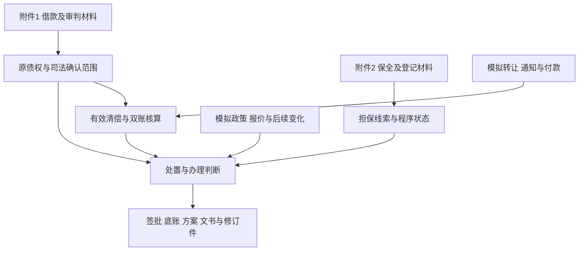

# 题目5 题型逻辑与附件关系分析

本题属于以案件卷宗为依据的公司法务综合决策题。核心任务是公司受让债权后，确定可以收什么款、按什么口径核算、在什么条件下解押或结清，以及如何落实到通知、法院申请和交易条款。

两份附件提供原债权、抵押和保全历史；题面补充明确的模拟交易与履行事件。难度来自证据范围、法律效力、现金口径和实际办理之间的相互约束。本文解释这套构造，供以后选择材料、设计同类题和判断附件是否真正有用。

## 题型定位

| 维度 | 本题定位 |
| --- | --- |
| 法律事项 | 民间借贷调解债权、债权转让、抵押权益、财产保全及执行衔接 |
| 职业角色 | 公司内部法务负责人 |
| 业务用途 | 债权受让后的收款管理、资产处置和投资退出 |
| 输入类型 | 两份同一纠纷相关的文书汇编，加可见的模拟业务条件和规则资料 |
| 作答方式 | 单轮纯文本，形成五份不同用途的业务成果 |
| 主要能力 | 跨文书证据判断、规则适用、连续事件核算、方案临界条件求解、条款及程序落地 |
| 评分方式 | 20项0/1等权，检查具体专业结果 |

附件原始纠纷发生在自然人之间，公司受让人身份是题设新增。由公司处理与自身投资和资产处置相关的法律事项，使原卷材料转化为公司法务任务；不能反过来说原卷已经记载了公司受让。

## 两份附件分别是什么材料

### 附件1提供债权形成和审判处理依据

[附件-1.docx](</Users/jack/Documents/codes/lvgou/豆包高经出题/题目 5/附件-1.docx>)是一份审判相关文书汇编，包括起诉状、借条、转账回单、增加优先受偿申请、抵押登记证明、庭审笔录、民事调解书及送达材料。

它让作答者面对不同证明强度和不同用途的记录：起诉状表达请求，借条和回单提供借款线索，优先受偿申请表达权利主张，笔录及调解书记载法院确认的处理结果。阅读时必须判断每份文书能支持哪一层结论。

### 附件2提供保全处理和财产线索

[附件-2.docx](</Users/jack/Documents/codes/lvgou/豆包高经出题/题目 5/附件-2.docx>)是一份执保相关文书汇编，包括立案审查信息、保全裁定、立案受理通知、不动产登记证明、登记查询结果、结案审批和送达材料。

它一方面增加财产线索，另一方面限制对“已经执行”的推断。材料记载无标的物可实施保全、实际到位0元，不能因有立案通知或裁定中出现划拨字样，就推定债权人已获得执行回款。

### 两份附件的关系

题设将二者作为同一借贷纠纷相关材料使用。附件1回答原债权及司法处理内容，附件2回答相关保全历史和财产记录。两份附件存在当事人、调解依据、登记事项的交叉，但这种关联不意味着所有脱敏案号、单元号和地址已经逐一完成原件核验。

它们适合共同用于债权收购尽调、履行核算、担保审查和执行衔接题。仅有这些材料，还不足以直接开展完整企业估值、破产分配或税务测算；那些任务需要对应的财务、债权顺位及税务输入。

## 附件内容怎样变成专业判断

| 材料线索 | 可以支持的判断 | 不能直接推出的结论 | 对本题的影响 |
| --- | --- | --- | --- |
| 起诉请求与调解书的金额、起息口径 | 区分当事人请求与法院确认结果 | 原起诉中的全部请求均已获支持 | 限制债权核验和办理请求的范围 |
| 12月27日笔录及调解确认条款 | 核对调解效力形成机制 | 一律以最后签收日决定生效 | 影响执行依据与时间判断 |
| 日期异常及遮蔽分期金额 | 确定需要核原件的局部问题 | 作者可自行修复日期、六期金额和总额 | 形成“可判断部分先处理，未知部分保留”的边界 |
| 三项财产的优先受偿申请 | 当事人曾提出相应主张 | 三项财产全部优先受偿已获法院确认 | 要求区分申请内容和裁判范围 |
| 抵押证明中的两证及主债权24**** | 核对抵押权人、对象和担保债权线索 | 自然覆盖调解本金26****及全部附随款 | 影响权利核验、解押和优先受偿请求 |
| 查询表三项“有抵押” | 三项财产在查询时点存在抵押记录 | 抵押权人均为汪**，且顺位、范围一致 | 防止把所有财产加入本次担保资源 |
| 执保立案、裁定及结案审批 | 核对保全程序和到位情况 | 正式执行一直存在或已有款可领 | 决定新申请、变更主体及财产措施的核查路径 |
| 后续送达记录 | 曾发生对应文书送达 | 仅凭送达就证明恢复执行或持续执行 | 要求说明记录的有限证明范围 |
| 通知书中的特别授权要求 | 确定部分处分行为的办理权限 | 一般授权可涵盖和解、弃权及领款 | 影响律师申请、和解及交割文本 |

原件保留这些不同口径，使作答者必须自行决定如何采信和衔接。若出题前先将全部材料改成一张“正确事实表”，会减少证据判断的工作。

## 原始材料与模拟条件如何分工

原卷不能确定本题7月的完整账务和公司投资决策。出题时加入三类模拟条件，把历史材料延展成可以完成的业务任务。

第一类是交易关系：公司受让债权、转让对价、通知安排、代收权限和受让价款扣减约定。它们确定资金流转对不同主体分别产生什么后果。

第二类是可计算参数：模拟期初本金260,000元、一般利息18,000元、费用1,300元、年利率14.2%、明确计息端点及舍入规则。它们让后续数值有确定答案，同时避免猜测原卷遮蔽金额。它们不证明真实借款已经按这些数额结算。

第三类是决策及变化：两项报价、两种110%政策、B净值变化、C的权利归属和一般保证提议。它们要求作答者比较不同处置方式，并在新信息到来后更新受影响的结果。

原始事实、模拟条件和适用规则在此共同作用。模拟条件不能静默覆盖原始材料，规则资料也不能替代缺失的登记或履行事实。

## 出题逻辑怎样逐步增加难度

### 从证据判断进入办理决定

本题要求的不仅是发现差异，还要说明差异如何影响公司动作。例如，“查询表有三项抵押”必须进一步转化为哪些财产可以纳入担保、哪些需要核验、可以先准备哪些手续、哪些处分尚不能实施。

这样，回答“材料存在风险，建议核实”只能覆盖部分识别工作，无法完成签批和办理任务。

### 用通知和付款制造连续状态变化

| 事件 | 作答者必须处理的结果 |
| --- | --- |
| 7月1日转让内部生效 | 公司取得何种债权和从权利，不与通知或登记更名混同 |
| 7月11日通知前付汪**50,000元 | 有效清偿减少债权；按合同扣减转让价款；公司未收到这笔现金 |
| 7月12日通知到达 | 此后债务人履行对象和对抗关系发生变化 |
| 7月13日仍付汪**20,000元 | 在无代收权、无追认条件下，不能直接减少公司债权 |
| 7月16日公司实际接受20,000元 | 当日记有效履行及公司回款，并据此更新后续计息本金 |

同样是“还款”，接收人、通知时点和权限不同，结果不同。先判断事件的法律效果，再算金额，后续数字才能正确。

### 同时维护债权账和公司现金账

7月11日是本题的重要区分：王**债务减少，公司应付受让价款也减少，但公司没有收到这50,000元。7月16日则是公司实际收款，同时减少王**债务，不再冲减已经结算的转让价款。

这要求作答者区分三个金额：债务人还欠多少、公司花了多少成本、公司实际收回多少现金。混淆其中任何两个，都会使退出决策失真。

### 两种处置政策使用不同判断标准

部分解押要保留债权，因此考查剩余担保是否足以覆盖剩余债权；全部退出允许折价，因此考查累计现金回收是否达到实际成本的回报要求。

本题的两个公式分别是：

- 部分解押：保留担保净值 ≥ 1.10 ×（当前全部债权 − 新增有效付款）。
- 全部退出：公司已实际回款 ＋ 新增到账现金 ≥ 1.10 × 公司实际总成本。

对原方案，甲110,000元低于部分解押最低款121,080.33元；乙190,000元高于现金退出下限164,800元。经济上存在应阻断与可附条件批准的不同对象，不能一律否决或一律放行。

### 后续材料同时解决问题和改变风险

7月30日的模拟登记资料确认A、B权利归属，减少原有未知；同时揭示B在先抵押，降低本次债权可用净值。作答者应扩大已可确认的范围，同时上调部分解押最低现金至157,443.97元。

方案乙报价降至180,000元仍高于164,800元底线，不能因为价格下降就宣布失败。5,000元一般保证又要求区分现金指标和担保权益，并考虑全部免债后是否还有可担保的主债务。这些变化需要重新作法律及业务判断，不能只替换表格数字。

### 用实际文书检查判断是否一致

五份成果分别面向签批、财务、谈判、律师和后续决策。相同事实必须贯穿全部成果：例如前文认为7月13日付款无清偿效力，通知不能写成在当日减本金；认为尚无正式执行案证据，法院申请就不能既写首次执行又无条件请求变更申请执行人。

实际文本还迫使作答者写出资金、文件、解押及免除的发生条件。只说“采用监管”不足以说明何时能使用注销文件、款项何时不可撤销归公司，以及失败后哪些权利保留。

## 哪些考点真正依赖附件

| 考点范围 | 主要输入依赖 | 附件作用 |
| --- | --- | --- |
| R1至R5 | 原附件及规则 | 强依赖：债权口径、生效、抵押对象、担保范围和保全状态需要跨文书阅读 |
| R6至R8 | 模拟转让、通知、付款及规则 | 原附件提供被转让权利的背景，具体时点判断主要来自题面新增条件 |
| R9至R13 | 模拟期初账、利率、成本、报价和政策 | 数值主要可由题面独立求解；不能声称这些金额全部从卷宗提炼而来 |
| R14至R17 | 原附件、规则和模拟交易 | 混合依赖：权利范围、案件身份与程序状态影响授权及文书内容 |
| R18至R20 | 后续模拟证据、原账和原权利边界 | 新信息改变部分判断，原材料仍限制担保及程序承诺 |

如果删除两份附件，通知与付款计算仍能做一部分，但原始债权及法院程序核验失去依据，不能完整回答本题。如果删除模拟条件，原卷仍能用于尽调或执行准备，但无法算出本题公司的投资成本、退出价格与连续付款后的余额。

如果将附件全部替换成作者整理好的结论表，数值计算可继续，但证据取舍难度会明显下降。因此，本题的难度由附件驱动的核验工作和模拟事件驱动的决策工作共同构成。

## 本次答案中已经观察到的失败

用户提供答案的本会话评分记录为3/20。可直接观察到的错误包括：把通知前留存款遗漏在成本扣减之外；在部分位置把它又算作公司现金；分段计息漏日；未按自己的公式正确解出最低付款；同一报价在签批和比较部分得出相反结论；法院正文混用首次执行与变更主体。

这些表现与题目要求维持“事实—规则—金额—动作—文本”一致性的设计相对应。单份答案不能证明每个难点都有效，也不能把所有零分都解释为高难度：其中一些来自漏答，一些来自独立算错，还有一些来自跨段矛盾。该分数为同一作者会话的辅助评分，仍需与独立盲评区分。

## 同类题中可以更换和应当保留的部分

| 可以更换的具体材料或参数 | 应保留的专业工作 |
| --- | --- |
| 公司名称、借款金额、付款日期、利率 | 明确规则及时间端点后，连续更新余额 |
| 债权受让业务 | 可换为供应商索赔和解、担保释放、应收账款处置等确有公司决策需求的场景 |
| 两份DOCX及本案文书组合 | 保留来源不同、证明范围不同且需要相互核验的材料 |
| A、B、C财产及报价 | 保留不同对象的权利、顺位或条件差异，避免所有对象答案相同 |
| 110%比例和成本数字 | 保留两项方案使用不同决策标准，以及可计算的批准临界条件 |
| 新登记资料及一般保证 | 保留会改变部分法律效果的新事件，并要求说明未受影响部分 |
| 五份成果的名称 | 保留不同接收人需要的实际结果，以及跨成果一致性 |

不能为了模仿本题，给每道题强加抵押、三笔付款或五份文书。先判断新附件中的真实关系能支撑什么业务，再选择事件和成果。

## 复用时需要注意的题目边界

本题将交易处理时点设为2023年7月，却让业务部引用附件中的2024年送达记录。作为回溯式练习可以明确说明“现已取得完整历史卷宗，再按模拟时点规则评价”；若要模拟当时实时签批，则需限定各时点可获得的材料，避免未来信息进入早期判断。本次仅记录这一适用边界，未改原题或历史得分。

部分解押计算按题设允许的全额债权和假定可用净值求解，不能把该假设当成原24****抵押真实覆盖全部26****债权的法律结论。换用新材料时，应重新确定担保范围与计算口径。

复用时最终应核对：关键判断是否都有可见输入，新增条件是否明示为模拟，是否存在可以明确放行的事项，是否要求写出实际结果，以及每个考点是否核验不同的专业工作。保留这些关系，比照搬数值和材料数量更有用。

## 对应成果

- [完整题目包](题目5-债权受让与分段解押决策.md)
- [Codex模型与出题过程记录](题目5-Codex模型与出题过程记录.md)
- [用户提供的作答文本](/Users/jack/.codex/attachments/eb47fa25-c0fd-43dd-8d64-c40fd9ceed3f/已粘贴的文本.txt)

具体法律出处保留在完整题目包的“必要规则资料”中。本分析用于解释本题构造，不扩大原附件能够证明的事实或原评分结论。
