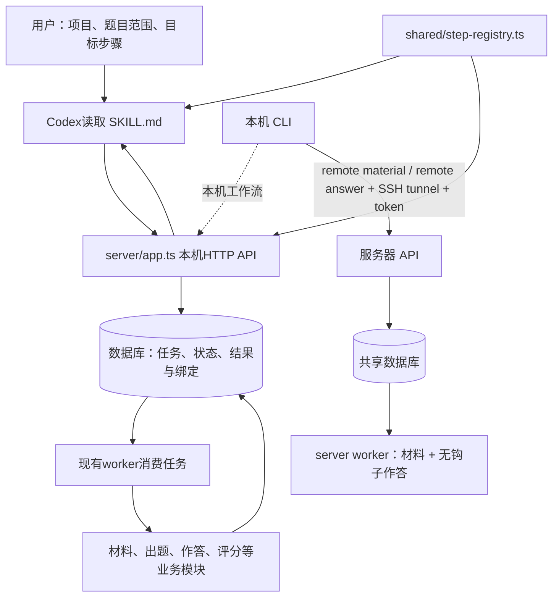

# Workflow Skill 架构设计

## 目标与现状

让 Codex 根据用户本次指定的项目、题目范围和终点，直接调用现有本机 HTTP API 操作工作台。流程经持久化队列执行；用户可以调整操作规则，不必操作页面。

本机执行入口是操作 Skill 加本机 API。Skill 提供执行指令，Codex承担外部编排；没有通用自动推进引擎。CLI 是可选 API 客户端：本机命令覆盖工作台管理和步骤操作；远程命令经 SSH 隧道调用服务器专用 API，提交材料操作或作答，服务器 worker 执行。远程 CLI 不接 Agent 出题、评分、判定或归档。代码、接口测试和部署验收是不同证据，不能互相替代。

## 两种材料组织方式

旧项目默认 `question_folders`，目录即题目；显式启用的 `material_packages` 项目，目录先登记材料包，完成入库／脱敏后从成功版本创建一题或多题。每题独立保存材料和脱敏产物快照及来源身份。补充材料只影响后来新建的题；材料包只执行前两步，派生题目执行出题及后续步骤。Skill 必须先读身份再决定对象 ID，不能只按页面步骤名推断。

## 结构与职责

| 层 | 负责 | 事实依据与边界 |
| --- | --- | --- |
| 用户指令 | 本次项目、范围、目标和是否重做 | 每次从当前请求确定，不沿用示例中的题号或模型 |
| `skill/SKILL.md` | 查状态、选择授权步骤、等待、核实与停止规则 | 不计算就绪条件、分数或达标；不直接执行模型 |
| Codex | 解释请求并依规则逐轮调用HTTP API，保留题目和attempt关联 | 到达终点即停止；遵循质量需真实行为验收 |
| `cli/` | 本机 API 客户端；另含经 SSH 隧道的远程材料／作答调用、幂等请求关联和材料文件取回 | 本机命令不直连数据库；远程命令读取本机 `.env` 中的凭证；不复制业务算法；远程 worker 不处理 Agent、评分或归档 |
| API与业务模块 | 校验前置、冻结输入、创建任务、版本校验、保存结果、达标判定 | Web、Codex直接调用与CLI共享同一套实现 |
| worker | 消费持久化任务、并发、心跳和取消 | API请求或等待到期不会取消已提交任务 |
| 项目 `projects/<项目>/skill/` | 出题内容规范 | 与根目录操作Skill不同；按业务执行器读取，不注入被测模型 |

## 一次任务的数据流

1. **定位与固定范围**：已有明确ID时直接查询；需要解析名称或筛选题目时才读清单。将用户范围解析成明确workflow ID集合并区分查询、续跑和重新生成；项目中的一道题对应一条工作流。
2. **派发一个步骤**：通过共享注册表把key映射为ordinal。Codex直接调用步骤批量API，服务端决定哪些题就绪，分别返回派发结果和任务ID。
3. **跟踪实际任务**：按所有attempt ID等待；多模型作答及逐答案评分可能对应多个ID，不能只追踪首个。PDF内部提取也要从最新状态确认。
4. **逐题继续**：短等待后批量刷新本组全部题目的服务端状态，按各题下一授权且就绪步骤分组派发；其他题的活动尝试继续运行。需要正文时才读取完整结果，结束时核对模型结果与系统判定。
5. **停止与汇报**：到目标停止，保留失败、未就绪和仍活动任务。评分可自动产生系统判定；归档及Excel导出需要对应授权。

`project_id`定位项目，`workflow_id`定位题目，`attempt_id`定位一次执行，模型/答案ID区分各份评测。题目与rubric指纹、附件绑定均由服务端维护，不能以“最近一条”替代当前关联。Codex可在运行记录中保存本轮固定题目范围、分组、终点和跳过原因；该记录不复制数据库状态或任务历史，恢复后必须重新读取服务端状态。关联缺失时查询确认，不能猜测或重发。

当前服务端没有通用强制重做API，普通批量接口可能拒绝已完成步骤；Skill必须报告该能力缺口，不得用重置替代用户要求的普通重新生成。查询、执行、评分及导出分别按本次需要读取和汇报，不统一加载全部对象。

项目生命周期通过现有项目API执行：创建后可逐项应用Codex默认、已登记作答模型及阈值、步骤覆盖和作答策略；API不接收模型凭证。部分写入失败保留已成功设置，并返回成功/未应用清单，不伪装为事务回滚。项目删除要求当前项目全名二次确认，使用服务端现有逻辑删除；全局默认、项目配置容器和本地来源文件仍按服务端契约保留。创建后读取设置和skill状态，缺少作答模型阈值或`SKILL.md`时明确报告，避免将未就绪项目当作完整可运行项目。

## 状态与失败边界

| 层次 | 可证明什么 | 不可推断什么 |
| --- | --- | --- |
| 派发 `queued` / reused等 | 请求已被接受或返回已有任务 | 不证明模型开始生成或执行成功 |
| attempt `succeeded/failed/skipped` | 本次尝试的实际终态 | 终态不等于评分有效或题目达标 |
| 评分报告与有效性 | 同版答案的分项结果及校验情况 | 成功返回文字不保证评分可参与判定 |
| 系统 `decision/model_scores` | 当前所需模型的判定结果 | 不能从一个模型通过推定全题通过 |

当前达标方向是所有所需模型的有效百分制得分都严格低于各自上限；等于上限也未通过。Codex只读取服务端结论，不重算或放宽。

写请求失败可能已经入队，不自动重试；先查原范围与任务状态。API单次等待最多30秒；这些等待不会改动业务执行超时。状态查询优先使用 `view=status`，避免读取结果正文；服务端长轮询间隔1秒。短等待并不保证观察到全组终态，下一轮仍须用批量状态接口刷新全组，等待到期、中断或读取失败不能作为重新派发的依据。

## 调整与扩展

- 调整范围解释、继续/停止或汇报规则：修改`SKILL.md`；架构变化再同步本文。
- 调整API路径、请求/响应或就绪语义：修改服务端路由和契约说明，并核对Web与可选CLI客户端。
- 调整项目CRUD或项目设置入口：复用现有API、明确部分失败语义及删除确认，并同步Skill与接口地图；再核对CLI客户端兼容性。
- 新增业务步骤：先确认服务端能力与共享注册表，再更新Skill步骤卡和实际客户端；不重编号历史ordinal。
- 调整评分或就绪算法：修改对应服务端模块，由Web、Codex直接调用和CLI共同使用，不能只在Skill中改口径。
- 根目录`skill/`保存唯一操作Skill，`.agents/skills/ai-distill-workflow`仅为发现用的符号链接；不维护两份规则。

文件定位与命令到模块的对应关系见 [MAP.md](MAP.md) 的 [CLI 工具地图](MAP.md#cli-工具地图)。用户命令和输出参见 [CLI 指南](../cli/README.md)。当前实现边界与历史验证分别见 [系统架构](../docs/architecture.md) 和 [实施验收](../docs/evidence/2026-10-11-workflow-cli-skill.md)。

## 本地批次清单

批次范围和跳过原因由Codex保存在本轮运行记录中；业务批次大小由当前任务确定，不固定20。API对单次请求有数量限制，具体以服务端响应为准。同组逐题推进，按下一授权且服务端就绪步骤分组派发，让出题、作答和评分重叠；用户明确要求整批按阶段等待时遵从用户要求。本组全部到终点或记录跳过后才进入下一组。运行记录不触发任务、不取消任务、不保存分数；失败、活动任务、未知写结果及多模型关联继续按现有规则核对，不新增自动重试或后台调度器。新一轮允许重新选择失败题，旧记录保持可追溯。
