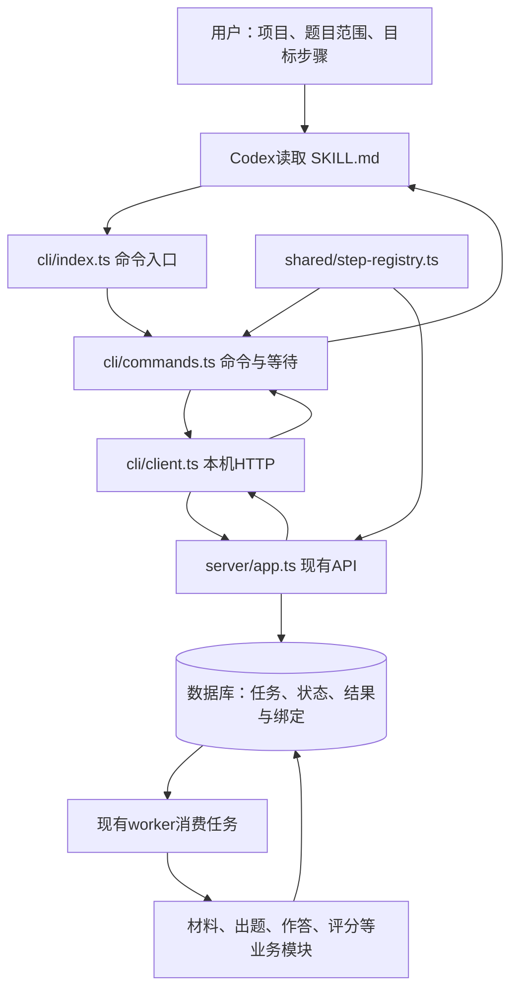

# Workflow Skill 架构设计

## 目标与现状

让 Codex 根据用户本次指定的项目、题目范围和终点，通过 CLI 操作现有工作台。流程经持久化队列执行；用户可以调整操作规则，不必操作页面。

当前实现是操作 Skill 加本机 CLI。Skill 提供执行指令，Codex承担外部编排；没有另一个自动运行程序、后台推进引擎或MCP服务。CLI单元测试已验证命令契约，尚未验证Codex依据此Skill真实跑完整流程。

## 结构与职责

| 层 | 负责 | 事实依据与边界 |
| --- | --- | --- |
| 用户指令 | 本次项目、范围、目标、是否重做或返修 | 每次从当前请求确定，不沿用示例中的题号或模型 |
| `skill/SKILL.md` | 查状态、选择授权步骤、等待、核实与停止规则 | 不计算就绪条件、分数或达标；不直接执行模型 |
| Codex | 解释请求并依规则逐轮调用CLI，保留题目和attempt关联 | 到达终点即停止；遵循质量需真实行为验收 |
| `cli/` | 参数校验、稳定步骤映射、HTTP、批量分组、有限等待和输出 | 不直连数据库、不加载服务端凭证、不复制业务规则 |
| API与业务模块 | 校验前置、冻结输入、创建任务、版本校验、保存结果、达标判定 | Web与CLI使用同一套实现 |
| worker | 消费持久化任务、并发、心跳、取消和已有返修链接续 | CLI退出或等待到期不会取消已提交任务 |
| 项目 `projects/<项目>/skill/` | 出题内容规范 | 与根目录操作Skill不同；按业务执行器读取，不注入被测模型 |

## 一次任务的数据流

1. **定位与固定范围**：已有明确ID时直接查询；需要解析名称或筛选题目时才读清单。将用户范围解析成明确workflow ID集合并区分查询、续跑、重新生成和返修；项目中的一道题对应一条工作流。
2. **派发一个步骤**：通过共享注册表把key映射为ordinal。CLI按100题分组发送，服务端决定哪些题就绪，分别返回派发结果和任务ID。
3. **跟踪实际任务**：按所有attempt ID等待；多模型作答及逐答案评分可能对应多个ID，不能只追踪首个。PDF内部提取也要从最新状态确认。
4. **重新读取当前结果**：等待结束后查看服务端状态、当前题目绑定和模型结果，再决定是否继续用户授权的下一步。
5. **停止与汇报**：到目标停止，保留失败、未就绪和仍活动任务。评分可自动产生系统判定；归档、返修及Excel导出需要对应授权。

`project_id`定位项目，`workflow_id`定位题目，`attempt_id`定位一次执行，模型/答案ID区分各份评测。题目与rubric指纹、附件绑定均由服务端维护，不能以“最近一条”替代当前关联。CLI不另存运行账本；Codex在当前对话进度记录及上下文交接摘要保留范围、终点、逐题任务关联和阻断，恢复后重新读取服务端核实。关联缺失时查询确认，不能猜测或重发。

当前CLI没有通用强制重做命令，服务端普通批量接口可能拒绝已完成步骤；Skill必须报告该能力缺口，不得用重置或返修替代用户要求的普通重新生成。查询、执行、评分及导出分别按本次需要读取和汇报，不统一加载全部对象。

## 状态与失败边界

| 层次 | 可证明什么 | 不可推断什么 |
| --- | --- | --- |
| 派发 `queued` / reused等 | 请求已被接受或返回已有任务 | 不证明模型开始生成或执行成功 |
| attempt `succeeded/failed/skipped` | 本次尝试的实际终态 | 终态不等于评分有效或题目达标 |
| 评分报告与有效性 | 同版答案的分项结果及校验情况 | 成功返回文字不保证评分可参与判定 |
| 系统 `decision/model_scores` | 当前所需模型的判定结果 | 不能从一个模型通过推定全题通过 |

当前达标方向是所有所需模型的有效百分制得分都严格低于各自上限；等于上限也未通过。CLI只呈现服务端结论，不重算或放宽。

写请求失败可能已经入队，CLI不自动重试；先查原范围与任务状态。等待外层最多1小时，API单次等待最多30秒，传输故障边界35秒；这些等待不会改动业务执行超时。并发观察最多4个任务。等待到期、中断或读取失败均不能作为重新派发的依据。

## 调整与扩展

- 调整范围解释、继续/停止或汇报规则：修改`SKILL.md`；架构变化再同步本文。
- 调整命令参数、输出、等待或分组：修改CLI并更新对应测试和CLI说明。
- 新增业务步骤：先确认服务端能力与共享注册表，再接CLI，最后更新Skill步骤卡；不重编号历史ordinal。
- 调整评分或就绪算法：修改对应服务端模块，由Web和CLI共同使用，不能只在Skill中改口径。
- 根目录`skill/`保存唯一操作Skill，`.agents/skills/ai-distill-workflow`仅为发现用的符号链接；不维护两份规则。

文件定位与命令到模块的对应关系见 [MAP.md](MAP.md)。当前实现边界与历史验证分别见 [系统架构](../docs/architecture.md) 和 [实施验收](../docs/evidence/2026-10-11-workflow-cli-skill.md)。
