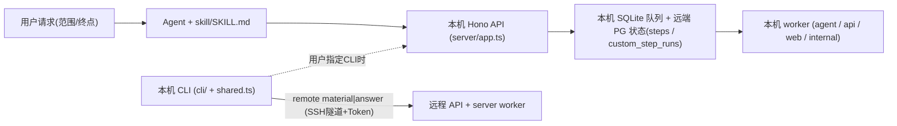

# Workflow Skill 架构设计

## 1. 分层与职责

| 层 | 职责 | 禁止越界 |
| --- | --- | --- |
| `skill/SKILL.md` | 范围解析、通道选择、封存态/定制步骤认知、分页/轻量读取、等待与恢复决策 | 不硬编码某期题量/阈值，不自行算分或判定达标 |
| `cli/` | HTTP API 命令行薄封装 + 共用原子读写/有界并发底座（`cli/shared.ts`）+ 受限本机文件导出/预处理 | 不直连 DB，不自动重试写请求，不复制评分/就绪算法 |
| `server/` API | 校验前置、冻结快照、运行 `inline_before_gate`、预留本机队列容量、版本绑定与达标计算 | Web、Agent 直调与 CLI 共用同一实现 |
| `server/custom-steps/` | 项目级隔离定制步骤插座（独立表 `custom_step_runs`、沙盒目录与 `queued_subruns` 多路子运行） | 未注册项目 0 查询短路；异常绝不污染基础 `steps` |
| `worker` | 按本机归属消费 `agent`/`api`/`web`/`internal` 持久化任务并写检查点 | HTTP 请求超时或断开不会取消已入队任务 |
| `projects/<项目>/` | 具体项目规则资料、`skill/`（仅作者读取）、`custom-steps/` 与 `scripts/delivery.ts` | 出题 `skill/` 不注入被测作答模型或独立评分模型 |

## 2. 材料组织与快照不变量

- **新共享材料库（`library_v1`，默认）**：原子提取入库（`POST /imports` 全部提取成功后才发布包与版本）→ 可选 `aliases`（Agent 或显式 API）化名与 `prepare` 整理 → 加载到期次（`/loaded-materials`）→ 建题冻结来源快照（`redacted` 或 `original`）。`project_material_uses` 永久记录主项目跨期占用，撤回归档或删题不释放历史占用。
- **旧兼容路径（`legacy`）**：保留 `question_folders`（目录即题）与旧项目内 `material_packages`（ordinal 1/2/9）。

## 3. 状态与结论分层（禁止混同）

| 观测层 | 可证明事实 | 不可推断结论 |
| --- | --- | --- |
| 派发 `queued` / `reused` | 任务已受理或复用同依据活动/成功记录 | 模型已开始生成或本次执行成功 |
| attempt `succeeded` | 本次执行终态完成 | 出题达到 `complete`、评分有效或题目 `accepted` |
| 定制步骤 `succeeded` | 当前题包摘要下项目扩展关卡（如 ALE 验证/标定）通过 | 已完成第8步本地归档或外部平台交付 |
| 第7步 `decision=accepted` | 未封存模式下模型得分满足项目达标规则 | 已完成本地归档（第8步）或外部平台/飞书交付 |
| 第8步归档 `succeeded` | 本地归档产物与项目 `delivery.ts` 产物已生成（封存模式下按 `author_only_sealed` 放行） | 飞书远端写入通过（须另查 `feishu_deliveries` 且 `verification.status=passed`） |

## 4. 维护与扩展原则

- 稳定步骤身份与封存态唯一来源：`shared/step-registry.ts`（使用稳定 `ordinal`，通过 `SEALED_STEP_ORDINALS` 动态控制评测链 `[5,6,7]` 显隐）。
- 调整业务就绪、定制步骤门控、评分或容量规则：修改 `server/` 对应模块，三端（Web / HTTP / CLI）自动同步，不在 Skill 或 CLI 写第二套判断。
- 命令与模块定位见 [MAP.md](MAP.md#cli-工具地图)，CLI 详情见 [cli/README.md](../cli/README.md)。
