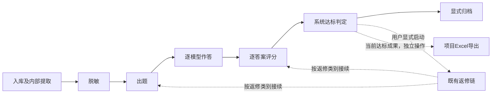

# Workflow Skill 地图

路径均相对于仓库根目录。先读入口；操作细节查CLI说明，维护时按下表定位源码，不必每次把后端全部读入上下文。

## 文件地图

```text
ai-distill/
├── skill/                         # 操作Skill的真实目录
│   ├── SKILL.md                   # Codex执行规则与步骤卡
│   ├── ARCHITECTURE.md            # 分层、数据流、状态边界与扩展方法
│   ├── MAP.md                     # 本地图：命令、源码与修改位置
│   └── README.md                  # 目录入口及验证边界
├── .agents/skills/
│   └── ai-distill-workflow -> ../../skill
├── cli/
│   ├── index.ts                   # 进程入口、JSON输出、退出码与中断
│   ├── commands.ts                # 命令映射、范围、分组与等待
│   ├── client.ts                  # 本机HTTP、JSON错误与下载
│   ├── client.test.ts             # 客户端边界单测
│   ├── commands.test.ts           # 命令与合成流程单测
│   └── README.md                  # 用法、状态契约与验证命令
├── shared/step-registry.ts        # 唯一稳定步骤身份来源
├── server/app.ts                  # 现有API装配
├── server/worker.ts               # 现有持久化任务消费入口
└── projects/<项目>/skill/         # 各项目出题规则，非本操作Skill
```

## 流程地图



箭头表示业务依赖，不表示CLI自动串行执行全部步骤；Codex只执行用户授权范围，达到终点停止。返修链可能涉及材料处理，以服务端分类为准。归档与Excel导出是不同操作，导出不以归档为前提。

| 稳定key | ordinal | 主要服务端文件/目录 |
| --- | --- | --- |
| receive_materials | 1 | `server/intake-jobs.ts`、`server/materials/jobs.ts`；PDF提取内部ordinal为2 |
| redact_materials | 9 | `server/materials/redaction-jobs.ts` |
| author_question | 4 | `server/authoring/jobs.ts`、`executor.ts` |
| model_answer | 5 | `server/answer-models/jobs.ts` |
| independent_score | 6 | `server/scoring/jobs.ts`、`executor.ts`、`validate.ts` |
| accept_or_revise | 7 | `server/decisions/jobs.ts`、`acceptance.ts` |
| publish_export | 8 | `server/publishing/jobs.ts`；Excel另走`server/reporting/export.ts` |

步骤key与ordinal以注册表和`step list`为准。隐藏的旧规则绑定/独立审查不作为当前操作入口。

## 命令与接口地图

所有命令由`cli/commands.ts`映射；除`step list`读取共享注册表外，均通过`cli/client.ts`访问现有API。完整参数见`bun run ai-distill --help`。

| 命令组 | API入口 | 用途与影响 |
| --- | --- | --- |
| project list/show、question list | GET `/api/projects`、`/api/projects/:id` | 只读定位项目与题目 |
| question show、result show | GET `/api/workflows/:id` | 当前题包、作答、评分、判定、有限历史和产物 |
| workflow status | GET `/api/projects/:id/workflow-status?ids=…` | 状态、就绪原因与尝试摘要；投影在`server/workflow-view.ts` |
| rules list/file | GET `/api/projects/:id/rules`、`/rules/file?path=…` | 项目本地规则清单及文件读取，不修改规则 |
| models show | GET `/api/projects/:id/answer-models` | 当前项目模型集合及阈值 |
| material text | GET `/api/workflows/:id/materials/:materialId/extracted-text?redacted_only=true` | 只读当前脱敏正文 |
| attempt show/wait | GET `/api/attempts/:id?wait_ms=…` | 精确任务观察；服务端有限等待在`server/attempts.ts` |
| step dispatch | POST `/api/projects/:id/steps/:ordinal/run-batch` | 指定范围的单一步骤派发；不修改步骤设置 |
| project create/sync | POST `/api/projects`、`/api/projects/:id/sync-folder` | 显式创建/同步；可能改变来源清单及下游有效性 |
| revision list/start/resume | GET/POST `/api/workflows/:id/revisions`、POST `/revisions/:chainId/resume` | 既有返修链；实现见`server/decisions/revision-*.ts` |
| result list | GET `/api/results` | 当前有效达标成果摘要 |
| export list/create | GET `/api/projects/:id/exports`、POST `/api/projects/:id/export` | 查询/显式生成Excel |
| artifact/export download | GET `/api/artifacts/:id/download`、`/api/exports/:id/download` | 显式下载到新文件，不覆盖已有文件 |
| monitor show | GET `/api/monitor` | 运行监控快照，不等于供应商生成进度 |

## 修改位置地图

| 要改什么 | 首先查看/修改 | 关联核对 |
| --- | --- | --- |
| 用户范围、目标步骤、停止或异常处理规则 | `skill/SKILL.md` | CLI真实能力、本文、架构说明 |
| 增加CLI命令或参数 | `cli/commands.ts` | 对应API、帮助、`commands.test.ts`、CLI README |
| 请求/响应错误或本机限制 | `cli/client.ts` | `client.test.ts`，不得新增凭证读取 |
| 退出码或进程信号 | `cli/index.ts` | 命令信封、CLI README |
| 步骤就绪/阻断投影 | `server/project-folders.ts`、`workflow-view.ts` | API、Web与CLI共用口径 |
| 新步骤身份 | `shared/step-registry.ts` | 服务端装配、worker、持久化兼容、CLI、Skill步骤卡 |
| 模型作答/评分/达标逻辑 | `server/answer-models/`、`scoring/`、`decisions/` | 当前绑定、逐模型结果、对应模块README与测试 |
| 任务执行或恢复问题 | `server/worker.ts`、`worker-pool.ts`及对应业务jobs | 先按workflow/attempt ID查日志，不直接改数据库状态 |

维护时先核对源码与模块README；历史证据只说明当时范围。操作Skill不存当前题目、附件、评分报告或密钥。
