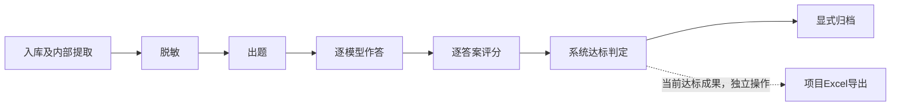

# Workflow Skill 地图

路径均相对于仓库根目录。先读入口；Codex默认直接调用本机API，具体契约查服务端路由及下表。CLI是可选客户端，仅在用户明确要求命令行时使用。

## 文件地图

```text
ai-distill/
├── skill/                         # 操作Skill的真实目录
│   ├── SKILL.md                   # Codex执行规则与步骤卡
│   ├── ARCHITECTURE.md            # 分层、数据流、状态边界与扩展方法
│   ├── MAP.md                     # 本地图：命令、源码与修改位置
│   └── README.md                  # 目录入口及验证边界
├── .agents/skills/
│   └── ai-distill-workflow -> ../../skill
├── cli/
│   ├── index.ts                   # 进程入口、JSON输出、退出码与中断
│   ├── commands.ts                # 项目生命周期/设置、命令映射、范围、分组与等待
│   ├── remote-materials.ts        # 远程入库/脱敏提交、状态恢复、文件清单校验与本机取回
│   ├── remote-answers.ts          # 远程作答提交及按 request-key 恢复状态
│   ├── batches.ts                 # 本机固定范围/批次/跳过清单
│   ├── failed-export.ts           # 当前未达标题包的固定路径与绑定核对
│   ├── client.ts                  # 本机HTTP、JSON错误与下载
│   └── README.md                  # 快速开始、命令参考、状态契约与验证边界
├── shared/step-registry.ts        # 唯一稳定步骤身份来源
├── server/app.ts                  # 现有API装配
├── server/worker.ts               # local/api/materials/server 等持久化任务消费模式
├── server/remote-material-routes.ts # 令牌保护的远程材料及作答 API
└── projects/<项目>/skill/         # 各项目出题规则，非本操作Skill
```

## 材料包多题接口

| 操作 | API／CLI | 对象与结果 |
| --- | --- | --- |
| 建立新模式项目 | POST `/api/projects` 的 `material_mode=material_packages`；CLI `project create --material-mode material_packages` | 后续来源目录登记材料包 |
| 切换旧项目 | PATCH `/api/projects/:id/material-mode`；CLI `project material-mode --clear-existing` | 显式隐藏旧题，活动任务会阻断切换 |
| 同步／上传材料 | 既有同步或上传 API；CLI `project sync` | 新模式生成材料包工作流 |
| 选择版本 | GET `/api/material-packages/:id/versions`；CLI `material-package versions` | 只列成功且有产物的脱敏尝试 |
| 建题 | POST `/api/material-packages/:id/questions`；CLI `question create` | 复制题目私有快照，记录来源尝试和哈希，不派发模型 |

服务端实现位于 `server/project-folders.ts`、`server/material-package-questions.ts`、`server/app.ts`；材料步骤与出题步骤仍沿用原队列和稳定 ordinal。材料包与题目状态均由服务端就绪投影判断。

## 流程地图



箭头表示业务依赖，不表示API自动串行执行全部步骤；Codex只执行用户授权范围，达到终点停止。未达标题目由用户决定是否按普通步骤重做。归档与Excel导出是不同操作，导出不以归档为前提。

| 稳定key | ordinal | 主要服务端文件/目录 |
| --- | --- | --- |
| receive_materials | 1 | `server/intake-jobs.ts`、`server/materials/jobs.ts`；PDF提取内部ordinal为2 |
| redact_materials | 9 | `server/materials/redaction-jobs.ts` |
| author_question | 4 | `server/authoring/jobs.ts`、`executor.ts` |
| model_answer | 5 | `server/answer-models/jobs.ts` |
| independent_score | 6 | `server/scoring/jobs.ts`、`executor.ts`、`validate.ts` |
| accept_or_revise | 7 | `server/decisions/jobs.ts`、`acceptance.ts` |
| publish_export | 8 | `server/publishing/jobs.ts`；Excel另走`server/reporting/export.ts` |

步骤key与ordinal以`shared/step-registry.ts`为准。隐藏的旧规则绑定/独立审查不作为当前操作入口。

## API 与 CLI 接口地图

Codex默认直接请求以下服务端API，不经过CLI、不直连数据库。CLI将部分相同接口封装为命令，只有用户明确要求命令行时才使用；其参数见`cli/README.md`。

| 操作 | API入口 | 用途与影响 |
| --- | --- | --- |
| batch create/show/skip | 创建时GET `/api/projects/:id`；其余仅本地文件 | 固定本轮范围、可配置大小、终点与跳过名单，不派发业务任务 |
| project list/show、question list | GET `/api/projects`、`/api/projects/:id` | 只读定位项目与题目 |
| project create/update/delete | POST/PATCH/DELETE `/api/projects` | 项目CRUD；创建可应用设置文件，删除要求精确确认项目名并沿用服务端逻辑删除/数据清理契约 |
| project settings show/apply | GET/PUT/DELETE 项目 Codex、模型、步骤及作答策略接口 | 读取并应用项目设置；逐项返回结果，部分失败不伪装为原子回滚 |
| models catalog/show | GET `/api/answer-models`、`/api/projects/:id/answer-models` | 查看系统可选模型和项目当前集合，供项目设置使用 |
| question show、result show | GET `/api/workflows/:id` | 当前题包、作答、评分、判定、有限历史和产物 |
| workflow status | GET `/api/projects/:id/workflow-status?ids=…` | 状态、就绪原因与尝试摘要；投影在`server/workflow-view.ts` |
| rules list/file | GET `/api/projects/:id/rules`、`/rules/file?path=…` | 项目本地规则清单及文件读取，不修改规则 |
| models show | GET `/api/projects/:id/answer-models` | 当前项目模型集合及阈值 |
| material text | GET `/api/workflows/:id/materials/:materialId/extracted-text?redacted_only=true` | 只读当前脱敏正文 |
| attempt show/wait | GET `/api/attempts/:id?wait_ms=…`；默认wait加`view=status` | wait只返回元信息；show／wait --full读取完整结果；一秒轮询在`server/attempts.ts` |
| step dispatch | POST `/api/projects/:id/steps/:ordinal/run-batch` | 指定范围的单一步骤派发；不修改步骤设置 |
| project sync | POST `/api/projects/:id/sync-folder` | 显式同步；可能改变来源清单及下游有效性 |
| result list | GET `/api/results` | 当前有效达标成果摘要 |
| export list/create | GET `/api/projects/:id/exports`、POST `/api/projects/:id/export` | 查询/显式生成Excel |
| artifact/export download | GET `/api/artifacts/:id/download`、`/api/exports/:id/download` | 显式下载到新文件，不覆盖已有文件 |
| export failed | GET 项目、工作流、精确尝试及产物下载 API | 按当前 `repair` 判定导出到 `assets/未达标题目/`，含出题、逐模型作答和评分；不写数据库 |
| export review | 同上，须指定题目 ID | 将已评分的指定题目导出到同一复核目录；保留真实 `accepted`／`repair` 判定 |
| monitor show | GET `/api/monitor` | 运行监控快照，不等于供应商生成进度 |

## CLI 工具地图

CLI 包装现有 API 与本机文件操作；没有自己的数据库、业务队列、模型规则或达标算法。所有实际 API 路径以 `cli/commands.ts`、`cli/remote-materials.ts`、`cli/remote-answers.ts` 和当前服务端路由为准。用户可先看 `bun run ai-distill --help`，完整命令语法见 [CLI 使用说明](../cli/README.md)。

| 能力组 | CLI 命令 | 关键实现 | 调用目标/副作用 |
| --- | --- | --- | --- |
| 项目管理 | `project list/show/create/update/delete/sync` | `commands.ts`、`client.ts` | 本机工作台 API；create/update/delete/sync 是写操作，删项目要求精确名称 |
| 项目设置 | `project settings show/apply` | `commands.ts`、JSON 设置文件 | 本机 API；按 Codex、模型、步骤、作答策略顺序写入，部分成功不会回滚 |
| 项目题目与状态 | `question list/show`、`workflow status`、`rules list/file` | `commands.ts` | 本机 API；材料正文只允许 `material text --redacted-only` |
| 模型与运行 | `models catalog/show`、`attempt show/wait`、`monitor show` | `commands.ts`、`client.ts` | 本机 API；默认 wait 只看元信息，`--full` 才读取结果正文 |
| 工作流步骤 | `step list`、`step dispatch STEP_KEY` | `commands.ts`、`shared/step-registry.ts` | 本机 API；只派发一个可见稳定步骤，不自动推进 |
| 批次计划 | `batch create/show/skip` | `batches.ts`、`commands.ts` | 本机 JSON 文件；固定范围，不派发任务、不覆盖服务器状态 |
| 结果与交付 | `result list/show`、`export list/create/download`、`artifact download` | `commands.ts`、`client.ts` | 本机 API 与显式下载；归档步骤与 Excel 导出分开 |
| 未达标复核 | `export failed`、`export review` | `failed-export.ts` | 读取当前绑定的题目/答案/评分并写入固定 `assets/未达标题目/`，不改数据库状态 |
| 远程材料 | `remote material start/run/status/sync` | `remote-materials.ts`、`remote-material-routes.ts`、`remote-material-operations.ts` | SSH 隧道 + 固定 token；服务器执行入库、PDF提取、API脱敏；sync 校验哈希后取回管理副本 |
| 远程作答 | `remote answer start/run/status` | `remote-answers.ts`、`remote-material-routes.ts`、`answer-models/jobs.ts` | SSH 隧道 + 固定 token；服务器执行 server-owned 作答 attempt；状态查询不返回答案正文 |
| 进程输出 | `--json`、退出码、中断信号 | `index.ts` | 输出统一结果信封；中断等待不会取消已入队的持久任务 |

### 本机与远程执行边界

| 步骤/功能 | 本机 CLI/API | 服务器 CLI/API + `WORKER_MODE=server` |
| --- | --- | --- |
| 项目查询、状态、设置、题目结果读取 | 支持，通过本机 API | 远程命令不提供这一整套代理；可用隧道打开常规工作台 API |
| 入库、PDF提取、脱敏 | 本机现有 worker/API 路径 | 支持，材料操作接口提交并由服务器 worker 执行 |
| 模型作答 | 本机 `execution_target=local` 队列 | 支持 `execution_target=server`，请求键用于幂等关联 |
| Agent/Codex 出题 | 走本机作者执行链 | 不支持；server worker 不领取 Agent 队列 |
| 独立评分、达标判定 | 走本机/API配置的现有链 | 不支持；服务器 worker 不领取评分或判定队列 |
| 归档、Excel、未达标导出 | 本机/API现有功能 | 不由 remote CLI 工作流命令执行 |

远程 worker 必须满足部署代码、迁移、共享数据库、服务器来源路径、token 及 worker 模式等条件。CLI 源码存在或本地类型检查通过，都不能证明远程实例已经部署可用；部署验收另行记录。

## 修改位置地图

| 要改什么 | 首先查看/修改 | 关联核对 |
| --- | --- | --- |
| 用户范围、目标步骤、停止或异常处理规则 | `skill/SKILL.md` | API真实能力、本文、架构说明 |
| API路由、请求/响应契约 | `server/app.ts`及对应模块 | Web、Skill、可选CLI客户端及接口说明 |
| 本机CLI命令或参数 | `cli/commands.ts` | 对应API、帮助、CLI README、本地图与适用的命令契约检查 |
| 远程材料CLI命令/同步 | `cli/remote-materials.ts` | `server/remote-material-routes.ts`、`remote-material-operations.ts`、`.env.example`、部署说明 |
| 远程作答CLI命令/状态恢复 | `cli/remote-answers.ts` | `server/remote-material-routes.ts`、`server/answer-models/jobs.ts`、`server/worker.ts` |
| 本轮范围、分组及跳过记录 | 当前任务运行记录 | Skill规则；权威状态仍以API为准 |
| 请求/响应错误或本机限制 | `cli/client.ts` | `client.test.ts`，不得新增凭证读取 |
| 退出码或进程信号 | `cli/index.ts` | 命令信封、CLI README |
| 步骤就绪/阻断投影 | `server/project-folders.ts`、`workflow-view.ts` | API、Web与可选CLI共用口径 |
| 新步骤身份 | `shared/step-registry.ts` | 服务端装配、worker、持久化兼容、可选CLI、Skill步骤卡 |
| 模型作答/评分/达标逻辑 | `server/answer-models/`、`scoring/`、`decisions/` | 当前绑定、逐模型结果、对应模块README与测试 |
| 任务执行或恢复问题 | `server/worker.ts`、`worker-pool.ts`及对应业务jobs | 先按workflow/attempt ID查日志，不直接改数据库状态 |

维护时先核对源码与模块README；历史证据只说明当时范围。操作Skill不存当前题目、附件、评分报告或密钥。
